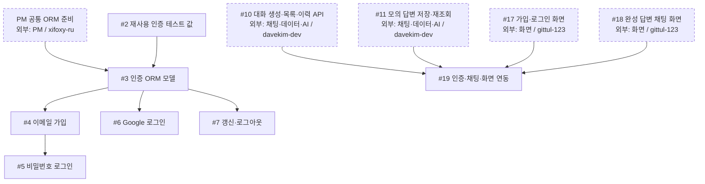
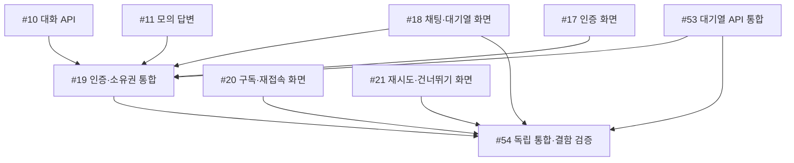

# 인증 공정

## 2차 작업과 현재 인계 (2026-10-27)

담당별 권장 순서와 서로 병렬로 가능한 일은 [전체 공정 안내](development-flow.md#담당별-우선순서와-병렬-진행)를 따른다. 같은 사람이 맡은 작업을 모두 동시에 진행하라는 뜻은 아니다.

[2차 마일스톤](https://github.com/next-stop-siren/Next-Stop-Siren/milestone/2)에 새 구현·운영 작업 12개와 기존 #19·#54 최종검증을 연결했다. 등록만으로 개발 착수를 뜻하지 않으며, 아래에서 병합·종료와 남은 검토를 구분한다. 기존 S01–S20 번호와 닫힌 목업의 완료 이력은 유지한다.

- `gittul-123`: [#65](https://github.com/next-stop-siren/Next-Stop-Siren/issues/65) 실제 회원 채팅 연결과 [#67](https://github.com/next-stop-siren/Next-Stop-Siren/issues/67) 인증 모달을 완료했다. 결과를 인계하고 [#69](https://github.com/next-stop-siren/Next-Stop-Siren/issues/69) Google 실패 화면을 이어 진행한다.
- `davekim-dev`: [#66](https://github.com/next-stop-siren/Next-Stop-Siren/issues/66) 문맥 쌍 순서, [#70](https://github.com/next-stop-siren/Next-Stop-Siren/issues/70) 민감 로그 차단을 먼저 준비할 수 있다. [#68](https://github.com/next-stop-siren/Next-Stop-Siren/issues/68) 실제 AI·긴 대화, [#72](https://github.com/next-stop-siren/Next-Stop-Siren/issues/72) 서비스 준비 확인, [#75](https://github.com/next-stop-siren/Next-Stop-Siren/issues/75) 데이터·복구 작업도 맡는다. #70의 전체 추적은 완료된 [#65](https://github.com/next-stop-siren/Next-Stop-Siren/issues/65) 결과를 활용하고 [#68](https://github.com/next-stop-siren/Next-Stop-Siren/issues/68) 연결 뒤 완성한다.
- `yejoo0310`: [#69](https://github.com/next-stop-siren/Next-Stop-Siren/issues/69) Google 실패 서버, [#71](https://github.com/next-stop-siren/Next-Stop-Siren/issues/71) 가입 요청·해시 제한, [#74](https://github.com/next-stop-siren/Next-Stop-Siren/issues/74) 프록시 뒤 로그인 제한을 맡는다. 본인 인증 변경은 다른 담당자가 독립 확인한다.
- Owner `xifoxy-ru`가 [#73](https://github.com/next-stop-siren/Next-Stop-Siren/issues/73) 운영 구성과 [#76](https://github.com/next-stop-siren/Next-Stop-Siren/issues/76) 측정·장애·검증 자료 준비를 맡는다. [#74](https://github.com/next-stop-siren/Next-Stop-Siren/issues/74)는 `yejoo0310`, [#75](https://github.com/next-stop-siren/Next-Stop-Siren/issues/75)는 `davekim-dev`와 운영 역할을 나눠 협업한다. #76의 실제 독립 확인은 구현자가 아닌 팀원이 수행하고 확인자·결과를 남긴다.

#19·#54는 관련 기능 구현과 담당 자체검사가 끝난 뒤 최종 통합검증을 진행한다. [PR #63](https://github.com/next-stop-siren/Next-Stop-Siren/pull/63)에 일부 결과가 제출돼 있으며 검토된 결과를 해당 범위에서 재사용한다. 실제 화면 격리와 전체 대기열 검증은 남아 있다. 운영·선택 리팩터링 전체를 기능 QA 선행으로 묶지 않는다.

PR #62의 서버 기반과 PR #64의 Rev 1 문서에 이어 PR #78·#80이 병합돼 #65·#67은 종료됐다. #18·#20·#21은 목업 완료 이력이다. PR #79 가입 보호와 API·인증 Rev 2 문서는 병합됐지만 #71의 독립 확인·인계는 남아 있다. #69의 서버 PR #81은 검토 중이며 실패 화면 연결은 남았다. 실제 AI·배포·#19·#54 최종 통합은 완료되지 않았다. 각 이슈의 고정 commit·Rev와 현재 병합 상태를 함께 확인한다.

이 담당의 2차 작업(완료 항목 포함): [Google 로그인 실패를 안전하게 화면으로 돌려보내기](https://github.com/next-stop-siren/Next-Stop-Siren/issues/69), [가입 요청과 비밀번호 해시의 동시 작업 제한하기](https://github.com/next-stop-siren/Next-Stop-Siren/issues/71), [프록시 뒤에서도 사용자별 로그인 제한이 동작하도록 수정하기](https://github.com/next-stop-siren/Next-Stop-Siren/issues/74).

현재 직접 선행은 [2차 전체 표](development-flow.md#2차-직접-선행)를 따른다. 아래 그림은 기존 작업의 역사적 기록이다.

기존 S01–S20 그림과 표는 **대기열 도입 전 공정 기록**이다. 문서 끝의 승인된 대기열 목표 표·그림도 당시 계획의 직접 선행 기록으로 보존한다. 이력의 선행 간선을 실제 완료·미완료 목록으로 읽지 않는다. 현재 인계와 실제 이슈·PR 상태를 먼저 확인한다.

담당: **`yejoo0310`** · [전체 공정과 직접 선행·후속 표](development-flow.md)

첫 공동 목표는 **로그인 → 모의 완성 답변 → 저장 → 새로고침 뒤 이력 재조회 → #19 연동**이다. 기존 그림은 대기열 도입 전 인계를 기록한다. 목표의 필수 선행은 문서 끝의 목표 그림과 전체 목표 표를 따르며, 점선 상자는 다른 담당자의 작업이다. 이슈 상태와 PR 병합 여부는 GitHub에서 확인한다.

## 작업 흐름

## 내 이슈

| 이슈 | 작업 |
| --- | --- |
| [#2](https://github.com/next-stop-siren/Next-Stop-Siren/issues/2) | 재사용 인증 테스트 값 |
| [#3](https://github.com/next-stop-siren/Next-Stop-Siren/issues/3) | 인증 ORM 모델 |
| [#4](https://github.com/next-stop-siren/Next-Stop-Siren/issues/4) | 이메일 가입 |
| [#5](https://github.com/next-stop-siren/Next-Stop-Siren/issues/5) | 비밀번호 로그인 |
| [#6](https://github.com/next-stop-siren/Next-Stop-Siren/issues/6) | Google 로그인 |
| [#7](https://github.com/next-stop-siren/Next-Stop-Siren/issues/7) | 갱신·로그아웃 |
| [#19](https://github.com/next-stop-siren/Next-Stop-Siren/issues/19) | 인증·채팅·화면 연동 |

## 인계와 참고 문서

- **#3 → #9:** PM 공통 ORM 준비와 #2 테스트 값을 받은 뒤 인증 ORM 모델을 검증·병합해 채팅 담당에게 인계한다. 채팅의 #9는 인증 기능 전체 완료를 기다릴 필요가 없다.
- **#5·#6·#7 → #17:** 세 로그인 결과를 화면 담당에게 인계한다. #17은 #16까지 포함한 네 선행 조건을 따른다.
- **#10·#11·#17·#18 → #19:** 네 결과가 모두 준비되면 인증·채팅·화면을 연동한다. 화면 작업을 기다리는 동안 승인된 형식의 연동 검사를 준비할 수 있다.

[인증 기준](../04-reference/authentication.md) · [API 형식](../04-reference/api.md) · [DB 설계](../04-reference/database.md)

## 승인된 대기열 목표 인계

정책 의도와 현재 구현 경계를 구분하는 [회원 채팅 정책](../04-reference/chat-policy.md)을 따른다. 실제 연동 완료의 전체 직접 선행은 [공정진행도](development-flow.md#승인된-대기열-목표-작업의-직접-선행)가 기준이다. 아래 그림은 이 담당 작업에 닿는 동일한 직접 간선만 표시한다. 공유 인터페이스 계획 뒤 mock 준비는 먼저 가능하며 실제 완료에는 선행 결과의 검증·병합이 필요하다.

