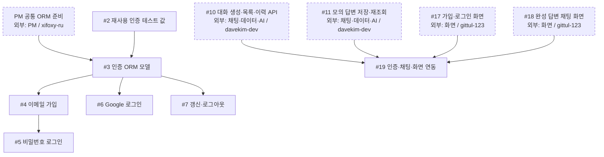
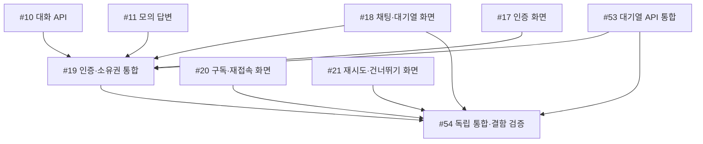

# 인증 공정

## 현재 인계 (2026-10-25)

PR #57·#59·#62로 한도·영속 기반·대기열 API가 병합됐다. PR #50의 인증 화면, PR #58의 기본 HTTP 채팅과 목업, PR #60·#61의 구독·재시도 목업을 구분한다. #18·#20·#21은 닫혔지만 실제 MemberChat 대기열·SSE 통합 완료가 아니다. #53은 PR #62 병합 후 종료됐고 #19·#54가 열려 있다.

- `gittul-123`: 계약을 바탕으로 실제 MemberChat의 접수·작업·구독·재시도·건너뛰기·취소·서버 시각 연결을 준비한다. **후속 이슈 등록 필요**이며 이 문서는 새 작업을 배정하지 않는다.
- `yejoo0310`: #19의 인증·소유권·회원 전환 검사를 먼저 진행한다. #54의 시나리오·결함 주입 준비는 가능하며 최종 통합 완료에는 실제 화면 연결과 두 구현 담당자의 자체검사가 필요하다.
- `davekim-dev`: #53 종료 뒤 현재 열린 배정 이슈는 없다. 실제 연결 지원과 QA에서 확인한 서버 결함 수정은 다음 작업 후보이며 새로 배정된 작업은 아니다.

실제 AI 연결과 배포는 미완료다. 문맥 쌍 순서의 알려진 차이는 [API](../04-reference/api.md#알려진-구현-차이와-인수-확인)를 확인한다. 현재 동작의 단일 기준은 [API 계약](../04-reference/api.md)이다.

기존 S01–S20 그림과 표는 **대기열 도입 전 공정 기록**이다. 문서 끝의 승인된 대기열 목표 표·그림도 당시 계획의 직접 선행 기록으로 보존한다. 이력의 선행 간선을 실제 완료·미완료 목록으로 읽지 않는다. 현재 인계와 실제 이슈·PR 상태를 먼저 확인한다.

담당: **`yejoo0310`** · [전체 공정과 직접 선행·후속 표](development-flow.md)

첫 공동 목표는 **로그인 → 모의 완성 답변 → 저장 → 새로고침 뒤 이력 재조회 → #19 연동**이다. 기존 그림은 대기열 도입 전 인계를 기록한다. 목표의 필수 선행은 문서 끝의 목표 그림과 전체 목표 표를 따르며, 점선 상자는 다른 담당자의 작업이다. 이슈 상태와 PR 병합 여부는 GitHub에서 확인한다.

## 작업 흐름

## 내 이슈

| 이슈 | 작업 |
| --- | --- |
| [#2](https://github.com/next-stop-siren/Next-Stop-Siren/issues/2) | 재사용 인증 테스트 값 |
| [#3](https://github.com/next-stop-siren/Next-Stop-Siren/issues/3) | 인증 ORM 모델 |
| [#4](https://github.com/next-stop-siren/Next-Stop-Siren/issues/4) | 이메일 가입 |
| [#5](https://github.com/next-stop-siren/Next-Stop-Siren/issues/5) | 비밀번호 로그인 |
| [#6](https://github.com/next-stop-siren/Next-Stop-Siren/issues/6) | Google 로그인 |
| [#7](https://github.com/next-stop-siren/Next-Stop-Siren/issues/7) | 갱신·로그아웃 |
| [#19](https://github.com/next-stop-siren/Next-Stop-Siren/issues/19) | 인증·채팅·화면 연동 |

## 인계와 참고 문서

- **#3 → #9:** PM 공통 ORM 준비와 #2 테스트 값을 받은 뒤 인증 ORM 모델을 검증·병합해 채팅 담당에게 인계한다. 채팅의 #9는 인증 기능 전체 완료를 기다릴 필요가 없다.
- **#5·#6·#7 → #17:** 세 로그인 결과를 화면 담당에게 인계한다. #17은 #16까지 포함한 네 선행 조건을 따른다.
- **#10·#11·#17·#18 → #19:** 네 결과가 모두 준비되면 인증·채팅·화면을 연동한다. 화면 작업을 기다리는 동안 승인된 형식의 연동 검사를 준비할 수 있다.

[인증 기준](../04-reference/authentication.md) · [API 형식](../04-reference/api.md) · [DB 설계](../04-reference/database.md)

## 승인된 대기열 목표 인계

정책 의도와 현재 구현 경계를 구분하는 [회원 채팅 정책](../04-reference/chat-policy.md)을 따른다. 실제 연동 완료의 전체 직접 선행은 [공정진행도](development-flow.md#승인된-대기열-목표-작업의-직접-선행)가 기준이다. 아래 그림은 이 담당 작업에 닿는 동일한 직접 간선만 표시한다. 공유 인터페이스 계획 뒤 mock 준비는 먼저 가능하며 실제 완료에는 선행 결과의 검증·병합이 필요하다.

