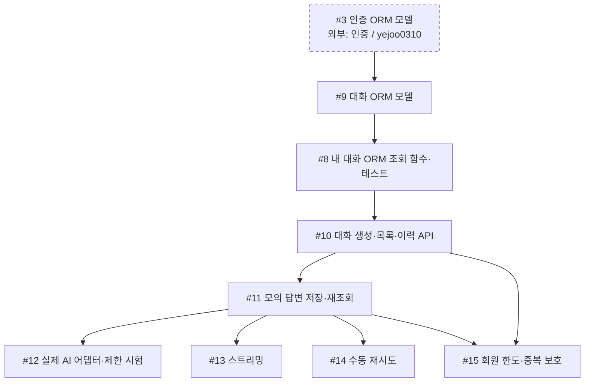
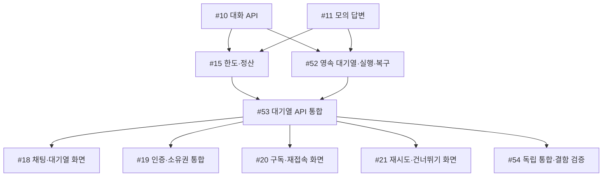

# 채팅·데이터·AI 공정

## 현재 인계 (2026-10-25)

PR #57·#59·#62로 한도·영속 기반·대기열 API가 병합됐다. PR #50의 인증 화면, PR #58의 기본 HTTP 채팅과 목업, PR #60·#61의 구독·재시도 목업을 구분한다. #18·#20·#21은 닫혔지만 실제 MemberChat 대기열·SSE 통합 완료가 아니다. #53은 PR #62 병합 후 종료됐고 #19·#54가 열려 있다.

- `gittul-123`: 계약을 바탕으로 실제 MemberChat의 접수·작업·구독·재시도·건너뛰기·취소·서버 시각 연결을 준비한다. **후속 이슈 등록 필요**이며 이 문서는 새 작업을 배정하지 않는다.
- `yejoo0310`: #19의 인증·소유권·회원 전환 검사를 먼저 진행한다. #54의 시나리오·결함 주입 준비는 가능하며 최종 통합 완료에는 실제 화면 연결과 두 구현 담당자의 자체검사가 필요하다.
- `davekim-dev`: #53 종료 뒤 현재 열린 배정 이슈는 없다. 실제 연결 지원과 QA에서 확인한 서버 결함 수정은 다음 작업 후보이며 새로 배정된 작업은 아니다.

실제 AI 연결과 배포는 미완료다. 문맥 쌍 순서의 알려진 차이는 [API](../04-reference/api.md#알려진-구현-차이와-인수-확인)를 확인한다. 현재 동작의 단일 기준은 [API 계약](../04-reference/api.md)이다.

기존 S01–S20 그림과 표는 **대기열 도입 전 공정 기록**이다. 문서 끝의 승인된 대기열 목표 표·그림도 당시 계획의 직접 선행 기록으로 보존한다. 이력의 선행 간선을 실제 완료·미완료 목록으로 읽지 않는다. 현재 인계와 실제 이슈·PR 상태를 먼저 확인한다.

담당: **`davekim-dev`** · [전체 공정과 직접 선행·후속 표](development-flow.md)

첫 공동 목표는 **로그인 → 모의 완성 답변 → 저장 → 새로고침 뒤 이력 재조회 → #19 연동**이다. 기존 그림은 대기열 도입 전 인계를 기록한다. 목표의 필수 선행은 문서 끝의 목표 그림과 전체 목표 표를 따르며, 점선 상자는 다른 담당자의 작업이다. 이슈 상태와 PR 병합 여부는 GitHub에서 확인한다.

## 작업 흐름

## 내 이슈

| 이슈 | 작업 |
| --- | --- |
| [#9](https://github.com/next-stop-siren/Next-Stop-Siren/issues/9) | 대화 ORM 모델 |
| [#8](https://github.com/next-stop-siren/Next-Stop-Siren/issues/8) | 내 대화 ORM 조회 함수·테스트 |
| [#10](https://github.com/next-stop-siren/Next-Stop-Siren/issues/10) | 대화 생성·목록·이력 API |
| [#11](https://github.com/next-stop-siren/Next-Stop-Siren/issues/11) | 모의 답변 저장·재조회 |
| [#12](https://github.com/next-stop-siren/Next-Stop-Siren/issues/12) | 실제 AI 어댑터·제한 시험 |
| [#13](https://github.com/next-stop-siren/Next-Stop-Siren/issues/13) | 스트리밍 |
| [#14](https://github.com/next-stop-siren/Next-Stop-Siren/issues/14) | 수동 재시도 |
| [#15](https://github.com/next-stop-siren/Next-Stop-Siren/issues/15) | 회원 한도·중복 보호 |

## 인계와 참고 문서

- **#3 → #9:** 검증·병합된 인증 ORM 모델을 받아 대화 ORM 모델을 만든다. 인증 기능 전체 완료는 #9의 조건이 아니다.
- **#9 → #8 → #10:** 대화 ORM 모델 뒤 소유권을 포함한 조회 함수와 자동 검사를 만들고, #10의 API에서 함수를 재사용한다. 기존 [PR #25](https://github.com/next-stop-siren/Next-Stop-Siren/pull/25)의 가짜 행·예상 결과와 [PR #26](https://github.com/next-stop-siren/Next-Stop-Siren/pull/26)의 제약 검사 초안은 검토 자료다. 새 결과는 ORM 기준으로 검증한다.
- **#11 → #12·#13·#14·#15·#18:** 모의 완성 답변의 저장·재조회 경로를 먼저 검증하고 결과를 화면 담당에게 인계한다. #15에는 #10도 필요하다.
- **S11 / #12 시작 전:** [GPT 연결 기준](../04-reference/ai.md)을 반드시 읽는다. 제공자·고정 모델·개인 할당·30초 기한·자동 재시도 금지와 완성 쌍 문맥 기준을 유지한다. 어댑터·필터링·격리 검사 코드는 현재 있고 일반 앱은 mock을 유지한다. #11은 S10, #13은 S12다.
- **승인된 목표:** [회원 채팅 정책](../04-reference/chat-policy.md)의 서버 대기열·한도 결합은 PR #62에 구현됐다. 실제 화면 연결은 남아 있다.

[백엔드 지침](../03-development/backend.md) · [DB 설계](../04-reference/database.md) · [API 형식](../04-reference/api.md)

## 승인된 대기열 목표 인계

정책 의도와 현재 구현 경계를 구분하는 [회원 채팅 정책](../04-reference/chat-policy.md)을 따른다. 실제 연동 완료의 전체 직접 선행은 [공정진행도](development-flow.md#승인된-대기열-목표-작업의-직접-선행)가 기준이다. 아래 그림은 이 담당 작업에 닿는 동일한 직접 간선만 표시한다. 공유 인터페이스 계획 뒤 mock 준비는 먼저 가능하며 실제 완료에는 선행 결과의 검증·병합이 필요하다.

