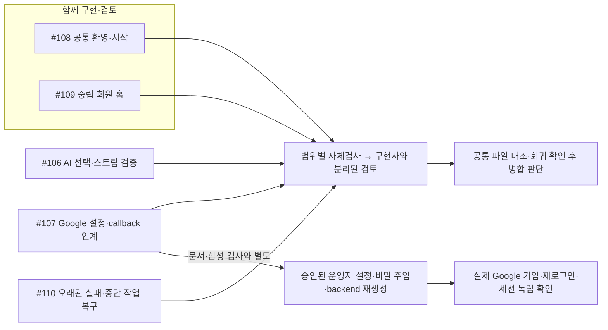
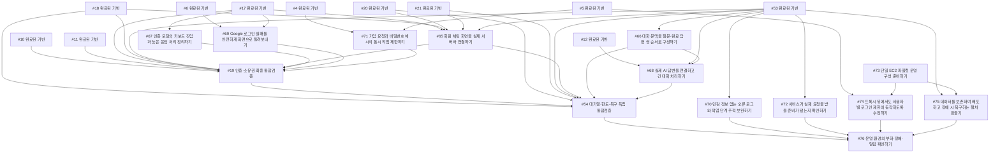
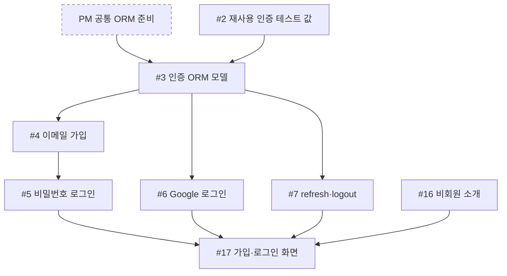
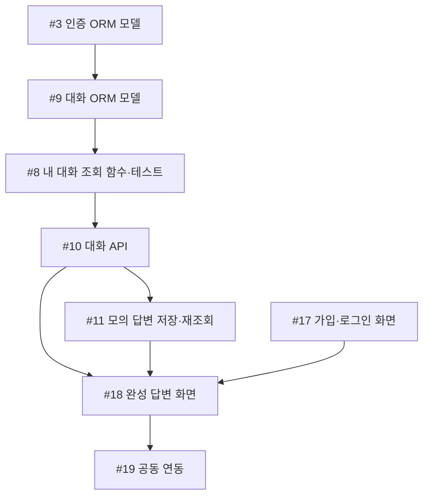
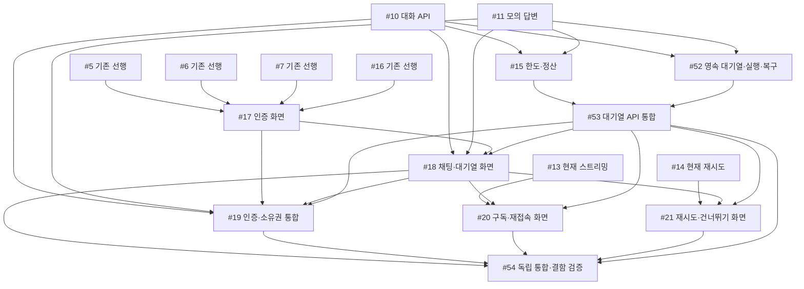

# 공정진행도

## 현재 수정 작업과 인계 (2026-11-25)

아래는 이번에 승인된 수정 범위다. 이슈 번호는 구현 순서가 아니다. 기존 완료 범위와 실제 운영 실행을 구분하고, 각 작업의 자체검사 뒤 구현자와 분리된 검토자가 변경 결과를 확인한다. 이 표는 완료·배포 선언이 아니다.

## 담당별 우선순서와 병렬 진행

| 작업 | 담당·실행 경계 | 시작·완료 인계 |
| --- | --- | --- |
| [#106 실제 AI 선택·불완전 응답 처리](https://github.com/next-stop-siren/Next-Stop-Siren/issues/106) · B71-OBS-026 | Owner `xifoxy-ru` | 기본 mock을 유지하고 서버의 명시적 Codyssey 선택과 잘못된 설정의 실패, 비정상 스트림의 미완료 처리를 구현·모의 검증한다. 기존 [#68](https://github.com/next-stop-siren/Next-Stop-Siren/issues/68)의 완료 이력은 유지한다. 실제 AI 호출은 별도 승인이다. |
| [#107 Google 가입·로그인 준비](https://github.com/next-stop-siren/Next-Stop-Siren/issues/107) · B71-OBS-057 | Owner `xifoxy-ru` | 기존 [#69](https://github.com/next-stop-siren/Next-Stop-Siren/issues/69) 실패 복귀를 보존하고 설정·callback·남은 운영자 작업을 정리한다. [실행 체크리스트](../03-development/google-login-readiness.md)에 따라 Console 설정, 서버 비밀 주입·backend 재생성, 실제 계정 확인을 문서·합성 검사와 구분한다. 이 문서 변경은 그 운영 실행의 승인이 아니다. |
| [#108 공통 환영·시작 화면](https://github.com/next-stop-siren/Next-Stop-Siren/issues/108) + [#109 중립 회원 홈](https://github.com/next-stop-siren/Next-Stop-Siren/issues/109) · B71-OBS-058/059 | Owner `xifoxy-ru`, 함께 구현·검토 | 로그인 전후 공통 환영 화면과 Home 동작을 연결한다. 로그인·새로고침·Home에서 대화를 자동 생성·선택·열지 않고, 새 대화·이력을 명시적으로 고른 뒤 연다. 완료 기준은 각 이슈별로 확인한다. |
| [#110 오래된 실패·중단 질문 복구](https://github.com/next-stop-siren/Next-Stop-Siren/issues/110) · B71-OBS-060 | Owner `xifoxy-ru`, 위 UI 작업과 별도 범위 | 100건 밖 이력을 커서로 읽어 질문·작업·allowed_actions를 복구한다. 마지막/빈 페이지·종료 경계, 재시도 키·SSE·회원 격리를 검증한다. #108/#109 완료를 구현 시작의 선행으로 요구하지 않는다. |

네 범위는 병렬로 준비할 수 있다. #108/#109는 Owner 선택에 따라 같은 회원 홈 흐름으로 묶고, #106·#107·#110은 각각의 계약과 검증을 남긴다. 합칠 때는 공통 파일 충돌을 검토하고 회원 전환·이력·인증 회귀를 독립 확인한다. 검토된 변경만 병합하며 원격 게시·배포·실제 AI 및 Google 실행은 해당 승인 범위를 별도로 확인한다.

[#73 운영 구성](https://github.com/next-stop-siren/Next-Stop-Siren/issues/73)·[#74 프록시 제한](https://github.com/next-stop-siren/Next-Stop-Siren/issues/74)·[#75 데이터·복구](https://github.com/next-stop-siren/Next-Stop-Siren/issues/75)·[#76 운영 측정](https://github.com/next-stop-siren/Next-Stop-Siren/issues/76)의 기존 담당·직접 선행·진행 상태는 이번 수정으로 바꾸지 않는다. 운영 환경은 PM-2/Owner가 관리한다. 아래 이전 공정은 당시 의존 관계를 보존한 기록이며 현재 미완료 목록이 아니다. 실제 완료·검토·운영 결과는 각 이슈와 연결 PR에서 확인한다.

## 2차 직접 선행

아래는 2026-10-25에 등록한 작업의 직접 선행 기록이다. 현재 수정 작업은 위 2026-11-25 인계를 따른다. 닫힌 기반 이슈도 재사용 관계를 표시한다. 아래 표와 그림은 같은 간선이며, 뒤의 과거 공정 기록과 구분한다. 미정인 입력 길이·토큰 상한, 가입 제한값과 운영 설정은 각 이슈에서 결정한다.

| 작업 | 담당 | 직접 선행 |
| --- | --- | --- |
| [회원 채팅 화면을 실제 서버와 연결하기](https://github.com/next-stop-siren/Next-Stop-Siren/issues/65) (#65) | gittul-123 | [#17](https://github.com/next-stop-siren/Next-Stop-Siren/issues/17), [#18](https://github.com/next-stop-siren/Next-Stop-Siren/issues/18), [#20](https://github.com/next-stop-siren/Next-Stop-Siren/issues/20), [#21](https://github.com/next-stop-siren/Next-Stop-Siren/issues/21), [#53](https://github.com/next-stop-siren/Next-Stop-Siren/issues/53) |
| [대화 문맥을 질문·완료 답변 쌍 순서로 구성하기](https://github.com/next-stop-siren/Next-Stop-Siren/issues/66) (#66) | davekim-dev | [#53](https://github.com/next-stop-siren/Next-Stop-Siren/issues/53) |
| [인증 모달의 키보드 진입과 늦은 응답 처리 정리하기](https://github.com/next-stop-siren/Next-Stop-Siren/issues/67) (#67) | gittul-123 | [#17](https://github.com/next-stop-siren/Next-Stop-Siren/issues/17) |
| [실제 AI 답변을 연결하고 긴 대화 처리하기](https://github.com/next-stop-siren/Next-Stop-Siren/issues/68) (#68) | davekim-dev | [#12](https://github.com/next-stop-siren/Next-Stop-Siren/issues/12), [#53](https://github.com/next-stop-siren/Next-Stop-Siren/issues/53), [#66](https://github.com/next-stop-siren/Next-Stop-Siren/issues/66) |
| [Google 로그인 실패를 안전하게 화면으로 돌려보내기](https://github.com/next-stop-siren/Next-Stop-Siren/issues/69) (#69) | yejoo0310, gittul-123 | [#6](https://github.com/next-stop-siren/Next-Stop-Siren/issues/6), [#17](https://github.com/next-stop-siren/Next-Stop-Siren/issues/17) |
| [민감 정보 없는 오류 로그와 작업 단계 추적 보완하기](https://github.com/next-stop-siren/Next-Stop-Siren/issues/70) (#70) | davekim-dev | [#53](https://github.com/next-stop-siren/Next-Stop-Siren/issues/53) |
| [가입 요청과 비밀번호 해시의 동시 작업 제한하기](https://github.com/next-stop-siren/Next-Stop-Siren/issues/71) (#71) | yejoo0310 | [#4](https://github.com/next-stop-siren/Next-Stop-Siren/issues/4), [#5](https://github.com/next-stop-siren/Next-Stop-Siren/issues/5) |
| [서비스가 실제 요청을 받을 준비가 됐는지 확인하기](https://github.com/next-stop-siren/Next-Stop-Siren/issues/72) (#72) | davekim-dev | [#53](https://github.com/next-stop-siren/Next-Stop-Siren/issues/53) |
| [단일 EC2 파일럿 운영 구성 준비하기](https://github.com/next-stop-siren/Next-Stop-Siren/issues/73) (#73) | xifoxy-ru | — |
| [프록시 뒤에서도 사용자별 로그인 제한이 동작하도록 수정하기](https://github.com/next-stop-siren/Next-Stop-Siren/issues/74) (#74) | yejoo0310, xifoxy-ru | [#5](https://github.com/next-stop-siren/Next-Stop-Siren/issues/5), [#73](https://github.com/next-stop-siren/Next-Stop-Siren/issues/73) |
| [데이터를 보존하며 배포하고 장애 시 복구하는 절차 만들기](https://github.com/next-stop-siren/Next-Stop-Siren/issues/75) (#75) | davekim-dev, xifoxy-ru | [#53](https://github.com/next-stop-siren/Next-Stop-Siren/issues/53), [#73](https://github.com/next-stop-siren/Next-Stop-Siren/issues/73) |
| [운영 환경의 부하·장애·알림 확인하기](https://github.com/next-stop-siren/Next-Stop-Siren/issues/76) (#76) | xifoxy-ru | [#70](https://github.com/next-stop-siren/Next-Stop-Siren/issues/70), [#72](https://github.com/next-stop-siren/Next-Stop-Siren/issues/72), [#74](https://github.com/next-stop-siren/Next-Stop-Siren/issues/74), [#75](https://github.com/next-stop-siren/Next-Stop-Siren/issues/75), [#54](https://github.com/next-stop-siren/Next-Stop-Siren/issues/54) |
| [인증·소유권 최종 통합검증](https://github.com/next-stop-siren/Next-Stop-Siren/issues/19) (#19) | yejoo0310 | [#10](https://github.com/next-stop-siren/Next-Stop-Siren/issues/10), [#11](https://github.com/next-stop-siren/Next-Stop-Siren/issues/11), [#17](https://github.com/next-stop-siren/Next-Stop-Siren/issues/17), [#18](https://github.com/next-stop-siren/Next-Stop-Siren/issues/18), [#53](https://github.com/next-stop-siren/Next-Stop-Siren/issues/53), [#65](https://github.com/next-stop-siren/Next-Stop-Siren/issues/65), [#67](https://github.com/next-stop-siren/Next-Stop-Siren/issues/67), [#69](https://github.com/next-stop-siren/Next-Stop-Siren/issues/69), [#71](https://github.com/next-stop-siren/Next-Stop-Siren/issues/71) |
| [대기열·한도·복구 독립 통합검증](https://github.com/next-stop-siren/Next-Stop-Siren/issues/54) (#54) | yejoo0310 | [#18](https://github.com/next-stop-siren/Next-Stop-Siren/issues/18), [#19](https://github.com/next-stop-siren/Next-Stop-Siren/issues/19), [#20](https://github.com/next-stop-siren/Next-Stop-Siren/issues/20), [#21](https://github.com/next-stop-siren/Next-Stop-Siren/issues/21), [#53](https://github.com/next-stop-siren/Next-Stop-Siren/issues/53), [#65](https://github.com/next-stop-siren/Next-Stop-Siren/issues/65), [#66](https://github.com/next-stop-siren/Next-Stop-Siren/issues/66), [#68](https://github.com/next-stop-siren/Next-Stop-Siren/issues/68) |

기존 S01–S20 그림과 표는 **대기열 도입 전 공정 기록**이다. 문서 끝의 승인된 대기열 목표 표·그림도 당시 계획의 직접 선행 기록으로 보존한다. 이력의 선행 간선을 실제 완료·미완료 목록으로 읽지 않는다. 현재 인계와 실제 이슈·PR 상태를 먼저 확인한다.

이 문서는 팀의 **작업 순서와 인계 지점**을 보여 준다. 진행률이나 완료 현황을 기록하는 문서는 아니다. 각 이슈의 실제 상태·막힌 이유는 연결된 이슈에서, 검토·병합 여부는 해당 PR에서 확인한다. 이슈가 열려 있다는 사실만으로 미착수를 뜻하지 않는다. 아래 표의 선행 작업은 **검증을 마치고 병합되어 다음 작업에서 사용할 수 있는 결과**를 뜻한다.

현재 팀 작업의 `S01`–`S20`은 이슈 #2–#21에 각각 대응하는 고정 식별자다(`#2 = S01`, `#21 = S20`). 번호는 작업 순서나 현재 진행 상태를 뜻하지 않는다. 기존 순서는 역사적 기록으로 남기고 현재 시작·완료 조건은 위 2차 직접 선행에서 확인한다.

이 표는 의존 관계의 설계이며 현재 미완료 목록이 아니다. 백엔드 인증·ORM·대화·모의 답변과 GPT 격리 어댑터, 비회원 화면 구현은 이미 있으므로 소스·테스트와 실제 이슈·PR 상태를 확인한다. 최초 흐름에서는 인증 [#2](https://github.com/next-stop-siren/Next-Stop-Siren/issues/2)와 화면 [#16](https://github.com/next-stop-siren/Next-Stop-Siren/issues/16)을 진행할 수 있다. 채팅은 PM의 [공통 ORM 준비](../01-start/stack.md#개발과-초기-db)와 #3 인증 모델 뒤 #9 대화 모델을 만들고, 그 뒤 #8 조회 함수를 시작한다. 표의 `—`는 선행 칸에서는 로컬 준비 뒤 시작 가능, 다음 칸에서는 **이 표에 있는 직접 후속 이슈가 없음**을 뜻한다. 프로젝트 전체의 완료를 뜻하지 않는다.

## 담당별 경로

| 담당 | 담당 문서 | 맡은 이슈 |
| --- | --- | --- |
| 인증 `yejoo0310` | [인증 공정](auth-flow.md) | #2–#7, #19 공동 연동 |
| 채팅·데이터·AI `davekim-dev` | [채팅·데이터·AI 공정](chat-flow.md) | #8–#15 |
| 화면 `gittul-123` | [화면 공정](frontend-flow.md) | #16–#18, #20–#21 |

담당 문서의 그림은 각자의 작업과 필요한 외부 인계를 보여 준다. 역사적 직접 선행은 마지막 승인 목표 표에 보존한다. PM `xifoxy-ru`는 정책 값을 확정하고 공통 형식·선행 이슈 PR을 검토하며, 시작 조건이 바뀌면 해당 이슈를 갱신한다.

**공동 목표**

로그인 → 모의 완성 답변 → 저장 → 새로고침 뒤 재조회 → [#19 인증·채팅·화면 연동](https://github.com/next-stop-siren/Next-Stop-Siren/issues/19)

아래 그림은 대기열 도입 전 주요 인계 기록이다. 현재 서버 스트리밍·재시도는 병합됐으며 2차 작업은 위 현재 표를 따른다.

## 기존 S01–S20 직접 선행·후속 기록

| 담당 | 이슈·결과 | 직접 선행 | 직접 후속 |
| --- | --- | --- | --- |
| 인증 | [#2 재사용 인증 테스트 값](https://github.com/next-stop-siren/Next-Stop-Siren/issues/2) | — | #3 |
| 인증 | [#3 인증 ORM 모델](https://github.com/next-stop-siren/Next-Stop-Siren/issues/3) | #2 + [PM 공통 ORM 준비](../01-start/stack.md#개발과-초기-db) | #4, #6, #7, #9 |
| 인증 | [#4 이메일 가입](https://github.com/next-stop-siren/Next-Stop-Siren/issues/4) | #3 | #5 |
| 인증 | [#5 비밀번호 로그인](https://github.com/next-stop-siren/Next-Stop-Siren/issues/5) | #4 | #17 |
| 인증 | [#6 Google 로그인](https://github.com/next-stop-siren/Next-Stop-Siren/issues/6) | #3 | #17 |
| 인증 | [#7 refresh·logout](https://github.com/next-stop-siren/Next-Stop-Siren/issues/7) | #3 | #17 |
| 인증·공동 연동 | [#19 인증·채팅·화면 연동](https://github.com/next-stop-siren/Next-Stop-Siren/issues/19) | #10, #11, #17, #18 | — |
| 채팅 | [#9 대화 ORM 모델](https://github.com/next-stop-siren/Next-Stop-Siren/issues/9) | #3 | #8 |
| 채팅 | [#8 내 대화 ORM 조회 함수·테스트](https://github.com/next-stop-siren/Next-Stop-Siren/issues/8) | #9 | #10 |
| 채팅 | [#10 대화 생성·목록·이력 API](https://github.com/next-stop-siren/Next-Stop-Siren/issues/10) | #8 | #11, #15, #18, #19 |
| 채팅 | [#11 모의 완성 답변 저장·재조회](https://github.com/next-stop-siren/Next-Stop-Siren/issues/11) | #10 | #12, #13, #14, #15, #18, #19 |
| 채팅 | [#12 실제 AI 어댑터·제한 시험](https://github.com/next-stop-siren/Next-Stop-Siren/issues/12) | #11 | — |
| 채팅 | [#13 스트리밍](https://github.com/next-stop-siren/Next-Stop-Siren/issues/13) | #11 | #20 |
| 채팅 | [#14 수동 재시도](https://github.com/next-stop-siren/Next-Stop-Siren/issues/14) | #11 | #21 |
| 채팅 | [#15 회원 한도·중복 보호](https://github.com/next-stop-siren/Next-Stop-Siren/issues/15) | #10, #11 | — |
| 화면 | [#16 비회원 소개](https://github.com/next-stop-siren/Next-Stop-Siren/issues/16) | — | #17 |
| 화면 | [#17 가입·로그인 화면](https://github.com/next-stop-siren/Next-Stop-Siren/issues/17) | #5, #6, #7, #16 | #18, #19 |
| 화면 | [#18 완성 답변 채팅 화면](https://github.com/next-stop-siren/Next-Stop-Siren/issues/18) | #10, #11, #17 | #19, #20, #21 |
| 화면 | [#20 스트리밍 화면](https://github.com/next-stop-siren/Next-Stop-Siren/issues/20) | #13, #18 | — |
| 화면 | [#21 재시도 화면](https://github.com/next-stop-siren/Next-Stop-Siren/issues/21) | #14, #18 | — |

## 막히기 쉬운 인계

- **PM 공통 ORM 준비 → #3 → #9 → #8 → #10:** PM은 공통 엔진·세션·모델 등록과 보호된 테스트 DB 초기화를 제공한다. #3 인증 모델, #9 대화 모델을 검증·병합한 뒤 #8의 소유권 조회 함수와 자동 검사를 작성한다. #10은 이 함수를 재사용한다. 인증 기능 전체 완료는 #9의 조건이 아니다.
- **#5·#6·#7 → #17:** 화면 담당은 기다리는 동안 승인된 [API·인증 형식](../04-reference/api.md#인증-요청응답)을 읽고 화면 상태, 가짜 응답 예시, 검사 시나리오를 준비할 수 있다. #17 구현 시작·실제 API 연동·완료에는 기존 네 선행 조건(#5·#6·#7·#16)을 그대로 적용한다.
- **#11 → #12~#15·#18:** 채팅 담당은 모의 완성 답변의 저장·재조회 경로를 먼저 검증한다. 당시 #11은 입력 기준과 동기 생성을 구현했다. PR #62 이후에는 접수·실행·구독 분리와 실행기 복구를 쓴다. #12(S11)의 제공자·모델·호출·격리 시험은 승인된 [GPT 기준](../04-reference/ai.md)을 따른다. 대기열·한도·재시도는 PR #62에 연결됐다. 이전 D4·요청별 스트림은 현재 계약이 아니다. 목표 인계는 아래 표를 따른다.
- **#17·#18 → #19:** 화면 작업이 늦어지면 인증·채팅 담당은 이미 승인된 형식의 연동 검사와 선행 조건이 충족된 독립 후속 작업을 준비한다. PM은 다른 작업을 막는 이슈와 PR 검토를 우선한다.
- **#13 → #20, #14 → #21:** 서버 결과와 화면 동작을 각각 인계해 함께 확인한다. 실제 AI를 사용자에게 열려면 #12의 제한 시험 외에도 #15와 #19의 결과 및 배포 검증이 필요하다.

일정이나 소요 시간이 정해지지 않았으므로 이 문서는 완료 날짜나 예상 최장 경로를 제시하지 않는다. 최신 착수·차단·검토·완료 판단은 [GitHub 이슈 목록](https://github.com/next-stop-siren/Next-Stop-Siren/issues)에서 해당 이슈와 연결 PR을 확인한다.

## 승인된 대기열 목표 작업의 직접 선행

아래는 PR #55에서 승인한 **당시 실제 API 연동 완료 계획**의 직접 선행 기록이다. #18·#20·#21은 이후 목업 범위로 종료됐으므로 실제 연결이 완료됐다는 뜻이 아니다. 위 기존 S01–S20 공정은 역사적 기반을 보존한다. 새 작업은 S 번호를 붙이지 않는다. 공유 작업과 입장·예약·정산 인터페이스와 상태·오류·허용 동작을 먼저 합의한다. 그 뒤 #52 기반과 #15 한도를 독립 진행하며 서로 완료를 선행으로 요구하지 않는다. mock 화면·가짜 응답·시나리오 준비는 계약을 읽고 먼저 가능하지만 실제 연동 완료를 뜻하지 않는다.

| 담당 | 목표 작업 | 직접 선행(실제 연동 완료) | 직접 후속 |
| --- | --- | --- | --- |
| davekim-dev | [#15](https://github.com/next-stop-siren/Next-Stop-Siren/issues/15) 한도·정산 | [#10](https://github.com/next-stop-siren/Next-Stop-Siren/issues/10), [#11](https://github.com/next-stop-siren/Next-Stop-Siren/issues/11) | [#53](https://github.com/next-stop-siren/Next-Stop-Siren/issues/53) |
| gittul-123 | [#17](https://github.com/next-stop-siren/Next-Stop-Siren/issues/17) 인증 화면 | [#5](https://github.com/next-stop-siren/Next-Stop-Siren/issues/5), [#6](https://github.com/next-stop-siren/Next-Stop-Siren/issues/6), [#7](https://github.com/next-stop-siren/Next-Stop-Siren/issues/7), [#16](https://github.com/next-stop-siren/Next-Stop-Siren/issues/16) | [#18](https://github.com/next-stop-siren/Next-Stop-Siren/issues/18), [#19](https://github.com/next-stop-siren/Next-Stop-Siren/issues/19) |
| gittul-123 | [#18](https://github.com/next-stop-siren/Next-Stop-Siren/issues/18) 채팅·대기열 화면 | [#10](https://github.com/next-stop-siren/Next-Stop-Siren/issues/10), [#11](https://github.com/next-stop-siren/Next-Stop-Siren/issues/11), [#17](https://github.com/next-stop-siren/Next-Stop-Siren/issues/17), [#53](https://github.com/next-stop-siren/Next-Stop-Siren/issues/53) | [#19](https://github.com/next-stop-siren/Next-Stop-Siren/issues/19), [#20](https://github.com/next-stop-siren/Next-Stop-Siren/issues/20), [#21](https://github.com/next-stop-siren/Next-Stop-Siren/issues/21), [#54](https://github.com/next-stop-siren/Next-Stop-Siren/issues/54) |
| yejoo0310 | [#19](https://github.com/next-stop-siren/Next-Stop-Siren/issues/19) 인증·소유권 통합 | [#10](https://github.com/next-stop-siren/Next-Stop-Siren/issues/10), [#11](https://github.com/next-stop-siren/Next-Stop-Siren/issues/11), [#17](https://github.com/next-stop-siren/Next-Stop-Siren/issues/17), [#18](https://github.com/next-stop-siren/Next-Stop-Siren/issues/18), [#53](https://github.com/next-stop-siren/Next-Stop-Siren/issues/53) | [#54](https://github.com/next-stop-siren/Next-Stop-Siren/issues/54) |
| gittul-123 | [#20](https://github.com/next-stop-siren/Next-Stop-Siren/issues/20) 구독·재접속 화면 | [#13](https://github.com/next-stop-siren/Next-Stop-Siren/issues/13), [#18](https://github.com/next-stop-siren/Next-Stop-Siren/issues/18), [#53](https://github.com/next-stop-siren/Next-Stop-Siren/issues/53) | [#54](https://github.com/next-stop-siren/Next-Stop-Siren/issues/54) |
| gittul-123 | [#21](https://github.com/next-stop-siren/Next-Stop-Siren/issues/21) 재시도·건너뛰기 화면 | [#14](https://github.com/next-stop-siren/Next-Stop-Siren/issues/14), [#18](https://github.com/next-stop-siren/Next-Stop-Siren/issues/18), [#53](https://github.com/next-stop-siren/Next-Stop-Siren/issues/53) | [#54](https://github.com/next-stop-siren/Next-Stop-Siren/issues/54) |
| davekim-dev | [#52](https://github.com/next-stop-siren/Next-Stop-Siren/issues/52) 영속 대기열·실행·복구 | [#10](https://github.com/next-stop-siren/Next-Stop-Siren/issues/10), [#11](https://github.com/next-stop-siren/Next-Stop-Siren/issues/11) | [#53](https://github.com/next-stop-siren/Next-Stop-Siren/issues/53) |
| davekim-dev | [#53](https://github.com/next-stop-siren/Next-Stop-Siren/issues/53) 대기열 API 통합 | [#15](https://github.com/next-stop-siren/Next-Stop-Siren/issues/15), [#52](https://github.com/next-stop-siren/Next-Stop-Siren/issues/52) | [#18](https://github.com/next-stop-siren/Next-Stop-Siren/issues/18), [#19](https://github.com/next-stop-siren/Next-Stop-Siren/issues/19), [#20](https://github.com/next-stop-siren/Next-Stop-Siren/issues/20), [#21](https://github.com/next-stop-siren/Next-Stop-Siren/issues/21), [#54](https://github.com/next-stop-siren/Next-Stop-Siren/issues/54) |
| yejoo0310 | [#54](https://github.com/next-stop-siren/Next-Stop-Siren/issues/54) 독립 통합·결함 검증 | [#18](https://github.com/next-stop-siren/Next-Stop-Siren/issues/18), [#19](https://github.com/next-stop-siren/Next-Stop-Siren/issues/19), [#20](https://github.com/next-stop-siren/Next-Stop-Siren/issues/20), [#21](https://github.com/next-stop-siren/Next-Stop-Siren/issues/21), [#53](https://github.com/next-stop-siren/Next-Stop-Siren/issues/53) | — |

#17은 기존 인증 범위만 유지한다. Google 실패 복귀는 PR #50에서 제외된 후속 #69 작업이다. #69의 서버 처리와 자체 검증은 `1cbf709`에 반영됐으며, 실패 화면 연결·실제 Google 전체 흐름·독립 검토는 남아 있다. [연동 안내](../03-development/google-login-failure.md)를 따른다. #19는 인증·소유권과 비공개 화면 격리를 맡고 전체 대기열 검증은 #54가 독립 수행한다. 공개 AI·배포 준비는 별도다.

