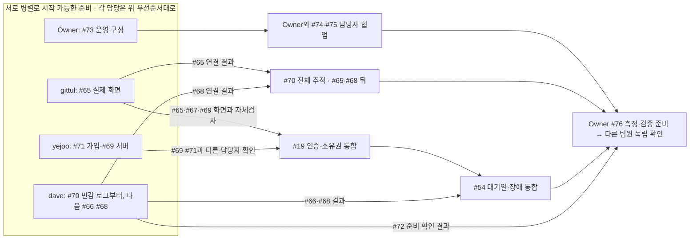
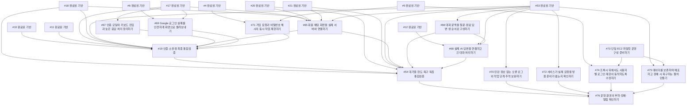
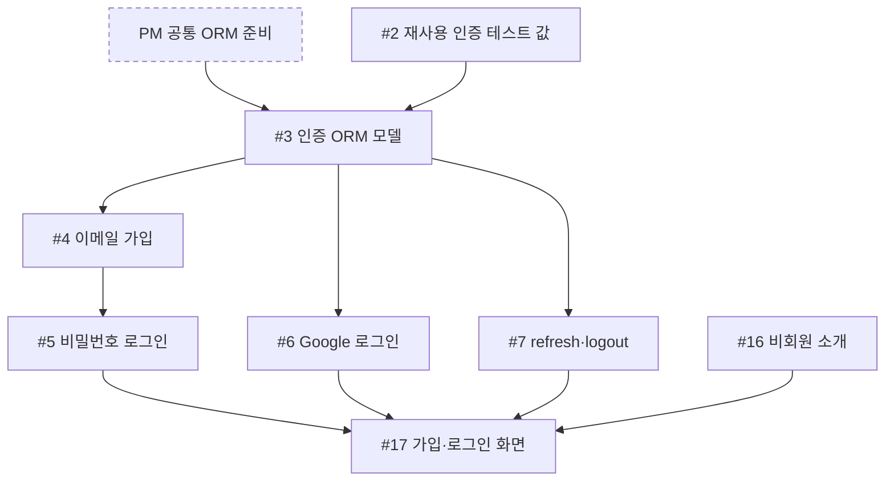
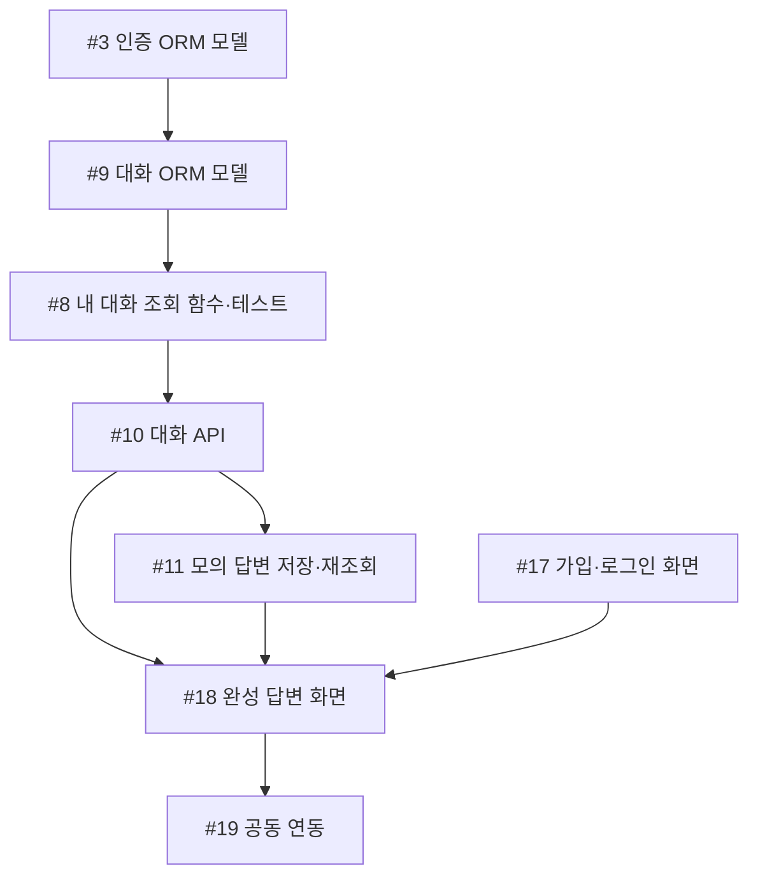
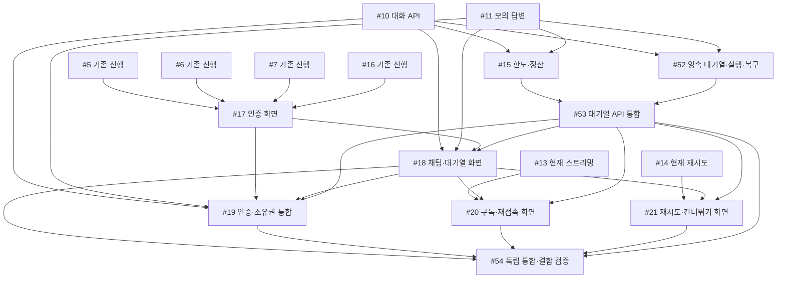

# 공정진행도

## 2차 작업과 현재 인계 (2026-10-25)

[2차 마일스톤](https://github.com/next-stop-siren/Next-Stop-Siren/milestone/2)에 새 구현·운영 작업 12개와 기존 #19·#54 최종검증을 연결했다. 등록 상태는 대기이며 개발을 시작했다는 뜻은 아니다. 기존 S01–S20 번호와 닫힌 목업의 완료 이력은 유지한다.

- `gittul-123`: [#65](https://github.com/next-stop-siren/Next-Stop-Siren/issues/65) 실제 회원 채팅 연결, [#67](https://github.com/next-stop-siren/Next-Stop-Siren/issues/67) 인증 모달, [#69](https://github.com/next-stop-siren/Next-Stop-Siren/issues/69) Google 실패 화면을 맡는다.
- `davekim-dev`: [#66](https://github.com/next-stop-siren/Next-Stop-Siren/issues/66) 문맥 쌍 순서, [#70](https://github.com/next-stop-siren/Next-Stop-Siren/issues/70) 민감 로그 차단을 먼저 준비할 수 있다. [#68](https://github.com/next-stop-siren/Next-Stop-Siren/issues/68) 실제 AI·긴 대화, [#72](https://github.com/next-stop-siren/Next-Stop-Siren/issues/72) 서비스 준비 확인, [#75](https://github.com/next-stop-siren/Next-Stop-Siren/issues/75) 데이터·복구 작업도 맡는다. #70의 전체 추적은 [#65](https://github.com/next-stop-siren/Next-Stop-Siren/issues/65)·[#68](https://github.com/next-stop-siren/Next-Stop-Siren/issues/68) 기능 연결 뒤 완성한다.
- `yejoo0310`: [#69](https://github.com/next-stop-siren/Next-Stop-Siren/issues/69) Google 실패 서버, [#71](https://github.com/next-stop-siren/Next-Stop-Siren/issues/71) 가입 요청·해시 제한, [#74](https://github.com/next-stop-siren/Next-Stop-Siren/issues/74) 프록시 뒤 로그인 제한을 맡는다. 본인 인증 변경은 다른 담당자가 독립 확인한다.
- Owner `xifoxy-ru`가 [#73](https://github.com/next-stop-siren/Next-Stop-Siren/issues/73) 운영 구성과 [#76](https://github.com/next-stop-siren/Next-Stop-Siren/issues/76) 측정·장애·검증 자료 준비를 맡는다. [#74](https://github.com/next-stop-siren/Next-Stop-Siren/issues/74)는 `yejoo0310`, [#75](https://github.com/next-stop-siren/Next-Stop-Siren/issues/75)는 `davekim-dev`와 운영 역할을 나눠 협업한다. #76의 실제 독립 확인은 구현자가 아닌 팀원이 수행하고 확인자·결과를 남긴다.

#19·#54는 관련 기능 구현과 담당 자체검사가 끝난 뒤 최종 통합검증을 진행한다. [PR #63](https://github.com/next-stop-siren/Next-Stop-Siren/pull/63)에 일부 결과가 제출돼 있으며 검토된 결과를 해당 범위에서 재사용한다. 실제 화면 격리와 전체 대기열 검증은 남아 있다. 운영·선택 리팩터링 전체를 기능 QA 선행으로 묶지 않는다.

PR #62의 서버 대기열과 PR #64의 Rev 1 문서는 완료된 기반이다. #18·#20·#21 닫힘은 목업 완료이며 실제 화면 연결은 #65에서 진행한다. 실제 AI·배포는 완료되지 않았다. 세부 동작과 고정 commit·Rev 참조는 각 이슈를 따른다.

## 담당별 우선순서와 병렬 진행

이 표는 같은 담당자가 작업을 고르는 권장 순서다. 아래의 **직접 선행 표는 그대로**이며 우선순서 때문에 새 선행 관계를 추가하지 않는다. 결정이나 검토를 기다리면 준비 가능한 다음 작업으로 옮길 수 있다. 다른 담당자끼리는 병렬로 진행하되 한 사람이 여러 작업을 동시에 끝내야 한다는 뜻은 아니다.

| 담당 | 권장 순서와 기다리는 지점 |
| --- | --- |
| `gittul-123` | [#65](https://github.com/next-stop-siren/Next-Stop-Siren/issues/65) 회원 채팅 → [#67](https://github.com/next-stop-siren/Next-Stop-Siren/issues/67) 모달 → [#69](https://github.com/next-stop-siren/Next-Stop-Siren/issues/69) 실패 화면. #65가 결정을 기다리면 모달 등 준비 가능한 일을 먼저 할 수 있다. |
| `davekim-dev` | [#70](https://github.com/next-stop-siren/Next-Stop-Siren/issues/70) **민감 로그 차단 단계** → [#66](https://github.com/next-stop-siren/Next-Stop-Siren/issues/66) 문맥 → [#68](https://github.com/next-stop-siren/Next-Stop-Siren/issues/68) AI 연결. 값 결정을 기다릴 때 [#72](https://github.com/next-stop-siren/Next-Stop-Siren/issues/72) 준비 상태를 확인한다. #75는 Owner 환경과 협업하고, [#70](https://github.com/next-stop-siren/Next-Stop-Siren/issues/70) **전체 추적**은 [#65](https://github.com/next-stop-siren/Next-Stop-Siren/issues/65)·[#68](https://github.com/next-stop-siren/Next-Stop-Siren/issues/68) 연결 뒤 완성한다. |
| `yejoo0310` | [#71](https://github.com/next-stop-siren/Next-Stop-Siren/issues/71) 가입 제한 → [#69](https://github.com/next-stop-siren/Next-Stop-Siren/issues/69) 실패 서버 → [#74](https://github.com/next-stop-siren/Next-Stop-Siren/issues/74) 프록시 협업. [#74](https://github.com/next-stop-siren/Next-Stop-Siren/issues/74) 실제 확인은 Owner의 [#73](https://github.com/next-stop-siren/Next-Stop-Siren/issues/73) 프록시·실행 프로세스 구성 결과를 사용한다. |
| Owner `xifoxy-ru` | [#73](https://github.com/next-stop-siren/Next-Stop-Siren/issues/73) 운영 구성 → [#74](https://github.com/next-stop-siren/Next-Stop-Siren/issues/74) 프록시 확인·[#75](https://github.com/next-stop-siren/Next-Stop-Siren/issues/75) 백업과 복구를 각 담당자와 진행 → [#76](https://github.com/next-stop-siren/Next-Stop-Siren/issues/76) 측정·장애·검증 자료 준비. #76의 실제 독립 확인은 구현하지 않은 팀원이 수행한다. |

아래는 **현재 열린 작업의 진행·인계 요약**이다. 각 박스 안의 전체 작업이 끝나야 다음 박스를 시작한다는 뜻이 아니다. 화살표에 적힌 해당 작업 결과만 기다리며, 정확한 직접 선행은 다음 절의 표를 따른다.

실제 데이터 사용·외부 로그 수집 전에는 #70의 민감 로그 차단 결과를 확인한다. 전체 처리 단계 추적은 기능 연결이 끝난 뒤 완성하므로 앞의 안전 수정을 막지 않는다. [#66](https://github.com/next-stop-siren/Next-Stop-Siren/issues/66) 문맥 수정은 #68의 입력 길이·토큰 한도 결정을 기다리지 않는다. [#19](https://github.com/next-stop-siren/Next-Stop-Siren/issues/19)·#54는 관련 기능과 자체검사 뒤 진행하며 운영·선택 리팩터링 전체를 선행으로 묶지 않는다.

아직 정하지 않은 값·운영 설정은 각 이슈에서 결정한다. #76의 독립 확인자 이름은 실제로 맡은 팀원과 확인 결과에 기록하며 Owner의 자체검사로 대신하지 않는다.

## 2차 직접 선행

아래는 현재 등록된 작업의 직접 선행이다. 닫힌 기반 이슈도 재사용 관계를 표시한다. 아래 표와 그림은 같은 간선이며, 뒤의 과거 공정 기록과 구분한다. 미정인 입력 길이·토큰 상한, 가입 제한값과 운영 설정은 각 이슈에서 결정한다.

| 작업 | 담당 | 직접 선행 |
| --- | --- | --- |
| [회원 채팅 화면을 실제 서버와 연결하기](https://github.com/next-stop-siren/Next-Stop-Siren/issues/65) (#65) | gittul-123 | [#17](https://github.com/next-stop-siren/Next-Stop-Siren/issues/17), [#18](https://github.com/next-stop-siren/Next-Stop-Siren/issues/18), [#20](https://github.com/next-stop-siren/Next-Stop-Siren/issues/20), [#21](https://github.com/next-stop-siren/Next-Stop-Siren/issues/21), [#53](https://github.com/next-stop-siren/Next-Stop-Siren/issues/53) |
| [대화 문맥을 질문·완료 답변 쌍 순서로 구성하기](https://github.com/next-stop-siren/Next-Stop-Siren/issues/66) (#66) | davekim-dev | [#53](https://github.com/next-stop-siren/Next-Stop-Siren/issues/53) |
| [인증 모달의 키보드 진입과 늦은 응답 처리 정리하기](https://github.com/next-stop-siren/Next-Stop-Siren/issues/67) (#67) | gittul-123 | [#17](https://github.com/next-stop-siren/Next-Stop-Siren/issues/17) |
| [실제 AI 답변을 연결하고 긴 대화 처리하기](https://github.com/next-stop-siren/Next-Stop-Siren/issues/68) (#68) | davekim-dev | [#12](https://github.com/next-stop-siren/Next-Stop-Siren/issues/12), [#53](https://github.com/next-stop-siren/Next-Stop-Siren/issues/53), [#66](https://github.com/next-stop-siren/Next-Stop-Siren/issues/66) |
| [Google 로그인 실패를 안전하게 화면으로 돌려보내기](https://github.com/next-stop-siren/Next-Stop-Siren/issues/69) (#69) | yejoo0310, gittul-123 | [#6](https://github.com/next-stop-siren/Next-Stop-Siren/issues/6), [#17](https://github.com/next-stop-siren/Next-Stop-Siren/issues/17) |
| [민감 정보 없는 오류 로그와 작업 단계 추적 보완하기](https://github.com/next-stop-siren/Next-Stop-Siren/issues/70) (#70) | davekim-dev | [#53](https://github.com/next-stop-siren/Next-Stop-Siren/issues/53) |
| [가입 요청과 비밀번호 해시의 동시 작업 제한하기](https://github.com/next-stop-siren/Next-Stop-Siren/issues/71) (#71) | yejoo0310 | [#4](https://github.com/next-stop-siren/Next-Stop-Siren/issues/4), [#5](https://github.com/next-stop-siren/Next-Stop-Siren/issues/5) |
| [서비스가 실제 요청을 받을 준비가 됐는지 확인하기](https://github.com/next-stop-siren/Next-Stop-Siren/issues/72) (#72) | davekim-dev | [#53](https://github.com/next-stop-siren/Next-Stop-Siren/issues/53) |
| [단일 EC2 파일럿 운영 구성 준비하기](https://github.com/next-stop-siren/Next-Stop-Siren/issues/73) (#73) | xifoxy-ru | — |
| [프록시 뒤에서도 사용자별 로그인 제한이 동작하도록 수정하기](https://github.com/next-stop-siren/Next-Stop-Siren/issues/74) (#74) | yejoo0310, xifoxy-ru | [#5](https://github.com/next-stop-siren/Next-Stop-Siren/issues/5), [#73](https://github.com/next-stop-siren/Next-Stop-Siren/issues/73) |
| [데이터를 보존하며 배포하고 장애 시 복구하는 절차 만들기](https://github.com/next-stop-siren/Next-Stop-Siren/issues/75) (#75) | davekim-dev, xifoxy-ru | [#53](https://github.com/next-stop-siren/Next-Stop-Siren/issues/53), [#73](https://github.com/next-stop-siren/Next-Stop-Siren/issues/73) |
| [운영 환경의 부하·장애·알림 확인하기](https://github.com/next-stop-siren/Next-Stop-Siren/issues/76) (#76) | xifoxy-ru | [#70](https://github.com/next-stop-siren/Next-Stop-Siren/issues/70), [#72](https://github.com/next-stop-siren/Next-Stop-Siren/issues/72), [#74](https://github.com/next-stop-siren/Next-Stop-Siren/issues/74), [#75](https://github.com/next-stop-siren/Next-Stop-Siren/issues/75), [#54](https://github.com/next-stop-siren/Next-Stop-Siren/issues/54) |
| [인증·소유권 최종 통합검증](https://github.com/next-stop-siren/Next-Stop-Siren/issues/19) (#19) | yejoo0310 | [#10](https://github.com/next-stop-siren/Next-Stop-Siren/issues/10), [#11](https://github.com/next-stop-siren/Next-Stop-Siren/issues/11), [#17](https://github.com/next-stop-siren/Next-Stop-Siren/issues/17), [#18](https://github.com/next-stop-siren/Next-Stop-Siren/issues/18), [#53](https://github.com/next-stop-siren/Next-Stop-Siren/issues/53), [#65](https://github.com/next-stop-siren/Next-Stop-Siren/issues/65), [#67](https://github.com/next-stop-siren/Next-Stop-Siren/issues/67), [#69](https://github.com/next-stop-siren/Next-Stop-Siren/issues/69), [#71](https://github.com/next-stop-siren/Next-Stop-Siren/issues/71) |
| [대기열·한도·복구 독립 통합검증](https://github.com/next-stop-siren/Next-Stop-Siren/issues/54) (#54) | yejoo0310 | [#18](https://github.com/next-stop-siren/Next-Stop-Siren/issues/18), [#19](https://github.com/next-stop-siren/Next-Stop-Siren/issues/19), [#20](https://github.com/next-stop-siren/Next-Stop-Siren/issues/20), [#21](https://github.com/next-stop-siren/Next-Stop-Siren/issues/21), [#53](https://github.com/next-stop-siren/Next-Stop-Siren/issues/53), [#65](https://github.com/next-stop-siren/Next-Stop-Siren/issues/65), [#66](https://github.com/next-stop-siren/Next-Stop-Siren/issues/66), [#68](https://github.com/next-stop-siren/Next-Stop-Siren/issues/68) |

기존 S01–S20 그림과 표는 **대기열 도입 전 공정 기록**이다. 문서 끝의 승인된 대기열 목표 표·그림도 당시 계획의 직접 선행 기록으로 보존한다. 이력의 선행 간선을 실제 완료·미완료 목록으로 읽지 않는다. 현재 인계와 실제 이슈·PR 상태를 먼저 확인한다.

이 문서는 팀의 **작업 순서와 인계 지점**을 보여 준다. 진행률이나 완료 현황을 기록하는 문서는 아니다. 각 이슈의 실제 상태·막힌 이유는 연결된 이슈에서, 검토·병합 여부는 해당 PR에서 확인한다. 이슈가 열려 있다는 사실만으로 미착수를 뜻하지 않는다. 아래 표의 선행 작업은 **검증을 마치고 병합되어 다음 작업에서 사용할 수 있는 결과**를 뜻한다.

현재 팀 작업의 `S01`–`S20`은 이슈 #2–#21에 각각 대응하는 고정 식별자다(`#2 = S01`, `#21 = S20`). 번호는 작업 순서나 현재 진행 상태를 뜻하지 않는다. 기존 순서는 역사적 기록으로 남기고 현재 시작·완료 조건은 위 2차 직접 선행에서 확인한다.

이 표는 의존 관계의 설계이며 현재 미완료 목록이 아니다. 백엔드 인증·ORM·대화·모의 답변과 GPT 격리 어댑터, 비회원 화면 구현은 이미 있으므로 소스·테스트와 실제 이슈·PR 상태를 확인한다. 최초 흐름에서는 인증 [#2](https://github.com/next-stop-siren/Next-Stop-Siren/issues/2)와 화면 [#16](https://github.com/next-stop-siren/Next-Stop-Siren/issues/16)을 진행할 수 있다. 채팅은 PM의 [공통 ORM 준비](../01-start/stack.md#개발과-초기-db)와 #3 인증 모델 뒤 #9 대화 모델을 만들고, 그 뒤 #8 조회 함수를 시작한다. 표의 `—`는 선행 칸에서는 로컬 준비 뒤 시작 가능, 다음 칸에서는 **이 표에 있는 직접 후속 이슈가 없음**을 뜻한다. 프로젝트 전체의 완료를 뜻하지 않는다.

## 담당별 경로

| 담당 | 담당 문서 | 맡은 이슈 |
| --- | --- | --- |
| 인증 `yejoo0310` | [인증 공정](auth-flow.md) | #2–#7, #19 공동 연동 |
| 채팅·데이터·AI `davekim-dev` | [채팅·데이터·AI 공정](chat-flow.md) | #8–#15 |
| 화면 `gittul-123` | [화면 공정](frontend-flow.md) | #16–#18, #20–#21 |

담당 문서의 그림은 각자의 작업과 필요한 외부 인계를 보여 준다. 역사적 직접 선행은 마지막 승인 목표 표에 보존한다. PM `xifoxy-ru`는 정책 값을 확정하고 공통 형식·선행 이슈 PR을 검토하며, 시작 조건이 바뀌면 해당 이슈를 갱신한다.

**공동 목표**

로그인 → 모의 완성 답변 → 저장 → 새로고침 뒤 재조회 → [#19 인증·채팅·화면 연동](https://github.com/next-stop-siren/Next-Stop-Siren/issues/19)

아래 그림은 대기열 도입 전 주요 인계 기록이다. 현재 서버 스트리밍·재시도는 병합됐으며 2차 작업은 위 현재 표를 따른다.

## 기존 S01–S20 직접 선행·후속 기록

| 담당 | 이슈·결과 | 직접 선행 | 직접 후속 |
| --- | --- | --- | --- |
| 인증 | [#2 재사용 인증 테스트 값](https://github.com/next-stop-siren/Next-Stop-Siren/issues/2) | — | #3 |
| 인증 | [#3 인증 ORM 모델](https://github.com/next-stop-siren/Next-Stop-Siren/issues/3) | #2 + [PM 공통 ORM 준비](../01-start/stack.md#개발과-초기-db) | #4, #6, #7, #9 |
| 인증 | [#4 이메일 가입](https://github.com/next-stop-siren/Next-Stop-Siren/issues/4) | #3 | #5 |
| 인증 | [#5 비밀번호 로그인](https://github.com/next-stop-siren/Next-Stop-Siren/issues/5) | #4 | #17 |
| 인증 | [#6 Google 로그인](https://github.com/next-stop-siren/Next-Stop-Siren/issues/6) | #3 | #17 |
| 인증 | [#7 refresh·logout](https://github.com/next-stop-siren/Next-Stop-Siren/issues/7) | #3 | #17 |
| 인증·공동 연동 | [#19 인증·채팅·화면 연동](https://github.com/next-stop-siren/Next-Stop-Siren/issues/19) | #10, #11, #17, #18 | — |
| 채팅 | [#9 대화 ORM 모델](https://github.com/next-stop-siren/Next-Stop-Siren/issues/9) | #3 | #8 |
| 채팅 | [#8 내 대화 ORM 조회 함수·테스트](https://github.com/next-stop-siren/Next-Stop-Siren/issues/8) | #9 | #10 |
| 채팅 | [#10 대화 생성·목록·이력 API](https://github.com/next-stop-siren/Next-Stop-Siren/issues/10) | #8 | #11, #15, #18, #19 |
| 채팅 | [#11 모의 완성 답변 저장·재조회](https://github.com/next-stop-siren/Next-Stop-Siren/issues/11) | #10 | #12, #13, #14, #15, #18, #19 |
| 채팅 | [#12 실제 AI 어댑터·제한 시험](https://github.com/next-stop-siren/Next-Stop-Siren/issues/12) | #11 | — |
| 채팅 | [#13 스트리밍](https://github.com/next-stop-siren/Next-Stop-Siren/issues/13) | #11 | #20 |
| 채팅 | [#14 수동 재시도](https://github.com/next-stop-siren/Next-Stop-Siren/issues/14) | #11 | #21 |
| 채팅 | [#15 회원 한도·중복 보호](https://github.com/next-stop-siren/Next-Stop-Siren/issues/15) | #10, #11 | — |
| 화면 | [#16 비회원 소개](https://github.com/next-stop-siren/Next-Stop-Siren/issues/16) | — | #17 |
| 화면 | [#17 가입·로그인 화면](https://github.com/next-stop-siren/Next-Stop-Siren/issues/17) | #5, #6, #7, #16 | #18, #19 |
| 화면 | [#18 완성 답변 채팅 화면](https://github.com/next-stop-siren/Next-Stop-Siren/issues/18) | #10, #11, #17 | #19, #20, #21 |
| 화면 | [#20 스트리밍 화면](https://github.com/next-stop-siren/Next-Stop-Siren/issues/20) | #13, #18 | — |
| 화면 | [#21 재시도 화면](https://github.com/next-stop-siren/Next-Stop-Siren/issues/21) | #14, #18 | — |

## 막히기 쉬운 인계

- **PM 공통 ORM 준비 → #3 → #9 → #8 → #10:** PM은 공통 엔진·세션·모델 등록과 보호된 테스트 DB 초기화를 제공한다. #3 인증 모델, #9 대화 모델을 검증·병합한 뒤 #8의 소유권 조회 함수와 자동 검사를 작성한다. #10은 이 함수를 재사용한다. 인증 기능 전체 완료는 #9의 조건이 아니다.
- **#5·#6·#7 → #17:** 화면 담당은 기다리는 동안 승인된 [API·인증 형식](../04-reference/api.md#인증-요청응답)을 읽고 화면 상태, 가짜 응답 예시, 검사 시나리오를 준비할 수 있다. #17 구현 시작·실제 API 연동·완료에는 기존 네 선행 조건(#5·#6·#7·#16)을 그대로 적용한다.
- **#11 → #12~#15·#18:** 채팅 담당은 모의 완성 답변의 저장·재조회 경로를 먼저 검증한다. 당시 #11은 입력 기준과 동기 생성을 구현했다. PR #62 이후에는 접수·실행·구독 분리와 실행기 복구를 쓴다. #12(S11)의 제공자·모델·호출·격리 시험은 승인된 [GPT 기준](../04-reference/ai.md)을 따른다. 대기열·한도·재시도는 PR #62에 연결됐다. 이전 D4·요청별 스트림은 현재 계약이 아니다. 목표 인계는 아래 표를 따른다.
- **#17·#18 → #19:** 화면 작업이 늦어지면 인증·채팅 담당은 이미 승인된 형식의 연동 검사와 선행 조건이 충족된 독립 후속 작업을 준비한다. PM은 다른 작업을 막는 이슈와 PR 검토를 우선한다.
- **#13 → #20, #14 → #21:** 서버 결과와 화면 동작을 각각 인계해 함께 확인한다. 실제 AI를 사용자에게 열려면 #12의 제한 시험 외에도 #15와 #19의 결과 및 배포 검증이 필요하다.

일정이나 소요 시간이 정해지지 않았으므로 이 문서는 완료 날짜나 예상 최장 경로를 제시하지 않는다. 최신 착수·차단·검토·완료 판단은 [GitHub 이슈 목록](https://github.com/next-stop-siren/Next-Stop-Siren/issues)에서 해당 이슈와 연결 PR을 확인한다.

## 승인된 대기열 목표 작업의 직접 선행

아래는 PR #55에서 승인한 **당시 실제 API 연동 완료 계획**의 직접 선행 기록이다. #18·#20·#21은 이후 목업 범위로 종료됐으므로 실제 연결이 완료됐다는 뜻이 아니다. 위 기존 S01–S20 공정은 역사적 기반을 보존한다. 새 작업은 S 번호를 붙이지 않는다. 공유 작업과 입장·예약·정산 인터페이스와 상태·오류·허용 동작을 먼저 합의한다. 그 뒤 #52 기반과 #15 한도를 독립 진행하며 서로 완료를 선행으로 요구하지 않는다. mock 화면·가짜 응답·시나리오 준비는 계약을 읽고 먼저 가능하지만 실제 연동 완료를 뜻하지 않는다.

| 담당 | 목표 작업 | 직접 선행(실제 연동 완료) | 직접 후속 |
| --- | --- | --- | --- |
| davekim-dev | [#15](https://github.com/next-stop-siren/Next-Stop-Siren/issues/15) 한도·정산 | [#10](https://github.com/next-stop-siren/Next-Stop-Siren/issues/10), [#11](https://github.com/next-stop-siren/Next-Stop-Siren/issues/11) | [#53](https://github.com/next-stop-siren/Next-Stop-Siren/issues/53) |
| gittul-123 | [#17](https://github.com/next-stop-siren/Next-Stop-Siren/issues/17) 인증 화면 | [#5](https://github.com/next-stop-siren/Next-Stop-Siren/issues/5), [#6](https://github.com/next-stop-siren/Next-Stop-Siren/issues/6), [#7](https://github.com/next-stop-siren/Next-Stop-Siren/issues/7), [#16](https://github.com/next-stop-siren/Next-Stop-Siren/issues/16) | [#18](https://github.com/next-stop-siren/Next-Stop-Siren/issues/18), [#19](https://github.com/next-stop-siren/Next-Stop-Siren/issues/19) |
| gittul-123 | [#18](https://github.com/next-stop-siren/Next-Stop-Siren/issues/18) 채팅·대기열 화면 | [#10](https://github.com/next-stop-siren/Next-Stop-Siren/issues/10), [#11](https://github.com/next-stop-siren/Next-Stop-Siren/issues/11), [#17](https://github.com/next-stop-siren/Next-Stop-Siren/issues/17), [#53](https://github.com/next-stop-siren/Next-Stop-Siren/issues/53) | [#19](https://github.com/next-stop-siren/Next-Stop-Siren/issues/19), [#20](https://github.com/next-stop-siren/Next-Stop-Siren/issues/20), [#21](https://github.com/next-stop-siren/Next-Stop-Siren/issues/21), [#54](https://github.com/next-stop-siren/Next-Stop-Siren/issues/54) |
| yejoo0310 | [#19](https://github.com/next-stop-siren/Next-Stop-Siren/issues/19) 인증·소유권 통합 | [#10](https://github.com/next-stop-siren/Next-Stop-Siren/issues/10), [#11](https://github.com/next-stop-siren/Next-Stop-Siren/issues/11), [#17](https://github.com/next-stop-siren/Next-Stop-Siren/issues/17), [#18](https://github.com/next-stop-siren/Next-Stop-Siren/issues/18), [#53](https://github.com/next-stop-siren/Next-Stop-Siren/issues/53) | [#54](https://github.com/next-stop-siren/Next-Stop-Siren/issues/54) |
| gittul-123 | [#20](https://github.com/next-stop-siren/Next-Stop-Siren/issues/20) 구독·재접속 화면 | [#13](https://github.com/next-stop-siren/Next-Stop-Siren/issues/13), [#18](https://github.com/next-stop-siren/Next-Stop-Siren/issues/18), [#53](https://github.com/next-stop-siren/Next-Stop-Siren/issues/53) | [#54](https://github.com/next-stop-siren/Next-Stop-Siren/issues/54) |
| gittul-123 | [#21](https://github.com/next-stop-siren/Next-Stop-Siren/issues/21) 재시도·건너뛰기 화면 | [#14](https://github.com/next-stop-siren/Next-Stop-Siren/issues/14), [#18](https://github.com/next-stop-siren/Next-Stop-Siren/issues/18), [#53](https://github.com/next-stop-siren/Next-Stop-Siren/issues/53) | [#54](https://github.com/next-stop-siren/Next-Stop-Siren/issues/54) |
| davekim-dev | [#52](https://github.com/next-stop-siren/Next-Stop-Siren/issues/52) 영속 대기열·실행·복구 | [#10](https://github.com/next-stop-siren/Next-Stop-Siren/issues/10), [#11](https://github.com/next-stop-siren/Next-Stop-Siren/issues/11) | [#53](https://github.com/next-stop-siren/Next-Stop-Siren/issues/53) |
| davekim-dev | [#53](https://github.com/next-stop-siren/Next-Stop-Siren/issues/53) 대기열 API 통합 | [#15](https://github.com/next-stop-siren/Next-Stop-Siren/issues/15), [#52](https://github.com/next-stop-siren/Next-Stop-Siren/issues/52) | [#18](https://github.com/next-stop-siren/Next-Stop-Siren/issues/18), [#19](https://github.com/next-stop-siren/Next-Stop-Siren/issues/19), [#20](https://github.com/next-stop-siren/Next-Stop-Siren/issues/20), [#21](https://github.com/next-stop-siren/Next-Stop-Siren/issues/21), [#54](https://github.com/next-stop-siren/Next-Stop-Siren/issues/54) |
| yejoo0310 | [#54](https://github.com/next-stop-siren/Next-Stop-Siren/issues/54) 독립 통합·결함 검증 | [#18](https://github.com/next-stop-siren/Next-Stop-Siren/issues/18), [#19](https://github.com/next-stop-siren/Next-Stop-Siren/issues/19), [#20](https://github.com/next-stop-siren/Next-Stop-Siren/issues/20), [#21](https://github.com/next-stop-siren/Next-Stop-Siren/issues/21), [#53](https://github.com/next-stop-siren/Next-Stop-Siren/issues/53) | — |

#17은 기존 인증 범위만 유지한다. Google 실패 복귀는 PR #50에서 제외된 후속 #69 작업이다. #69의 서버 처리와 자체 검증은 `1cbf709`에 반영됐으며, 실패 화면 연결·실제 Google 전체 흐름·독립 검토는 남아 있다. [연동 안내](../03-development/google-login-failure.md)를 따른다. #19는 인증·소유권과 비공개 화면 격리를 맡고 전체 대기열 검증은 #54가 독립 수행한다. 공개 AI·배포 준비는 별도다.

