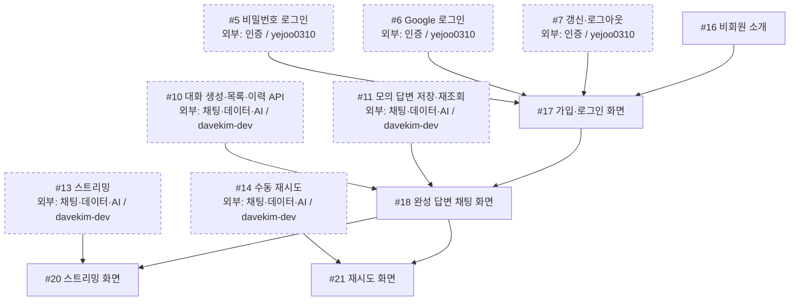
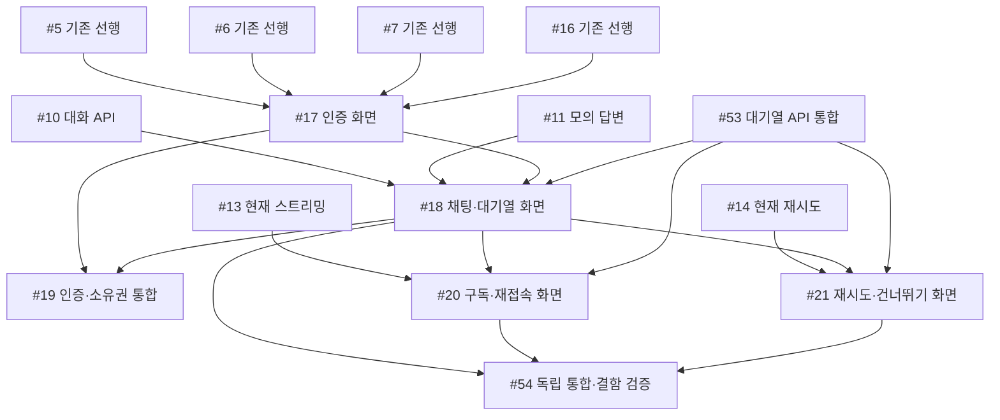

# 화면 공정

## 현재 인계 (2026-10-25)

PR #57·#59·#62로 한도·영속 기반·대기열 API가 병합됐다. PR #50의 인증 화면, PR #58의 기본 HTTP 채팅과 목업, PR #60·#61의 구독·재시도 목업을 구분한다. #18·#20·#21은 닫혔지만 실제 MemberChat 대기열·SSE 통합 완료가 아니다. #53은 PR #62 병합 후 종료됐고 #19·#54가 열려 있다.

- `gittul-123`: 계약을 바탕으로 실제 MemberChat의 접수·작업·구독·재시도·건너뛰기·취소·서버 시각 연결을 준비한다. **후속 이슈 등록 필요**이며 이 문서는 새 작업을 배정하지 않는다.
- `yejoo0310`: #19의 인증·소유권·회원 전환 검사를 먼저 진행한다. #54의 시나리오·결함 주입 준비는 가능하며 최종 통합 완료에는 실제 화면 연결과 두 구현 담당자의 자체검사가 필요하다.
- `davekim-dev`: #53 종료 뒤 현재 열린 배정 이슈는 없다. 실제 연결 지원과 QA에서 확인한 서버 결함 수정은 다음 작업 후보이며 새로 배정된 작업은 아니다.

실제 AI 연결과 배포는 미완료다. 문맥 쌍 순서의 알려진 차이는 [API](../04-reference/api.md#알려진-구현-차이와-인수-확인)를 확인한다. 현재 동작의 단일 기준은 [API 계약](../04-reference/api.md)이다.

기존 S01–S20 그림과 표는 **대기열 도입 전 공정 기록**이다. 문서 끝의 승인된 대기열 목표 표·그림도 당시 계획의 직접 선행 기록으로 보존한다. 이력의 선행 간선을 실제 완료·미완료 목록으로 읽지 않는다. 현재 인계와 실제 이슈·PR 상태를 먼저 확인한다.

담당: **`gittul-123`** · [전체 공정과 직접 선행·후속 표](development-flow.md)

첫 공동 목표는 **로그인 → 모의 완성 답변 → 저장 → 새로고침 뒤 이력 재조회 → #19 연동**이다. 기존 그림은 대기열 도입 전 인계를 기록한다. 목표의 필수 선행은 문서 끝의 목표 그림과 전체 목표 표를 따르며, 점선 상자는 다른 담당자의 작업이다. 이슈 상태와 PR 병합 여부는 GitHub에서 확인한다.

## 작업 흐름

## 내 이슈

| 이슈 | 작업 |
| --- | --- |
| [#16](https://github.com/next-stop-siren/Next-Stop-Siren/issues/16) | 비회원 소개 |
| [#17](https://github.com/next-stop-siren/Next-Stop-Siren/issues/17) | 가입·로그인 화면 |
| [#18](https://github.com/next-stop-siren/Next-Stop-Siren/issues/18) | 완성 답변 채팅 화면 |
| [#20](https://github.com/next-stop-siren/Next-Stop-Siren/issues/20) | 스트리밍 화면 |
| [#21](https://github.com/next-stop-siren/Next-Stop-Siren/issues/21) | 재시도 화면 |

## 인계와 참고 문서

- **#5·#6·#7·#16 → #17:** 기다리는 동안 승인된 API·인증 형식으로 화면 상태, 가짜 응답 예시, 검사 시나리오를 준비할 수 있다. #17 구현 시작·실제 API 연동·완료에는 네 선행 조건을 모두 적용한다.
- **#10·#11·#17 → #18:** 대화 API와 모의 답변 저장·재조회 결과를 받아 완성 답변 화면에 연결한다. #17·#18 결과는 #19 공동 연동에 인계한다.
- **#13·#18 → #20, #14·#18 → #21:** 서버의 스트리밍·재시도 결과와 화면 동작을 함께 확인한다. 목표 규칙은 아래 승인된 대기열 정책을 따른다.

[화면 지침](../03-development/frontend.md) · [API 형식](../04-reference/api.md) · [인증 기준](../04-reference/authentication.md)

## 승인된 대기열 목표 인계

정책 의도와 현재 구현 경계를 구분하는 [회원 채팅 정책](../04-reference/chat-policy.md)을 따른다. 실제 연동 완료의 전체 직접 선행은 [공정진행도](development-flow.md#승인된-대기열-목표-작업의-직접-선행)가 기준이다. 아래 그림은 이 담당 작업에 닿는 동일한 직접 간선만 표시한다. 공유 인터페이스 계획 뒤 mock 준비는 먼저 가능하며 실제 완료에는 선행 결과의 검증·병합이 필요하다.

