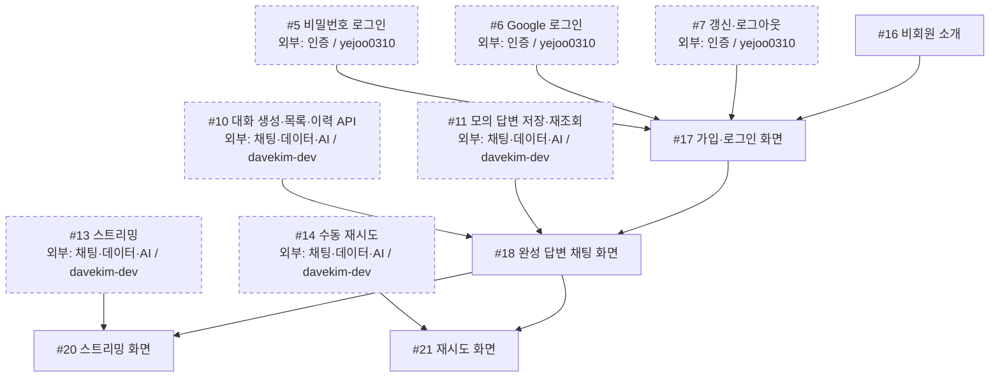
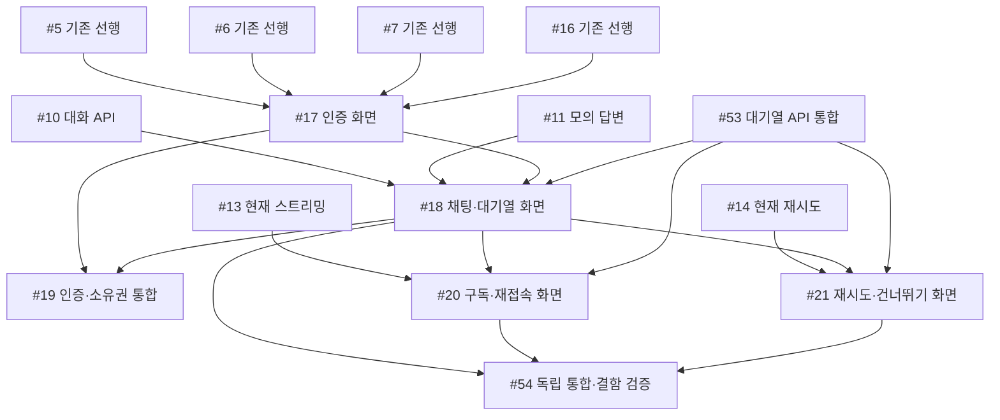

# 화면 공정

## 2차 작업과 현재 인계 (2026-10-25)

[2차 마일스톤](https://github.com/next-stop-siren/Next-Stop-Siren/milestone/2)에 새 구현·운영 작업 12개와 기존 #19·#54 최종검증을 연결했다. 등록 상태는 대기이며 개발을 시작했다는 뜻은 아니다. 기존 S01–S20 번호와 닫힌 목업의 완료 이력은 유지한다.

- `gittul-123`: [#65](https://github.com/next-stop-siren/Next-Stop-Siren/issues/65) 실제 회원 채팅 연결, [#67](https://github.com/next-stop-siren/Next-Stop-Siren/issues/67) 인증 모달, [#69](https://github.com/next-stop-siren/Next-Stop-Siren/issues/69) Google 실패 화면을 맡는다.
- `davekim-dev`: [#66](https://github.com/next-stop-siren/Next-Stop-Siren/issues/66) 문맥 쌍 순서, [#70](https://github.com/next-stop-siren/Next-Stop-Siren/issues/70) 민감 로그 차단을 먼저 준비할 수 있다. [#68](https://github.com/next-stop-siren/Next-Stop-Siren/issues/68) 실제 AI·긴 대화, [#72](https://github.com/next-stop-siren/Next-Stop-Siren/issues/72) 서비스 준비 확인, [#75](https://github.com/next-stop-siren/Next-Stop-Siren/issues/75) 데이터·복구 작업도 맡는다. #70의 전체 추적은 [#65](https://github.com/next-stop-siren/Next-Stop-Siren/issues/65)·[#68](https://github.com/next-stop-siren/Next-Stop-Siren/issues/68) 기능 연결 뒤 완성한다.
- `yejoo0310`: [#69](https://github.com/next-stop-siren/Next-Stop-Siren/issues/69) Google 실패 서버, [#71](https://github.com/next-stop-siren/Next-Stop-Siren/issues/71) 가입 요청·해시 제한, [#74](https://github.com/next-stop-siren/Next-Stop-Siren/issues/74) 프록시 뒤 로그인 제한을 맡는다. 본인 인증 변경은 다른 담당자가 독립 확인한다.
- [#73](https://github.com/next-stop-siren/Next-Stop-Siren/issues/73) EC2 구성과 [#76](https://github.com/next-stop-siren/Next-Stop-Siren/issues/76) 운영 부하·장애·알림의 운영 담당은 미배정이다. [#74](https://github.com/next-stop-siren/Next-Stop-Siren/issues/74)·#75의 운영 협업 역할도 별도 지정해야 한다.

#19·#54는 관련 기능 구현과 담당 자체검사가 끝난 뒤 최종 통합검증을 진행한다. [PR #63](https://github.com/next-stop-siren/Next-Stop-Siren/pull/63)에 일부 결과가 제출돼 있으며 검토된 결과를 해당 범위에서 재사용한다. 실제 화면 격리와 전체 대기열 검증은 남아 있다. 운영·선택 리팩터링 전체를 기능 QA 선행으로 묶지 않는다.

PR #62의 서버 대기열과 PR #64의 Rev 1 문서는 완료된 기반이다. #18·#20·#21 닫힘은 목업 완료이며 실제 화면 연결은 #65에서 진행한다. 실제 AI·배포는 완료되지 않았다. 세부 동작과 고정 commit·Rev 참조는 각 이슈를 따른다.

이 담당의 새 작업: [회원 채팅 화면을 실제 서버와 연결하기](https://github.com/next-stop-siren/Next-Stop-Siren/issues/65), [인증 모달의 키보드 진입과 늦은 응답 처리 정리하기](https://github.com/next-stop-siren/Next-Stop-Siren/issues/67), [Google 로그인 실패를 안전하게 화면으로 돌려보내기](https://github.com/next-stop-siren/Next-Stop-Siren/issues/69).

현재 직접 선행은 [2차 전체 표](development-flow.md#2차-직접-선행)를 따른다. 아래 그림은 기존 작업의 역사적 기록이다.

기존 S01–S20 그림과 표는 **대기열 도입 전 공정 기록**이다. 문서 끝의 승인된 대기열 목표 표·그림도 당시 계획의 직접 선행 기록으로 보존한다. 이력의 선행 간선을 실제 완료·미완료 목록으로 읽지 않는다. 현재 인계와 실제 이슈·PR 상태를 먼저 확인한다.

담당: **`gittul-123`** · [전체 공정과 직접 선행·후속 표](development-flow.md)

첫 공동 목표는 **로그인 → 모의 완성 답변 → 저장 → 새로고침 뒤 이력 재조회 → #19 연동**이다. 기존 그림은 대기열 도입 전 인계를 기록한다. 목표의 필수 선행은 문서 끝의 목표 그림과 전체 목표 표를 따르며, 점선 상자는 다른 담당자의 작업이다. 이슈 상태와 PR 병합 여부는 GitHub에서 확인한다.

## 작업 흐름

## 내 이슈

| 이슈 | 작업 |
| --- | --- |
| [#16](https://github.com/next-stop-siren/Next-Stop-Siren/issues/16) | 비회원 소개 |
| [#17](https://github.com/next-stop-siren/Next-Stop-Siren/issues/17) | 가입·로그인 화면 |
| [#18](https://github.com/next-stop-siren/Next-Stop-Siren/issues/18) | 완성 답변 채팅 화면 |
| [#20](https://github.com/next-stop-siren/Next-Stop-Siren/issues/20) | 스트리밍 화면 |
| [#21](https://github.com/next-stop-siren/Next-Stop-Siren/issues/21) | 재시도 화면 |

## 인계와 참고 문서

- **#5·#6·#7·#16 → #17:** 기다리는 동안 승인된 API·인증 형식으로 화면 상태, 가짜 응답 예시, 검사 시나리오를 준비할 수 있다. #17 구현 시작·실제 API 연동·완료에는 네 선행 조건을 모두 적용한다.
- **#10·#11·#17 → #18:** 대화 API와 모의 답변 저장·재조회 결과를 받아 완성 답변 화면에 연결한다. #17·#18 결과는 #19 공동 연동에 인계한다.
- **#13·#18 → #20, #14·#18 → #21:** 서버의 스트리밍·재시도 결과와 화면 동작을 함께 확인한다. 목표 규칙은 아래 승인된 대기열 정책을 따른다.

[화면 지침](../03-development/frontend.md) · [API 형식](../04-reference/api.md) · [인증 기준](../04-reference/authentication.md)

## 승인된 대기열 목표 인계

정책 의도와 현재 구현 경계를 구분하는 [회원 채팅 정책](../04-reference/chat-policy.md)을 따른다. 실제 연동 완료의 전체 직접 선행은 [공정진행도](development-flow.md#승인된-대기열-목표-작업의-직접-선행)가 기준이다. 아래 그림은 이 담당 작업에 닿는 동일한 직접 간선만 표시한다. 공유 인터페이스 계획 뒤 mock 준비는 먼저 가능하며 실제 완료에는 선행 결과의 검증·병합이 필요하다.

