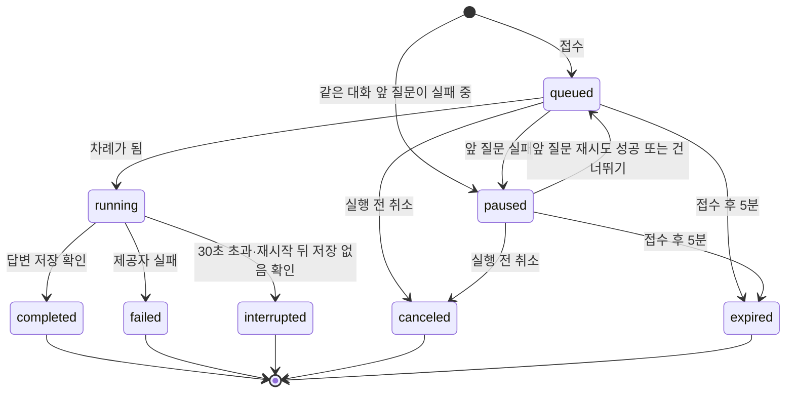

# API 계약

**Rev 2 · 2026-10-27 (KST)** · 코드 기준: [`1566e8b`](https://github.com/next-stop-siren/Next-Stop-Siren/tree/1566e8ba7af681ebc39bcdbab8339b1c4f32a313)

변경 근거: [PR #50](https://github.com/next-stop-siren/Next-Stop-Siren/pull/50) · [PR #56](https://github.com/next-stop-siren/Next-Stop-Siren/pull/56) · [PR #57](https://github.com/next-stop-siren/Next-Stop-Siren/pull/57) · [PR #59](https://github.com/next-stop-siren/Next-Stop-Siren/pull/59) · [PR #62](https://github.com/next-stop-siren/Next-Stop-Siren/pull/62) · [PR #78](https://github.com/next-stop-siren/Next-Stop-Siren/pull/78) · [PR #79](https://github.com/next-stop-siren/Next-Stop-Siren/pull/79). Rev는 이 문서의 계약·상태·범위 변경을 추적한다. 유지 규칙은 [협업 흐름](../03-development/workflow.md#문서-rev와-변경-이력)을 따른다.

이 문서는 **현재 구현 계약**이다. #53부터 질문·재시도는 [회원 채팅 정책](chat-policy.md)의 대기열로 접수하고, 결과는 회원 단위 구독과 작업 조회로 받는다([회원 채팅 대기열](#회원-채팅-대기열-53)). 이전의 동기 생성(`201`), `409 conversation_busy`, `502`·`504`, `/messages/stream`, D4 재시도와 60초 `pending` 회복은 더 이상 쓰지 않는다. 네 메시지 상태와 공개 메시지 형식은 그대로다.

현재 백엔드는 health/ready, 로컬·Google 인증, 쿠키 세션, 본인 대화·메시지 API와 대기열·구독 API를 등록한다. 일반 채팅은 모의 답변을 저장·재조회하며 실제 AI 키를 요구하지 않는다. 가입 접수량·해시 동시 처리 제한은 PR #79에서 구현했다. 회원 화면의 실제 대화·대기열·구독 연결은 #65의 PR #78에 반영됐으며 #19·#54의 독립 통합 검증과 운영 검증은 별도다. #18·#20·#21의 목업 완료 이력은 유지한다. 실행·Swagger 확인은 [온보딩](../01-start/onboarding.md#3-1-swagger로-가입로그인과-모의-대화-확인)을 따른다. 예시 계정·내용·시각은 가짜다.

## 공통 규칙

이 문서의 **요청·응답 형식**은 현재 백엔드 계약과 후속 화면 연결의 기준이다. **테스트 예시(fixture)**는 실제 계정·토큰 없이 만든 가짜 입력과 예상 결과다. **확인된 사용자 정보(principal)**는 서버가 로그인 자격을 검사해 얻은 사용자 ID다.

- 기본 경로는 기존 앱과 같은 `/api`다. JSON 요청에는 `Content-Type: application/json`, 응답에는 `application/json`을 쓴다.
- DB의 `bigint` ID와 이를 참조하는 필드는 JSON **십진 문자열**이다. 화면에서 `Number`로 바꾸지 않는다. 경로와 페이지 기준 ID도 같은 십진 문자열이다.
- 시각은 UTC ISO 8601 문자열(`2026-01-02T03:04:05Z`)이다. 예시에서 `null`은 값이 아직 없거나 해당 상태에 적용되지 않음을 뜻한다.
- 보호 경로는 서버가 검증한 principal의 사용자 ID만 신뢰한다. 요청 본문의 `user_id`는 받지 않는다. 비인증은 401, 없는 자원과 다른 사용자 소유 자원은 똑같이 404다.
- 목록은 `items` 배열과 `next_cursor`(십진 ID 문자열 또는 `null`)를 반환한다. `limit` 기본값은 20, 허용 범위는 1~100이다.
- 대화는 생성 ID 내림차순이고 다음 페이지에 `before_id=next_cursor`를 보낸다. 최근 수정 순서가 아니라 생성 순서를 택해 페이지 이동 중 위치가 바뀌지 않게 한다.
- 메시지는 ID 오름차순이다. 다음 페이지에는 `after_id=next_cursor`를 보낸다. `next_cursor`는 반환한 마지막 항목 ID이며 더 없으면 `null`이다. 새 행이 추가돼도 이미 읽은 행을 중복하지 않는다.
- 커서 페이지는 이미 받은 행의 상태 변경을 알려 주지 않는다. 진행 중인 답변은 구독 이벤트나 작업 조회(`GET /api/chat/jobs/{id}`)로 확인한다.
- 입력 오류 본문은 아래 공통 형식을 쓴다. 내부 예외, DB 정보, 제공자 응답과 비밀값은 본문에 넣지 않는다.

**오류 본문 예시 — `422 Unprocessable Entity`**

```json
{
  "error": {
    "code": "validation_error",
    "message": "요청을 확인해 주세요.",
    "fields": {
      "content": "공백만 입력할 수 없습니다."
    },
    "trace_id": "trace-demo-001"
  }
}
```

`fields`는 필드별 짧은 문자열의 객체이며 필드 오류가 없으면 `{}`다. `trace_id`는 서버가 오류마다 생성하는 추적 문자열이며 클라이언트의 `request_key`와 무관하다.

경로·본문 검증 실패도 이 형식으로 반환한다. 오류 코드는 아래 표의 안정된 분기 값이다. `message`는 화면에 그대로 표시해도 되는 안전한 문구다.

| 상태 | `error.code` | 뜻 |
| --- | --- | --- |
| 401 | `unauthenticated` | 확인된 사용자가 없음; 로그인 실패·만료·폐기 refresh에도 사용 |
| 403 | `csrf_failed` | Origin 또는 CSRF 검증 실패; 재사용의 증거는 아님 |
| 404 | `not_found` | 자원이 없거나 다른 사용자 소유 |
| 409 | `request_key_conflict` | 같은 대화·키에 다른 질문 본문 |
| 409 | `retry_not_allowed` | 수동 재시도를 허용하지 않는 답변 상태(완료 등) 또는 그 질문의 시도가 대기·실행 중 |
| 409 | `retry_not_latest` | 같은 대화의 뒤 질문이 실행을 시작해 수동 재시도 불가 |
| 409 | `queue_full`, `retry_queue_full`, `job_not_cancelable`, `skip_not_allowed` | [대기열 오류](#오류-코드-대기열) |
| 409 | `refresh_race` | 회전된 refresh가 5초 경합 창에 재제출됨 |
| 409 | `local_email_exists` | 로컬 가입 이메일이 이미 존재함 |
| 422 | `validation_error` | 경로·본문·페이지 입력 오류 |
| 429 | `rate_limited` | 로컬 로그인 실패 제한 초과; `Retry-After` 포함 |
| 429 | `registration_rate_limited` | 서버 전체 가입 접수량 초과; `Retry-After`는 가장 오래된 접수가 시간창을 벗어날 때까지 남은 초를 올림한 정수, 최소 1초 |
| 429 | `attempt_too_soon`, `quota_exceeded` | 채팅 접수 간격·한도; `Retry-After` 포함 |
| 503 | `registration_busy` | 가입 처리 자리 부족; `Retry-After`는 설정된 재시도 권고 초, 기본 5초 |
| 503 | `temporarily_unavailable` | 서비스·DB·인증 설정·쿠키 처리 실패 등; 가입 처리 자리 부족과 구분 |

## 인증 요청·응답

정책과 브라우저 절차는 [인증 구현 기준](authentication.md)을 따른다. 인증 경로는 백엔드에 구현되어 있으며, 화면의 세션 복구·제한된 refresh 재시도는 PR #50에 구현됐고 실제 통합 검증은 #19에 남아 있다. 예시 계정·토큰·시각은 가짜 테스트 데이터다.

모든 인증 오류도 위의 `error`/`fields`/`trace_id` 형식을 쓴다. 없는 계정과 틀린 비밀번호는 같은 `401 unauthenticated` 문구다. 로컬 가입·로그인 및 refresh·logout `POST`에는 정확히 허용된 `Origin`(요청을 시작한 화면의 출처)이 필요하다. Google의 top-level 시작·callback `GET`은 state·nonce·PKCE로 검증한다.

**로컬 계정과 현재 사용자**

- `POST /api/auth/register`: JSON `email`, `password`와 `Origin`을 보낸다. 성공은 `201`, 공개 `user`, 메모리용 `access_token`, `expires_in: 900`, 본문의 `csrf_token`, refresh·CSRF `Set-Cookie`다. 실패는 입력 422, 로컬 이메일 중복 409, Origin 403, 접수량 초과 `429 registration_rate_limited`, 처리 자리 부족 `503 registration_busy`, 내부 처리·설정 실패 `503 temporarily_unavailable`이다. 가입 제한 응답은 [가입 제한](#가입-제한)을 따른다.
- `POST /api/auth/login`: 가입과 같은 JSON·`Origin`을 보낸다. 성공은 `200`과 같은 인증 본문·쿠키다. 실패는 동일한 로그인 실패 401, 실패 제한 429, Origin 403이다.
- `GET /api/me`: `Authorization: Bearer <access>`를 보낸다. 성공은 `200`과 공개 `user`, access 검증 실패는 401이다.

**쿠키 세션**

- `GET /api/auth/csrf`: refresh 쿠키를 포함하도록 credentials를 설정한다. 성공은 `200`과 `csrf_token`, refresh 실패는 401이다.
- `POST /api/auth/refresh`: refresh·CSRF 쿠키, `Origin`, `X-CSRF-Token`을 보내며 본문은 없다. 성공은 `200`, 새 access·CSRF 본문과 교체된 쿠키다. 실패는 만료·재사용·계보 한도 401, Origin/CSRF 403, 경합 409, 손상 계보 503이다.
- `POST /api/auth/logout`: refresh·CSRF 쿠키, `Origin`, `X-CSRF-Token`을 보내며 본문은 없다. 성공은 `204`와 두 쿠키 만료다. 실패는 refresh 401, Origin/CSRF 403, 손상 계보 503이다.

**Google 로그인**

- `GET /api/auth/google/start`: top-level 이동으로 시작한다. 선택 `return_to`는 허용 목록의 상대 경로다. 성공은 Google authorization endpoint로 `302`와 트랜잭션 쿠키다. 복귀 경로 오류는 422, 설정·제공자 실패는 503이다.
- `GET /api/auth/google/callback`: 제공자의 `code`, `state`와 트랜잭션 쿠키를 받는다. 성공은 `302`와 refresh·CSRF 쿠키다. `GOOGLE_FRONTEND_ORIGIN`이 있으면 검증된 설정 Origin + 허용 상대 경로로 이동하고 없으면 기존 상대 경로를 유지한다. callback URL은 바뀌지 않는다. 검증 실패는 401, 제공자·설정 실패는 503이며 실패 시 세션은 없다.

로컬 이메일은 앞뒤 공백 제거, 유효한 형식과 최대 320자이며 로컬 계정에서만 `lower(email)`로 중복 판정한다. 비밀번호는 정규화 없이 Unicode 코드 포인트 12~128자와 UTF-8 1024바이트 이하를 모두 만족해야 한다. 두 값 모두 필수 문자열이다. 가입 중복의 `409` 코드는 `local_email_exists`이며 Google과 이메일이 같아도 중복이 아니다. 미인증 이메일은 소유 증명이 아니다.

`POST /api/auth/register` 요청 예시 (`/login`도 같은 입력):

```json
{
  "email": "a@example.test",
  "password": "fixture-only-password"
}
```

가입·로그인 성공 본문 예시 (가입 201, 로그인 200):

```json
{
  "user": {
    "id": "101",
    "email": "a@example.test",
    "created_at": "2026-01-02T03:04:05Z"
  },
  "access_token": "fixture.access.jwt",
  "token_type": "Bearer",
  "expires_in": 900,
  "csrf_token": "fixture-csrf-value"
}
```

`access_token`은 화면 메모리 전용이며 URL·쿠키·브라우저 저장소에 넣지 않는다.

로그인·가입의 refresh 쿠키는 `HttpOnly; SameSite=Lax; Path=/api/auth`, CSRF도 별도의 같은 속성 쿠키다. 둘 다 호스트 전용(`Domain` 없음)이며 운영에서는 `Secure`다. refresh는 최초 로그인부터 절대 14일로 만료된다. refresh 쿠키의 `Expires`는 그 절대 시각, 교체할 때의 `Max-Age`는 남은 초다.

개발 인증은 API 주소 `http://127.0.0.1:8000`을 사용하고 화면 `http://127.0.0.1:5173`과 Swagger UI `http://127.0.0.1:8000`을 `AUTH_ALLOWED_ORIGINS`에 명시한다. `localhost`는 제외하며 Origin에는 `/docs` 경로를 넣지 않는다. 개발용 HTTP `127.0.0.1`에서만 `Secure=false`를 허용하고 CORS credentials는 허용 목록과 정확히 일치하는 Origin에만 허용한다.

### 가입 제한

`POST /api/auth/register`는 Origin·입력 검사 후 해시 시작 전에 서버 전체 접수량과 처리 자리를 함께 확인한다.
승인 기본값은 최근 600초에 10건, 가입 전체 처리 동시 1건이며 대기열은 없다.
설정과 운영 전제는 [인증 기준의 가입 접수와 해시 제한](authentication.md#가입-접수와-해시-제한)을 따른다.

| 거절 조건 | 상태와 `error.code` | `Retry-After`와 안내 |
| --- | --- | --- |
| 접수량 상한 도달 | `429 registration_rate_limited` | 가장 오래된 접수 시각 + 시간창 - 현재 경과 시간을 올림한 초, 최소 1초. 기본 시간창에서 1~600초 |
| 처리 자리 상한 도달 | `503 registration_busy` | `AUTH_REGISTER_BUSY_RETRY_SECONDS`, 기본 5초 |

두 조건에 모두 걸리면 접수량 초과를 우선한다. 거절된 요청은 해시·가입 저장을 시작하지 않고 접수 횟수에도 포함하지 않는다.
접수 후 중복 이메일·해시·저장·쿠키 실패는 접수 횟수에 유지한다. 내부 실패의 `503 temporarily_unavailable`에는 가입 제한의 재시도 헤더를 붙이지 않는다.

두 제한 응답은 공통 오류 본문을 사용하고 `message`에도 헤더와 같은 재시도 초를 표시한다.
`Set-Cookie`·토큰 없이 `Cache-Control: no-store`, `Pragma: no-cache`를 반환한다.
`Retry-After`는 CORS `Access-Control-Expose-Headers`에 포함된다.
화면은 안내 시간 뒤 사용자가 다시 제출하게 하며 자동 재전송하지 않는다. 재시도 시점에 접수량과 처리 자리를 다시 판정한다.

기본 처리 자리 부족 응답 예시:

```http
HTTP/1.1 503 Service Unavailable
Content-Type: application/json
Retry-After: 5
Cache-Control: no-store
Pragma: no-cache

{"error":{"code":"registration_busy","message":"다른 가입 요청을 처리하고 있습니다. 5초 후 다시 시도해 주세요.","fields":{},"trace_id":"trace-demo-register-001"}}
```

### 현재 사용자 — `GET /api/me`

본문과 쿼리는 없다. 검증된 access principal의 공개 사용자만 반환한다. `200 OK`:

```json
{
  "user": {
    "id": "101",
    "email": "a@example.test",
    "created_at": "2026-01-02T03:04:05Z"
  }
}
```

인증 실패는 `401 unauthenticated`다. 채팅 보호 경로도 같은 Bearer access를 요구한다.

### 브라우저 복구·로그아웃

1. 가입·로그인 뒤 `csrf_token`과 access를 메모리에 둔다. 화면 새로고침 뒤에는 refresh 쿠키를 직접 읽지 않고 credentials를 포함해 `GET /api/auth/csrf`를 호출한다. 성공 `200`:

```json
{
  "csrf_token": "fixture-csrf-value"
}
```

2. 받은 값을 `X-CSRF-Token`에 싣고 정확한 `Origin`과 credentials로 `POST /api/auth/refresh`를 보낸다. 성공 `200`에는 새 refresh·CSRF 쿠키도 포함된다:

```json
{
  "access_token": "fixture.new.access.jwt",
  "token_type": "Bearer",
  "expires_in": 900,
  "csrf_token": "fixture-new-csrf-value"
}
```

3. 낡은 refresh와 짝 CSRF가 5초 안에 다시 오면 `409 refresh_race`, `Retry-After: 1`, `Set-Cookie` 없음이다. 새 refresh 쿠키에 낡은 CSRF 헤더가 붙으면 `403 csrf_failed`이며 재사용 폐기로 취급하지 않는다. 화면은 잠시 기다려 `/csrf`를 다시 읽고 refresh를 한 번만 재시도한다. 실패하면 재로그인을 안내한다.
4. `POST /api/auth/logout` 성공은 `204 No Content`와 두 쿠키 만료다. 화면 메모리의 access·CSRF를 지운다. 다른 로그인 계보는 유지되고 이미 발급된 access는 최대 15분 유효할 수 있다.

일반 인증 오류 예시 (`401`; 403·409·429·503도 같은 JSON 형식에 각각 위 코드를 쓴다):

```json
{
  "error": {
    "code": "unauthenticated",
    "message": "로그인이 필요합니다.",
    "fields": {},
    "trace_id": "trace-demo-auth-001"
  }
}
```

손상된 계보는 `503 temporarily_unavailable`로 운영 경보를 남긴다. 4095개 정상 발급 상한에 도달하면 활성 계보를 폐기하고 쿠키 만료·401을 반환한다. 폐기 커밋 실패 시 성공 또는 새 토큰을 반환하지 않는다.

### Google에서 돌아온 화면

`/api/auth/google/start`에서 서버는 요청과 callback을 연결하는 `state`, ID 토큰을 해당 로그인에 묶는 `nonce`, code 교환을 보호하는 PKCE(S256)를 시작한다. callback은 Google의 서명과 필수 claim, 검증된 `(issuer, subject)`를 확인한다. 같은 이메일의 로컬 사용자와 합치지 않는다.

callback 성공은 허용 목록의 상대 경로로만 redirect한다. 외부 URL과 `//`로 시작하는 프로토콜 상대 URL은 `return_to`로 허용하지 않는다. 돌아온 화면이 `/api/auth/csrf` → `/api/auth/refresh`를 호출해 access를 메모리에 넣는다. access는 redirect URL이나 쿠키에 실리지 않는다.

Google 트랜잭션 쿠키는 시작과 callback을 모두 포함하는 `Path=/api/auth`이며 짧은 수명·호스트 전용·`HttpOnly; SameSite=Lax`, 운영 `Secure`다.

## 대화

모든 경로는 인증이 필요하다. `id`, `user_id`, 시각은 클라이언트가 생성하지 않는다.

### 생성 — `POST /api/conversations`

요청 본문은 빈 객체 `{}`다. `201 Created`:

```json
{
  "conversation": {
    "id": "501",
    "created_at": "2026-01-02T03:05:00Z",
    "updated_at": "2026-01-02T03:05:00Z"
  }
}
```

비인증은 위 `401` 형식. 요청 필드가 있거나 JSON 형식이 틀리면 `422 validation_error`다.

### 내 목록 — `GET /api/conversations?limit=20`

선택 쿼리 `limit`, `before_id`를 받는다. `before_id`는 이전 응답의 `next_cursor`다. 소유자의 대화만 반환한다. `200 OK`:

```json
{
  "items": [
    {
      "id": "501",
      "created_at": "2026-01-02T03:05:00Z",
      "updated_at": "2026-01-02T03:07:00Z"
    }
  ],
  "next_cursor": null
}
```

비인증은 `401`, 잘못된 쿼리는 `422`다. 항목이 없으면 `items: []`, `next_cursor: null`이다.

## 메시지

메시지 표시는 같은 대화에서 `id` 오름차순이다. 공개 메시지에는 다음 필드가 **항상** 있다.

| 필드 | JSON 형식 | 규칙 |
| --- | --- | --- |
| `id` | 문자열 | 메시지 ID |
| `role` | `user` 또는 `assistant` | 질문/답변 |
| `status` | `pending`, `completed`, `failed`, `interrupted` | 질문은 `completed`만 |
| `content` | 문자열 또는 `null` | 질문·완료 답변은 비어 있지 않은 문자열; 그 외 답변은 `null` |
| `request_key` | 문자열 또는 `null` | 질문에만 원래 요청 키 |
| `reply_to_message_id` | 문자열 또는 `null` | 답변에만 질문 ID |
| `attempt_no` | 정수 또는 `null` | 답변에만 1 이상; 첫 답변은 1 |
| `error_code` | 문자열 또는 `null` | 실패·중단 답변에만 안전한 이유 코드 |
| `created_at` | UTC 시각 | 항상 있음 |
| `updated_at` | UTC 시각 | 항상 있음 |
| `completed_at` | UTC 시각 또는 `null` | 질문·완료 답변에만 시각 |

답변 행은 작업이 **실행을 시작할 때** 생기므로 대기 중인 질문에는 답변이 없다. 첫 실행의 답변은 `attempt_no: 1`이고, 아래 수동 재시도가 만든 답변은 2부터 1씩 오른다. `retry_key`는 화면이 보관하는 값이므로 공개 메시지 형식에 넣지 않는다. 첫 목표의 저장된 `error_code`는 `provider_failed`(실패) 또는 `outcome_unknown`(시간 초과·중단)이다.

### 이력 — `GET /api/conversations/501/messages?limit=20`

선택 쿼리 `limit`, `after_id`를 받는다. 소유권을 확인한 뒤 메시지를 조회한다. `200 OK`:

```json
{
  "items": [
    {
      "id": "9001",
      "role": "user",
      "status": "completed",
      "content": "안녕?",
      "request_key": "q-demo-1",
      "reply_to_message_id": null,
      "attempt_no": null,
      "error_code": null,
      "created_at": "2026-01-02T03:06:00Z",
      "updated_at": "2026-01-02T03:06:00Z",
      "completed_at": "2026-01-02T03:06:00Z"
    },
    {
      "id": "9002",
      "role": "assistant",
      "status": "completed",
      "content": "안녕하세요.",
      "request_key": null,
      "reply_to_message_id": "9001",
      "attempt_no": 1,
      "error_code": null,
      "created_at": "2026-01-02T03:06:00Z",
      "updated_at": "2026-01-02T03:07:00Z",
      "completed_at": "2026-01-02T03:07:00Z"
    }
  ],
  "next_cursor": null
}
```

비인증 `401`, 없는/타인 대화 `404`, 잘못된 ID·쿼리 `422`다. 다른 사용자 `202`에게 대화 `501`의 존재 여부를 알리지 않는다.

## 회원 채팅 대기열 (#53)

질문과 재시도는 **접수만 하고 `202`로 바로 응답**한다. 생성은 서버의 실행기가 회원별 대기열 순서대로 하고, 진행·완료는 회원 단위 구독 `GET /api/chat/events`로 알린다. HTTP 경로·요청·응답·오류·이벤트의 단일 계약은 이 절이다. [채팅 시나리오](chat-queue-api-draft.md)는 이를 사용하는 가짜 예시와 화면 확인 목록이며, [회원 채팅 정책](chat-policy.md)은 수량·기간·정산·대기·재시도 정책과 구현 경계를 정한다.

| 바뀐 점 | #53 이전 | 지금 |
| --- | --- | --- |
| 질문 전송 | 생성까지 기다려 `201` + 완료 답변 | 접수 `202` + `job`·`limits`, `answer`는 `null` |
| 답변 행 | 접수 때 `pending` 생성 | **실행 시작 때** 생성 |
| 다른 질문 진행 중 | `409 conversation_busy` | 대기열에 넣음; 새 질문 대기 3개면 `409 queue_full` |
| 결과 받기 | 응답 본문 또는 요청별 스트림 | `GET /api/chat/events` 구독, `GET /api/chat/jobs/{id}` 조회 |
| 연결 끊김·로그아웃 | 스트림 생성을 `interrupted`로 중단 | 서버 작업은 계속; 재접속 후 저장 결과 조회 |
| 재시도 대상 | 가장 최근 **생성된** 질문 | 가장 최근 **실행된** 질문 |
| 한도 | 없음 | 일일 400·6시간 100 예약·정산, 접수 간격 10초 |
| `502`·`504`·`/messages/stream` | 사용 | **제거**; 실패는 작업 `state`와 답변 `error_code`로 알림 |

모든 경로는 Bearer access가 필요하다. 비인증 `401`(세션을 열기 전), 없는/타인 대화·질문·작업은 같은 `404`, 입력 오류 `422`, 저장 전 DB 실패 `503`이다. 구독 이벤트에도 본인 작업만 온다.

### 작업 — `job`

질문 1회 또는 재시도 1회의 생성 작업이다. 필드는 `id`, `kind`(`question`·`retry`), `conversation_id`, `question_message_id`, `answer_message_id`(실행 전 `null`), `state`, `position`(`queued`에서만 1부터, 1이 다음 실행), `paused_by_message_id`(`paused`에서만), `error_code`(`failed`·`interrupted`에서만 저장된 답변의 값), `accepted_at`, `started_at`, `finished_at`, `expires_at`(= 접수 + 5분), `allowed_actions`다.

| `state` | 뜻 | 한도 | `allowed_actions` |
| --- | --- | --- | --- |
| `queued` | 순서 대기 | 예약 | `["cancel"]` |
| `paused` | 같은 대화의 앞 질문 실패로 대기 | 예약 | `["cancel"]` |
| `running` | 생성 중 또는 저장 여부 확인 중; 회원당 1개 | 예약 유지 | `[]` |
| `completed` | 답변 저장 확인 | 1회 차감 | `[]` |
| `failed` | 제공자 실패(`provider_failed`) | 예약 해제 | 아래 규칙 |
| `interrupted` | 30초 초과·재시작 등, 저장 없음 확인(`outcome_unknown`) | 예약 해제 | 아래 규칙 |
| `canceled` | 실행 전 취소 | 예약 해제 | `[]` |
| `expired` | 실행 전 5분 경과 | 예약 해제 | `[]` |

`failed`·`interrupted` 작업은 답변이 그 질문의 **최신 시도**이고, 그 질문의 다른 시도가 대기·실행 중이 아니며, 같은 대화의 뒤 질문이 실행을 시작하지 않았을 때 `retry`를 허용한다. 그 대화가 이 작업 때문에 정지 중이면 `skip`도 허용한다(`["retry", "skip"]`). 건너뛴 뒤에는 `["retry"]`, 뒤 질문이 시작되면 `[]`다. 화면은 버튼을 `allowed_actions`로만 정하고, 한도·간격은 `limits`로 비활성화한다.

```json
{
  "id": "7003",
  "kind": "question",
  "conversation_id": "501",
  "question_message_id": "9005",
  "answer_message_id": null,
  "state": "paused",
  "position": null,
  "paused_by_message_id": "9003",
  "error_code": null,
  "accepted_at": "2026-10-20T03:00:40Z",
  "started_at": null,
  "finished_at": null,
  "expires_at": "2026-10-20T03:05:40Z",
  "allowed_actions": ["cancel"]
}
```



### 한도 — `limits`

`daily`·`six_hour`는 `limit`, `used`(정산), `reserved`(미종결), `remaining`(= `limit` − `used` − `reserved`), `resets_at`(KST 00:00 / 00·06·12·18시를 UTC로)이다. `queue`는 `running`, `questions_waiting`(`queued`·`paused` 새 질문), `questions_max: 3`, `retries_waiting`(`queued` 재시도), `retries_max: 1`이다. `next_attempt_at`은 직전 접수 + 10초이며 지금 접수할 수 있으면 `null`이다.

```json
{
  "daily": {
    "limit": 400,
    "used": 12,
    "reserved": 2,
    "remaining": 386,
    "resets_at": "2026-10-20T15:00:00Z"
  },
  "six_hour": {
    "limit": 100,
    "used": 5,
    "reserved": 2,
    "remaining": 93,
    "resets_at": "2026-10-20T09:00:00Z"
  },
  "queue": {
    "running": 1,
    "questions_waiting": 1,
    "questions_max": 3,
    "retries_waiting": 0,
    "retries_max": 1
  },
  "next_attempt_at": "2026-10-20T03:00:50Z"
}
```

수량·초기화·정산·대기·FIFO·재시도 정책은 [회원 채팅 정책](chat-policy.md)을 따른다. 위 객체는 그 정책을 화면에 전달하는 응답 형식이다. 새 질문 대기와 재시도 대기는 별도 필드로 표현하고 실행 중 작업을 포함하지 않는다.

### 질문 접수 — `POST /api/conversations/501/messages`

요청과 입력 기준(`content` 최대 4000자·공백만 거부·원문 보존, `request_key` 1~200자, NUL 거부)은 그대로다. 새 접수는 질문 행, 작업, **일일·6시간 예약**을 한 트랜잭션으로 저장한다. 하나라도 거부되면 아무것도 저장하지 않는다. 같은 대화가 앞 질문 실패로 정지 중이면 새 질문은 `paused`다.

`202 Accepted` 본문은 `{question, answer: null, job, limits}`다. **같은 키·같은 본문 재전송**은 새 예약·호출·차감 없이 그 작업을 같은 형식으로 돌려준다. 한도가 0이거나 10초 전이어도 된다. 작업이 끝났으면 `200`, 아니면 `202`이며, 시작된 작업의 `answer`는 그 시도의 답변이다. #53 이전에 저장된 질문의 재전송은 `job: null`과 최신 답변이다.

판정 순서: 인증 → 입력 → 대화 소유권 → 같은 키 재조회 → `409 request_key_conflict` → `409 queue_full` → `429 attempt_too_soon` → `429 quota_exceeded` → 예약·입장.

### 수동 재시도 — `POST /api/conversations/501/messages/9003/retry`

요청은 `{"retry_key": "..."}`(기준은 `request_key`와 같음)다. 질문이 대화에서 **가장 최근 실행된 질문**이고 최신 답변이 `failed`·`interrupted`일 때 허용한다. 뒤 질문이 `queued`·`paused`로만 있으면 막지 않으며, 재시도는 같은 대화의 뒤 질문보다 먼저 실행되지만 다른 작업을 선점하지 않는다. 같은 `retry_key`는 위 판정보다 먼저 그 작업을 돌려준다(종결 `200`, 아니면 `202`). #53 이전 동기 API가 그 키로 만든 시도는 작업이 없으므로 `job: null`과 그 시도의 답변을 돌려주며, 새로 접수하거나 예약하지 않는다.

| 상황 | 결과 |
| --- | --- |
| 허용 | `202`, `{question, answer: null, job(kind: retry), limits}` |
| 최신 답변이 `completed`이거나 이 질문의 시도가 대기·실행 중 | `409 retry_not_allowed` |
| 같은 대화의 뒤 질문이 실행을 시작함 | `409 retry_not_latest` |
| 재시도 대기 1개가 이미 있음 | `409 retry_queue_full` |
| 10초 간격 전 / 한도 0 | `429 attempt_too_soon` / `429 quota_exceeded` |

재시도가 완료되면 정지가 풀리고 뒤 질문이 `queued`로 돌아간다. 재시도의 실패는 정지를 새 실패 작업으로 옮기고, 취소·만료는 정지를 그대로 둔다.

### 건너뛰기 — `POST /api/conversations/501/messages/9003/skip`

본문은 `{}`다. 정지를 일으킨 실패 질문을 그대로 두고 정지된 뒤 질문을 다시 대기열에 넣는다. 한도를 쓰지 않는다. `200`, `{skipped_message_id, resumed_jobs, limits}`다. 그 질문이 정지를 일으킨 질문이 아니거나, 이미 건너뛰었거나, 그 질문의 재시도가 대기·실행 중이면 `409 skip_not_allowed`다(대기 중인 재시도는 먼저 취소한다). 질문이 아닌 ID는 `404`다.

### 내 작업 조회 — `GET /api/chat/jobs`, `GET /api/chat/jobs/7004`

- 쿼리 없음: 종결 전(`queued`, `paused`, `running`) 작업 전체, ID 오름차순.
- `conversation_id=501`: 그 대화의 작업 전체(종결 포함), ID 내림차순, `limit`·`before_id` 페이지.

본문은 `{items: [job...], next_cursor, limits, server_time}`이다. `server_time`은 응답을 만든 DB 시각이며 이어서 여는 구독의 `since`로 쓴다. 작업 하나 조회는 `{job, question, answer}`이며, 끝난 작업의 `answer`는 저장된 최종 답변이다.

### 실행 전 취소 — `POST /api/chat/jobs/7003/cancel`

본문은 `{}`다. `queued`·`paused`만 취소하고 예약을 해제한다. `200`, `{job, limits}`다. 이미 `canceled`면 같은 결과를 `200`으로 돌려준다. `running`과 다른 종결 상태는 `409 job_not_cancelable`이다. 실행 시작·만료와 겹치면 먼저 반영된 하나만 결과가 된다. 실행 중 취소는 없다.

### 한도 조회 — `GET /api/chat/limits`

`200`과 `limits` 객체만 돌려준다.

### 구독 — `GET /api/chat/events?since=2026-10-20T03:00:52Z`

회원 단위 SSE(`text/event-stream`, `Cache-Control: no-cache`, `X-Accel-Buffering: no`)다. `Authorization` 헤더가 필요하므로 화면은 `fetch` 스트림으로 읽는다. `since`는 생략할 수 있다. 제공한 값에 시간대가 없거나 ISO 시각이 아니면 `422`다.

| 이벤트 | 보내는 시점 | `data` |
| --- | --- | --- |
| `snapshot` | 연결 직후 1회, 다른 이벤트보다 먼저 | `{items: [{job, question, answer}...], limits, server_time}` |
| `job` | 작업 상태·순번·`allowed_actions`가 바뀐 변경이 **커밋된 뒤** | `{job, question, answer}` |
| `delta` | 실행 중 답변 조각 | `{job_id, text}` |
| `limits` | 예약·정산·예약 해제 뒤, 한도 기간이 초기화된 뒤 | `limits` |

- `snapshot.items`: 종결 전 작업 전체. `since`가 있으면 그 시각(서버가 30초 여유를 둠) 이후 끝난 작업과, 같은 대화의 변경으로 버튼이 바뀌었을 수 있는 실패 작업도 넣는다. 이 실패 작업은 `since` 시점에 그 대화에서 마지막으로 실행된 질문과 그 뒤 질문들의 것이라서, 끊긴 동안 질문이 몇 개 실행됐든 빠지지 않는다. 같은 작업이 겹쳐 오면 `job.id`로 덮어쓴다.
- 한 변경이 다른 작업의 버튼·순번을 바꾸면 그 작업들의 `job` 이벤트도 보낸다. 한 회원의 이벤트는 읽은 순서대로 도착한다.
- `delta`는 저장하지 않는 임시 출력이다. `completed` `job` 이벤트의 `answer.content`로 교체하고 `failed`·`interrupted`면 지운다. **놓친 `delta`는 다시 보내지 않는다.**
- 15초마다 `: ping` 주석 줄을 보낸다. 너무 밀린 연결은 서버가 닫으며, 화면은 마지막 `server_time`을 `since`로 다시 연결한다.
- 저장은 끝났지만 그 결과를 알리려고 다시 읽다가 실패하면, 서버는 그 회원의 연결을 모두 닫는다. 화면은 같은 방식으로 다시 연결해 `snapshot`으로 저장된 답변을 받는다.
- **연결을 연 access 토큰이 만료되면 서버가 스트림을 끝낸다.** 만료 뒤의 이벤트는 그 연결로 가지 않는다. 화면은 토큰을 갱신하고 마지막 `server_time`을 `since`로 다시 연결한다. 진행 중인 답변 생성은 그대로 계속된다.
- **연결 끊김·탭 닫기·로그아웃은 작업을 취소하지 않는다.** 로그아웃은 기존 access·refresh 규칙을 바꾸지 않는다. 화면은 로그아웃 때 대화·임시 출력·구독을 지운다.
- 구독은 이 서버 프로세스 안에서만 실시간으로 전달된다. 여러 프로세스로 배포하면 다른 프로세스의 변경은 재연결 `snapshot`으로 받는다.

### 서버 보장

| 보장 | 동작 |
| --- | --- |
| 원자적 입장 | 질문·작업·두 기간 예약을 한 트랜잭션으로 저장. 회원 행 → 대화 → 한도 행 순으로 잠가 동시 탭·기기에서도 대기 3개·재시도 1개·10초 간격을 넘지 않는다. |
| 실행 시 문맥 | 실행 시작 때 이전 완료 질문·답변만 읽고 현재 질문을 한 번 붙인다. 실패·중단·진행·`delta`는 제외한다. **쌍 순서는 아래 알려진 차이를 확인한다.** |
| 저장 뒤 완료 알림 | 답변 저장과 정산이 커밋된 뒤에만 `completed` 이벤트를 보낸다. 커밋이 실패하면 알리지 않고 작업은 `running`으로 남아 복구가 종결한다. |
| 한 번만 정산 | 작업마다 차감 또는 예약 해제는 정확히 한 번이다. 결과 불명 동안 예약을 유지한다. 초기화를 넘긴 예약 해제는 새 기간 잔량을 늘리지 않는다. |
| 자동 재시도 없음 | 실패·중단 뒤나 재시작 복구에서 제공자를 다시 부르지 않는다. 기한 + 15초가 지난 `running`은 저장된 완료 답변이 있으면 완료, 아니면 `interrupted`로 종결한다. |
| 늦은 결과 무시 | 결과는 시작 때 발급한 실행 토큰이 일치하는 `running` 작업에만 저장한다. 종결 상태·새 시도·완료 답변은 덮어쓰지 않는다. |
| 재시작 | 서버가 다시 뜨면 실행기가 만료 전 대기 작업을 이어서 실행한다. #53 이전 동기 API가 남긴 작업 없는 `pending` 답변은 그 대화의 다음 실행 시작 때 `interrupted`로 닫는다. |

### 오류 코드 (대기열)

| 상태 | `error.code` | 뜻 |
| --- | --- | --- |
| 409 | `queue_full` | 새 질문 대기 3개 |
| 409 | `retry_queue_full` | 재시도 대기 1개 |
| 409 | `job_not_cancelable` | 실행 중이거나 이미 끝난 작업 |
| 409 | `skip_not_allowed` | 건너뛸 수 있는 실패 질문이 아니거나 그 재시도가 대기·실행 중 |
| 409 | `retry_not_latest` | 같은 대화의 뒤 질문이 이미 실행을 시작함 |
| 429 | `attempt_too_soon` | 직전 접수 후 10초 전; `Retry-After`는 `next_attempt_at`까지 남은 초 |
| 429 | `quota_exceeded` | 일일 또는 6시간 잔량 0; `Retry-After`는 잔량 0인 기간이 모두 초기화될 때까지의 초 |

`Retry-After`는 1 이상의 정수 초(올림)이며 CORS `Access-Control-Expose-Headers`에 포함된다.

## 알려진 구현 차이와 인수 확인

완료 쌍을 `Q1 → A1 → Q2 → A2`로 구성하는 것이 정책이다. 현재 `app.repositories.chat_jobs.context_before()`는 메시지 ID로 정렬한다. Q1·Q2가 답변보다 먼저 접수되면 `Q1 → Q2 → A1 → A2`가 될 수 있어 **정책과 구현에 차이가 있다**. 완료 쌍 필터링의 존재를 순서 보장 완료로 표시하지 않는다. 이 문서는 결함을 수정하지 않는다.

아래는 구현 변경과 실제 화면 통합 때 유지할 인수 목록이다. 체크박스는 이 문서 작업에서 테스트를 재실행했다는 표시가 아니다.

- [ ] 두 사용자에게 대화·메시지가 섞이지 않고, 비인증 401과 타인 대화 404가 구분된다.
- [ ] `bigint` ID를 문자열로 유지하고 목록 페이지에 누락·중복이 없다.
- [ ] 질문 4000자 경계와 초과, 공백만인 질문, 키 1~200자 경계와 초과, 두 필드의 NUL 거부를 확인한다. 원문은 보존하고 같은 키·다른 본문은 409, 같은 키·같은 본문은 기존 결과다.
- [ ] 성공 답변은 저장 후 재조회되며 실패·중단 답변은 완료나 다음 문맥으로 취급하지 않는다.
- [ ] 제공자 호출 중 DB 트랜잭션·잠금을 열어 두지 않고 30초 기한을 실행기가 강제한다. 기한 + 15초가 지난 `running`은 복구가 종결하고 늦은 결과가 덮어쓰지 못한다.
- [ ] 접수와 두 기간 예약이 함께 저장되거나 함께 거부되고, 같은 키는 한도 0·10초 전에도 기존 작업을 돌려준다.
- [ ] 실패는 같은 대화의 뒤 질문만 정지하고, 재시도 성공이나 건너뛰기만 재개한다. 뒤 질문이 시작되면 앞 질문 재시도는 `409 retry_not_latest`다.
- [ ] `completed` 이벤트는 저장·정산 커밋 뒤에만 오고, 작업마다 차감 또는 예약 해제는 한 번이다. 연결 끊김·로그아웃은 작업을 멈추지 않고 재연결 `snapshot`이 저장 결과를 준다.

백엔드 라우트·ORM 모델·인증/채팅 검사와 PR #78의 회원 화면 연결이 있으며, 가입 제한은 PR #79에서 구현했다. 이것이 #19·#54의 독립 통합 검증이나 운영 준비 완료를 뜻하지는 않는다. 실제 GPT 어댑터·격리 시험 경계는 [S11 기준](ai.md)을 따른다. 대기열 실행기는 제공자의 `stream`을 쓰는데 실제 Codyssey 어댑터에는 아직 `complete`만 있으므로, 공개 서비스는 모의 제공자를 유지하고 실제 AI 연결은 별도 작업에서 `stream`을 더해 검증한다. 기존 #20·#21의 목업 완료 이력은 유지한다.

## 변경 이력

| Rev | 일자 (KST) | 변경과 근거 |
| --- | --- | --- |
| 1 | 2026-10-25 | PR #62 이후 단일 API 계약, 구독 복구, 당시 실제 화면 미연동과 문맥 순서 차이를 정리했다. 당시 기준 코드는 `2d50da5`다. |
| 2 | 2026-10-27 | PR #79의 가입 429·503 코드와 재시도 시간·접수 횟수·거절 응답을 반영했다. PR #78 이후 회원 화면을 미연동으로 읽게 하는 설명도 수정했다. 코드 기준 `1566e8b`, 정책 근거는 #71의 승인 댓글이다. |
