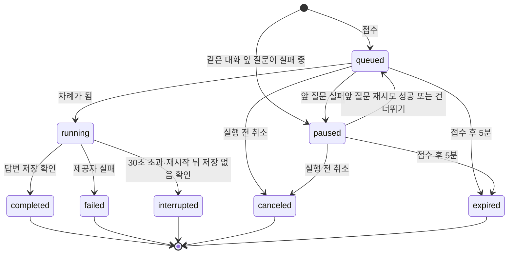

# 회원 채팅 대기열 API 제안 초안

> **구현 전 계약 제안이다.** PR #56 검토에서 정한 사항을 반영했다. 이 문서는 현재 구현을 바꾸지 않으며 기능 구현은 #15·#52·#53에서 한다. 현재 계약은 [API 기준](api.md), 승인된 목표 동작은 [회원 채팅 정책](chat-policy.md)이 기준이다. #53 구현 뒤 확정 내용을 [API 기준](api.md)에 반영한다.

화면 담당이 백엔드 완료 전에 mock을 만들 수 있도록 요청·응답 예시, 작업 상태, 상태별 화면 동작을 정리한다. 예시 계정·ID·시각·답변은 가짜다. 답변 문구는 화면 배치용이며 법률 정확성 검증 대상이 아니다.

## 시나리오: 교통법 검색 챗봇

회원은 2026년 기준 대한민국 교통 관련 법령(도로교통법, 교통사고처리 특례법 등)을 자연어로 질문하고, 챗봇은 관련 조문과 요지를 답한다. 아래 예시는 회원 `101`의 두 대화를 쓴다.

| 대화 | 질문 ID | 질문 | 예시 결과 |
| --- | --- | --- | --- |
| `501` | `9001` | 2026년 기준 어린이보호구역 제한속도는 얼마야? | 완료 |
| `501` | `9003` | 음주운전 단속 기준 혈중알코올농도는? | 1차 실패 → 재시도 완료 |
| `501` | `9005` | 전동킥보드 헬멧 미착용 범칙금은? | 앞 질문 실패로 정지 → 재개 후 완료 |
| `502` | `9006` | 주정차 위반 과태료는 어떻게 돼? | 대화 `501`의 정지와 무관하게 실행 |

## 지금 코드와 달라지는 점

| 항목 | 지금 코드 (`main`) | #53 이후 목표 |
| --- | --- | --- |
| 질문 전송 | 생성까지 기다려 `201` + 완료 답변 | 접수만 하고 `202` + `job` |
| 답변 행 생성 | 접수 때 `pending` 답변 생성 | **실행 시작 때** 생성; 대기 중 `answer`는 `null` |
| 다른 질문 진행 중 | `409 conversation_busy` | 대기열에 넣음; 대기 자리가 없으면 `409 queue_full` |
| 스트림 연결 끊김 | 생성을 `interrupted`로 중단 | 서버 작업은 계속; 재접속 후 저장 결과 조회 |
| 결과 받기 | 요청 응답 또는 요청별 스트림 | 회원 단위 구독 `GET /api/chat/events` |
| 한도 | 없음 | 일일 400·6시간 100 예약·정산, 10초 간격 |
| 재시도 대상 | 가장 최근 **생성된** 질문 | 가장 최근 **실행된** 질문 |

`MessageOut`(메시지 공개 형식)과 `ErrorBody`(오류 공통 형식)는 그대로 쓴다. `{question, answer}` 응답에는 `job`·`limits`를 더하고 `answer`를 `null` 허용으로 바꾼다.

## 공통 객체

### 작업 — `job`

질문 1회 또는 재시도 1회의 생성 작업이다. 메시지 상태와 별개다.

```json
{
  "id": "7003",
  "kind": "question",
  "conversation_id": "501",
  "question_message_id": "9005",
  "answer_message_id": null,
  "state": "paused",
  "position": null,
  "paused_by_message_id": "9003",
  "error_code": null,
  "accepted_at": "2026-10-20T03:00:40Z",
  "started_at": null,
  "finished_at": null,
  "expires_at": "2026-10-20T03:05:40Z",
  "allowed_actions": ["cancel"]
}
```

| 필드 | JSON 형식 | 규칙 |
| --- | --- | --- |
| `id` | 문자열 | 작업 ID |
| `kind` | `question` 또는 `retry` | 새 질문 / 수동 재시도 |
| `conversation_id`, `question_message_id` | 문자열 | 대상 대화와 질문 |
| `answer_message_id` | 문자열 또는 `null` | 실행 시작 뒤 생긴 답변 ID; 실행 전에는 `null` |
| `state` | 아래 [작업 상태](#작업-상태) | |
| `position` | 정수 또는 `null` | `queued`에서만 1부터; 1이 다음 실행 |
| `paused_by_message_id` | 문자열 또는 `null` | `paused`에서만, 정지를 일으킨 실패 질문 ID |
| `error_code` | 문자열 또는 `null` | `failed`·`interrupted`에서만 저장된 답변의 `error_code` |
| `accepted_at` | UTC 시각 | 접수 시각 |
| `started_at`, `finished_at` | UTC 시각 또는 `null` | 실행 시작 / 종결 시각 |
| `expires_at` | UTC 시각 | `accepted_at` + 5분; 실행 전이면 이 시각에 `expired` |
| `allowed_actions` | 문자열 배열 | 지금 서버가 허용하는 동작: `cancel`, `retry`, `skip` |

화면은 버튼 표시 여부를 `allowed_actions`로만 정한다. 한도·간격 때문에 지금 누를 수 없는 경우는 `limits`로 비활성화한다.

### 한도 — `limits`

```json
{
  "daily": {
    "limit": 400,
    "used": 12,
    "reserved": 2,
    "remaining": 386,
    "resets_at": "2026-10-20T15:00:00Z"
  },
  "six_hour": {
    "limit": 100,
    "used": 5,
    "reserved": 2,
    "remaining": 93,
    "resets_at": "2026-10-20T09:00:00Z"
  },
  "queue": {
    "running": 1,
    "questions_waiting": 1,
    "questions_max": 3,
    "retries_waiting": 0,
    "retries_max": 1
  },
  "next_attempt_at": "2026-10-20T03:00:50Z"
}
```

- `remaining` = `limit` − `used`(완료 차감) − `reserved`(접수했지만 아직 종결되지 않음)이다. 답변 저장 여부를 확인 중인 작업도 `reserved`에 남는다.
- `resets_at`은 KST 기준 초기화 시각을 UTC로 쓴다. 일일은 KST 00:00, 6시간은 KST 00·06·12·18시다.
- 새 질문 대기와 재시도 대기는 따로 센다. `questions_waiting`은 `queued`·`paused` 새 질문 수, `retries_waiting`은 `queued` 재시도 수이며 둘 다 실행 중 작업은 세지 않는다.
- `next_attempt_at`은 직전 새 질문 또는 재시도의 **접수 시각 + 10초**다. 지금 접수할 수 있으면 `null`이다. 응답을 받지 못해 같은 키로 다시 보내는 요청은 이 시각을 기다리지 않는다.

## 작업 상태



| `state` | 뜻 | 종결 | 한도 | 답변 메시지 |
| --- | --- | --- | --- | --- |
| `queued` | 접수됨, 순서 대기 | 아니요 | 예약 | 없음 |
| `paused` | 같은 대화의 앞 질문이 실패해 대기 | 아니요 | 예약 | 없음 |
| `running` | 생성 중 또는 답변 저장 여부 확인 중; 회원당 최대 1개 | 아니요 | 예약 유지 | `pending` |
| `completed` | 답변 저장 확인 | 예 | 1회 차감 | `completed` |
| `failed` | 제공자 실패, 저장 없음 확인 | 예 | 환불 | `failed` / `provider_failed` |
| `interrupted` | 시간 초과·재시작 등으로 끝나지 못함, 저장 없음 확인 | 예 | 환불 | `interrupted` / `outcome_unknown` |
| `canceled` | 실행 전 사용자 취소 | 예 | 환불 | 없음 |
| `expired` | 실행 전 5분 경과 | 예 | 환불 | 없음 |

**결과를 확인하기 전에는 환불하지 않는다.** 제공자 응답이나 저장 커밋의 결과를 아직 모르면 작업은 `running`으로 남고 예약도 유지된다. 그동안 그 1회는 `remaining`에 돌아오지 않는다. 서버가 완료 답변이 저장됐음을 확인하면 `completed`로 1회 차감하고, 저장되지 않았음을 확인하면 `failed` 또는 `interrupted`로 종결하면서 환불한다.

`failed`·`interrupted`는 같은 대화의 뒤 질문을 `paused`로 만든다. 재시도의 실패·취소·만료는 정지를 풀지 않는다.

## 상태별 화면 동작

| 상태 | 표시 | 버튼 (`allowed_actions`) |
| --- | --- | --- |
| `queued` | "대기 중 · N번째", 만료까지 남은 시간 | 취소 (`cancel`) |
| `paused` | "앞 질문 실패로 대기 중", 만료까지 남은 시간 | 취소 (`cancel`) |
| `running` | "답변 생성 중", 받은 `delta`를 임시 출력으로 표시 | 없음 (실행 중 취소 없음) |
| `completed` | 저장된 답변 `content` | 없음 |
| `failed` / `interrupted` | "답변을 만들지 못했습니다" | 아래 [재시도·건너뛰기 버튼](#재시도건너뛰기-버튼) 규칙 |
| `canceled` | "취소한 질문" (질문 원문 유지) | 없음; 같은 내용은 새 질문으로 다시 보냄 |
| `expired` | "대기 시간이 지나 취소됨" | 없음; 같은 내용은 새 질문으로 다시 보냄 |

### 재시도·건너뛰기 버튼

버튼은 한 질문의 **가장 최근 실패 시도**(답변이 `failed`·`interrupted`로 저장된 마지막 작업) 하나에만 나온다. 그보다 이전 실패 시도에는 버튼이 없다. 서버는 아래 표대로 그 작업의 `allowed_actions`를 바꾼다.

| 상황 | 가장 최근 실패 시도의 `allowed_actions` | 화면 |
| --- | --- | --- |
| 실패 직후, 대화에서 가장 최근 실행된 질문 | `["retry", "skip"]` | 재시도·건너뛰기 |
| 이 질문의 재시도가 `queued` | `[]` | 버튼 숨김; "재시도 대기 중 · 취소하면 건너뛸 수 있습니다". 취소 버튼은 재시도 작업에 있음 |
| 이 질문의 재시도가 `running` | `[]` | 버튼 숨김; "재시도 중" |
| 재시도 `completed` | `[]` | 버튼 없음; 이전 실패 시도에도 버튼 없음 |
| 재시도 `canceled`·`expired` | `["retry", "skip"]` | 버튼 다시 표시 |
| 재시도 `failed`·`interrupted` | 새 재시도 작업이 가장 최근 실패 시도가 되어 `["retry", "skip"]`, 이전 작업은 `[]` | 새 실패 답변에 버튼 표시 |
| 건너뛴 뒤, 같은 대화의 뒤 질문이 아직 실행 전 | `["retry"]` | 재시도만 |
| 같은 대화의 뒤 질문이 실행을 시작함 | `[]` | 버튼 없음 |

`allowed_actions`가 바뀌면 서버는 그 작업의 `job` 이벤트를 보낸다. 재시도 작업의 상태 변화로 원래 실패 작업의 버튼이 바뀌면 두 작업의 `job` 이벤트를 모두 보낸다. 화면은 새로고침 없이 이 이벤트로 버튼을 갱신한다. 연결이 끊겨 이 이벤트를 놓친 화면은 재연결 때 `snapshot`으로 바뀐 버튼을 받는다([구독](#구독--get-apichateventssince2026-10-20t030052z) 참고).

### 요청 제한에 따른 비활성화

`allowed_actions`에 있는 버튼도 다음 조건에서는 비활성화하고 이유를 표시한다. 새 질문 대기와 재시도 대기는 따로 센다. 새 질문 대기가 가득 차도 재시도 버튼은 막지 않고, 재시도 대기가 가득 차도 입력창은 막지 않는다.

| 조건 | 비활성화 대상 | 표시 예시 |
| --- | --- | --- |
| `daily.remaining` 또는 `six_hour.remaining`이 0 | 입력창, 재시도 버튼 | "질문 한도를 모두 썼습니다. 다음 초기화: 오후 6:00" |
| `questions_waiting` = `questions_max` | 입력창만 | "대기 중인 질문이 3개입니다. 답변 뒤에 보내 주세요." |
| `retries_waiting` = `retries_max` | 재시도 버튼만 | "다른 재시도가 대기 중입니다." |
| `next_attempt_at`이 미래 | 입력창, 재시도 버튼 | "N초 뒤에 보낼 수 있습니다" (남은 초) |

로그아웃·탭 닫기·연결 끊김은 서버 작업을 취소하지 않는다. 로그아웃 때 화면은 대화·임시 출력·구독을 지운다.

## 서버 보장 사항

화면 계약에 드러나지 않지만 서버가 지키는 규칙이다. 화면은 이 규칙을 따로 확인하거나 보완하지 않는다. #53 완료 조건과 검사의 기준이다.

| 보장 | 서버 동작 | 화면이 기대할 수 있는 것 |
| --- | --- | --- |
| 실행 시 문맥 | AI 문맥은 접수 때가 아니라 **실행 시작 때** 읽는다. 그 질문 이전의 `completed` 질문+답변 쌍을 순서대로 넣고 현재 질문을 한 번 붙인다. 실패·중단·진행 중 답변과 `delta` 임시 출력은 넣지 않는다. | 대기 중에 앞 질문이 완료되면 뒤 질문 답변이 그 내용을 반영한다. 실패한 답변은 이력에만 남는다. |
| 저장 뒤 완료 알림 | 답변 저장과 한도 정산이 커밋된 **뒤에만** `completed` `job` 이벤트를 보낸다. 저장이 실패하면 완료를 알리지 않는다. | `completed`를 받은 답변은 새로고침 뒤에도 같은 내용으로 조회된다. |
| 한 번만 정산 | 작업마다 차감 또는 환불은 정확히 한 번이다. 저장 여부를 확인하기 전에는 예약을 유지하고, 확인한 뒤 차감 또는 환불한다. 실행 시작·취소·만료가 겹쳐도 하나의 결과만 반영한다. 같은 키 재조회는 예약·차감하지 않는다. | `limits` 값을 그대로 표시한다. 화면에서 잔량을 계산해 맞추지 않는다. |
| 자동 재시도 없음 | 실패·중단 뒤 제공자를 다시 부르지 않는다. 재시작 복구에서 결과 불명 호출도 다시 보내지 않고 `interrupted`로 종결한다. | 새 답변은 사용자가 재시도를 눌렀을 때만 생긴다. |
| 늦은 결과 무시 | 이미 종결된 작업에 늦게 도착한 제공자 결과는 상태·답변·새 시도를 덮어쓰지 않는다. | 종결 상태(`completed`, `failed`, `interrupted`, `canceled`, `expired`)는 다시 바뀌지 않는다. |
| 회원·소유권 | 모든 경로와 구독은 검증된 회원 본인의 대화·작업만 다룬다. 타인 자원은 없는 자원과 같은 `404`다. | 구독 이벤트에는 본인 작업만 온다. |

## API

모든 경로에는 인증(`Authorization: Bearer <access>`)이 필요하다. 비인증 `401`, 없는/타인 자원 `404`, 입력 오류 `422`, 저장 전 DB 실패 `503`은 [공통 규칙](api.md#공통-규칙)과 같다.

### 질문 접수 — `POST /api/conversations/501/messages`

요청은 현재와 같다. 입력 기준도 현재와 같다.

```json
{
  "content": "전동킥보드 헬멧 미착용 범칙금은?",
  "request_key": "6f1c2a4e-0b7d-4c55-9a51-3a2f1e0d9c11"
}
```

새 접수는 **한도 예약과 대기열 입장을 함께** 처리하고 `202 Accepted`를 돌려준다. 생성은 기다리지 않는다. 앞 질문 `9003`이 실패한 상태라 이 질문은 `paused`다.

```json
{
  "question": {
    "id": "9005",
    "role": "user",
    "status": "completed",
    "content": "전동킥보드 헬멧 미착용 범칙금은?",
    "request_key": "6f1c2a4e-0b7d-4c55-9a51-3a2f1e0d9c11",
    "reply_to_message_id": null,
    "attempt_no": null,
    "error_code": null,
    "created_at": "2026-10-20T03:00:40Z",
    "updated_at": "2026-10-20T03:00:40Z",
    "completed_at": "2026-10-20T03:00:40Z"
  },
  "answer": null,
  "job": {
    "id": "7003",
    "kind": "question",
    "conversation_id": "501",
    "question_message_id": "9005",
    "answer_message_id": null,
    "state": "paused",
    "position": null,
    "paused_by_message_id": "9003",
    "error_code": null,
    "accepted_at": "2026-10-20T03:00:40Z",
    "started_at": null,
    "finished_at": null,
    "expires_at": "2026-10-20T03:05:40Z",
    "allowed_actions": ["cancel"]
  },
  "limits": {
    "daily": { "limit": 400, "used": 13, "reserved": 1, "remaining": 386, "resets_at": "2026-10-20T15:00:00Z" },
    "six_hour": { "limit": 100, "used": 6, "reserved": 1, "remaining": 93, "resets_at": "2026-10-20T09:00:00Z" },
    "queue": { "running": 0, "questions_waiting": 1, "questions_max": 3, "retries_waiting": 0, "retries_max": 1 },
    "next_attempt_at": "2026-10-20T03:00:50Z"
  }
}
```

**같은 키·같은 본문 재전송**은 새 예약·호출·차감 없이 현재 상태를 같은 형식으로 돌려준다. 한도가 0이거나 10초 간격 전이어도 된다. 종결이면 `200`, 아직 종결 전이면 `202`다. 완료된 경우 `answer`는 완료 답변이다.

```json
{
  "question": { "id": "9001", "content": "2026년 기준 어린이보호구역 제한속도는 얼마야?", "...": "..." },
  "answer": {
    "id": "9002",
    "role": "assistant",
    "status": "completed",
    "content": "도로교통법 제12조에 따라 시장 등은 어린이보호구역에서 자동차 등의 통행속도를 시속 30km 이내로 제한할 수 있습니다. (예시 답변)",
    "request_key": null,
    "reply_to_message_id": "9001",
    "attempt_no": 1,
    "error_code": null,
    "created_at": "2026-10-20T03:00:01Z",
    "updated_at": "2026-10-20T03:00:04Z",
    "completed_at": "2026-10-20T03:00:04Z"
  },
  "job": { "id": "7001", "state": "completed", "allowed_actions": [], "...": "..." },
  "limits": { "...": "..." }
}
```

판정 순서(제안): 인증 → 입력 → 대화 소유권 → 같은 키 재조회 → `request_key_conflict` → `queue_full` → `attempt_too_soon` → `quota_exceeded` → 예약·입장.

### 내 작업 조회 — `GET /api/chat/jobs`

새로고침·재접속 복구와 여러 탭이 같은 상태를 보기 위한 경로다.

- 쿼리 없음: 회원의 종결 전 작업(`queued`, `paused`, `running`) 전체.
- `conversation_id=501`: 그 대화의 작업 전체(종결 포함), `limit`·`before_id` 페이지. 이력 화면에서 취소·만료된 질문을 표시하는 데 쓴다.

`200 OK`:

```json
{
  "items": [
    {
      "id": "7004",
      "kind": "question",
      "conversation_id": "502",
      "question_message_id": "9006",
      "answer_message_id": "9007",
      "state": "running",
      "position": null,
      "paused_by_message_id": null,
      "error_code": null,
      "accepted_at": "2026-10-20T03:00:50Z",
      "started_at": "2026-10-20T03:00:50Z",
      "finished_at": null,
      "expires_at": "2026-10-20T03:05:50Z",
      "allowed_actions": []
    },
    {
      "id": "7003",
      "kind": "question",
      "conversation_id": "501",
      "question_message_id": "9005",
      "state": "paused",
      "paused_by_message_id": "9003",
      "allowed_actions": ["cancel"],
      "...": "..."
    }
  ],
  "next_cursor": null,
  "limits": { "...": "..." },
  "server_time": "2026-10-20T03:00:52Z"
}
```

`server_time`은 이 응답을 만든 서버 시각이다. 이어서 여는 구독의 `since`로 쓴다.

### 작업 하나 조회 — `GET /api/chat/jobs/7004`

`200`과 `{job, question, answer}`를 돌려준다. 종결된 작업이면 `answer`는 저장된 최종 답변이다. 화면이 진행 중으로 알던 작업의 결과를 확인할 때 쓴다.

### 구독 — `GET /api/chat/events?since=2026-10-20T03:00:52Z`

회원 단위 SSE다. 질문 접수 응답은 접수 결과만 알리고, 답변 진행 상황과 완료 결과는 이 연결로 받는다. 연결 하나가 로그인한 회원의 모든 대화를 다룬다. `EventSource`는 `Authorization` 헤더를 보낼 수 없으므로 현재 스트림처럼 `fetch` 스트림으로 읽는다. 연결을 끊어도 작업은 계속된다.

| 이벤트 | 보내는 시점 | `data` |
| --- | --- | --- |
| `snapshot` | 연결 직후 1회 | `{items: [{job, question, answer}...], limits, server_time}` |
| `job` | 작업 상태나 `allowed_actions`가 바뀔 때 (순번 변경 포함) | `{job, question, answer}`; `answer`는 실행 전 `null` |
| `delta` | 실행 중 답변 조각 | `{job_id, text}` |
| `limits` | 예약·차감·환불·초기화 | `limits` 객체 |

`snapshot.items`에는 다음 작업이 들어간다. `since`가 없으면 종결 전 작업만 들어간다.

- 종결 전 작업 전체.
- `since` 이후 종결된 작업. 저장된 최종 `answer`를 포함한다.
- `since` 이후 `allowed_actions`가 바뀐 작업. 이미 종결된 작업도 포함한다. 예를 들어 다른 탭에서 재시도가 완료되면, 예전에 실패한 원래 작업은 상태가 그대로지만 버튼이 사라지므로 바뀐 `allowed_actions`와 함께 들어간다.

`allowed_actions`는 같은 질문의 다른 시도나 같은 대화의 뒤 질문 때문에도 바뀐다. 서버는 그렇게 버튼이 바뀐 작업도 `since` 판정에 넣는다.

**연결 전이나 연결이 끊긴 사이에 끝난 답변도 놓치지 않게 한다.**

1. 화면은 `GET /api/chat/jobs` 응답이나 마지막으로 받은 `snapshot`의 `server_time`을 보관한다.
2. 구독을 열거나 다시 연결할 때 그 값을 `since`로 보낸다. 작업 조회 뒤 구독을 열기 전에 끝난 답변은 `snapshot`에 저장된 최종 답변으로 오고, 그 사이 버튼이 바뀐 작업도 새 `allowed_actions`로 온다.
3. 같은 작업이 `snapshot`과 `job` 이벤트에 겹쳐 와도 `job.id`로 덮어쓰면 된다.
4. 화면이 진행 중으로 알던 작업이 `snapshot`에 없으면 `GET /api/chat/jobs/{id}`로 최종 결과를 조회한다.

```text
event: snapshot
data: {"items": [{"job": {"id": "7004", "state": "running", ...}, "question": {...}, "answer": {"id": "9007", "status": "pending", ...}}, {"job": {"id": "7003", "state": "paused", ...}, "question": {...}, "answer": null}], "limits": {...}, "server_time": "2026-10-20T03:00:53Z"}

event: delta
data: {"job_id": "7004", "text": "도로교통법 제160조에 따라 "}

event: delta
data: {"job_id": "7004", "text": "주정차 위반은 과태료 부과 대상입니다."}

event: job
data: {"job": {"id": "7004", "state": "completed", ...}, "question": {"id": "9006", ...}, "answer": {"id": "9007", "status": "completed", "content": "도로교통법 제160조에 따라 주정차 위반은 과태료 부과 대상입니다. (예시 답변)", ...}}

event: limits
data: {"daily": {"used": 14, "reserved": 2, ...}, ...}
```

- `delta`는 임시 출력이다. 같은 작업의 `job` 이벤트가 `completed`와 저장된 `answer`를 줄 때 그 `content`로 교체한다. `failed`·`interrupted`면 임시 출력을 지운다.
- 중간에 연결하면 놓친 `delta`를 다시 보내지 않는다. `running` 작업은 "답변 생성 중"으로 표시하고 완료 `job` 이벤트를 기다린다. 끊긴 사이 완료된 답변과 바뀐 버튼은 위 `since` 규칙으로 받는다.
- 프록시 시간 제한을 막기 위해 15초마다 주석 줄(`: ping`)을 보낸다.

### 실행 전 취소 — `POST /api/chat/jobs/7003/cancel`

본문은 `{}`다. `queued`·`paused`만 취소한다. 성공은 `200`과 `{job, limits}`이며 `job.state`는 `canceled`, 예약은 환불된다. 이미 `canceled`면 같은 결과를 `200`으로 돌려준다. `running`이나 다른 종결 상태는 `409 job_not_cancelable`이다. 실행 시작·만료와 동시에 오면 먼저 반영된 하나만 결과가 된다.

### 수동 재시도 — `POST /api/conversations/501/messages/9003/retry`

요청은 현재와 같다.

```json
{
  "retry_key": "b8e0f7c2-5d3a-4e8b-8f61-0c9a7d2e4b33"
}
```

허용 조건은 질문 `9003`이 대화에서 **가장 최근 실행된 질문**이고 최신 답변이 `failed` 또는 `interrupted`인 경우다. 뒤 질문이 `queued`·`paused`로만 있으면 막지 않는다. 새 시도는 재시도 대기 자리(1개), 10초 간격, 한도를 검사하고 `202`와 다음을 돌려준다. 같은 대화의 뒤 질문보다 먼저 실행되지만 다른 실행 중 작업을 선점하지 않는다.

```json
{
  "question": { "id": "9003", "content": "음주운전 단속 기준 혈중알코올농도는?", "...": "..." },
  "answer": null,
  "job": {
    "id": "7005",
    "kind": "retry",
    "conversation_id": "501",
    "question_message_id": "9003",
    "answer_message_id": null,
    "state": "queued",
    "position": 1,
    "paused_by_message_id": null,
    "error_code": null,
    "accepted_at": "2026-10-20T03:01:00Z",
    "started_at": null,
    "finished_at": null,
    "expires_at": "2026-10-20T03:06:00Z",
    "allowed_actions": ["cancel"]
  },
  "limits": { "...": "..." }
}
```

실행이 시작되면 `attempt_no`가 1 오른 새 답변 행이 생긴다. 완료되면 정지된 뒤 질문 `9005`가 `queued`로 돌아간다. 같은 `retry_key` 재전송은 새 시도 없이 그 작업을 돌려준다(종결 `200`, 종결 전 `202`).

| 상황 | 결과 |
| --- | --- |
| 최신 답변이 `completed` | `409 retry_not_allowed` |
| 이 질문의 재시도가 이미 대기·실행 중 | `409 retry_not_allowed` |
| 건너뛴 질문, 같은 대화의 뒤 질문이 아직 실행 전 | 허용 |
| 뒤 질문이 이미 실행을 시작함 (건너뛴 질문 포함) | `409 retry_not_latest` |
| 재시도 대기 자리 없음 | `409 retry_queue_full` |
| 10초 간격 전 | `429 attempt_too_soon` |
| 한도 0 | `429 quota_exceeded` |

### 건너뛰기 — `POST /api/conversations/501/messages/9003/skip`

본문은 `{}`다. 실패 질문을 그대로 두고 정지된 뒤 질문을 다시 대기열에 넣는다. 한도를 쓰지 않는다. 질문이 대화에서 가장 최근 실행된 질문이고 가장 최근 시도가 `failed`·`interrupted`이며, 그 질문의 재시도가 대기·실행 중이 아닐 때만 허용한다. 성공은 `200`:

```json
{
  "skipped_message_id": "9003",
  "resumed_jobs": [
    { "id": "7003", "state": "queued", "position": 1, "allowed_actions": ["cancel"], "...": "..." }
  ],
  "limits": { "...": "..." }
}
```

| 상황 | 결과 |
| --- | --- |
| 이 질문의 재시도가 `queued` | `409 skip_not_allowed`; 재시도 작업을 먼저 취소한 뒤 건너뛴다 |
| 이 질문의 재시도가 `running` | `409 skip_not_allowed`; 실행 중에는 건너뛸 수 없다 |
| 이미 건너뜀, 최신 답변이 `completed`, 가장 최근 실행된 질문이 아님 | `409 skip_not_allowed` |

건너뛴 뒤 그 질문의 재시도는 같은 대화의 뒤 질문이 실행을 시작하기 전까지만 허용한다. 이 재시도도 일반 재시도처럼 뒤 질문보다 먼저 실행하며, 실패하면 뒤 질문을 다시 정지한다.

### 한도 조회 — `GET /api/chat/limits`

`200`과 `limits` 객체만 돌려준다. 입력창 상태를 처음 그릴 때 쓴다.

## 오류 코드

기존 코드는 [공통 규칙](api.md#공통-규칙)과 같다. 아래는 새로 제안하거나 뜻이 바뀌는 코드다. 본문은 기존 `ErrorBody` 형식이다.

| 상태 | `error.code` | 뜻 | 제안 `message` |
| --- | --- | --- | --- |
| 409 | `queue_full` | 새 질문 대기 3개 | 대기 중인 질문이 많습니다. 답변을 받은 뒤 다시 보내 주세요. |
| 409 | `retry_queue_full` | 재시도 대기 1개 | 다른 재시도가 대기 중입니다. |
| 409 | `job_not_cancelable` | 실행 중이거나 이미 끝난 작업 | 이미 실행 중이거나 끝난 질문은 취소할 수 없습니다. |
| 409 | `skip_not_allowed` | 건너뛸 수 있는 실패 질문이 아니거나 그 질문의 재시도가 대기·실행 중 | 지금은 건너뛸 수 없습니다. 대기 중인 재시도가 있으면 먼저 취소해 주세요. |
| 429 | `quota_exceeded` | 일일 또는 6시간 잔량 0; `Retry-After` 포함 | 질문 한도를 모두 사용했습니다. 초기화 뒤에 다시 시도해 주세요. |
| 429 | `attempt_too_soon` | 직전 새 질문·재시도 접수 후 10초 전; `Retry-After` 포함 | 잠시 후 다시 보내 주세요. |
| 409 | `retry_not_latest` | **바뀜:** 가장 최근 *실행된* 질문이 아님 | 기존 문구 유지 |
| 409 | `conversation_busy` | **사용 중단 제안:** 대기열이 대신함 | — |

`502 provider_failed`·`504 provider_timeout`은 접수 응답에서 더 쓰지 않는다. 생성 결과는 `job` 이벤트의 `state`와 답변 `error_code`로 알린다.

**두 429에는 다시 요청할 수 있을 때까지의 초를 `Retry-After` 헤더로 넣는다.** 기존 로그인 제한 `429 rate_limited`와 같은 방식이며 `ErrorBody` 형식은 바꾸지 않는다. 값은 1 이상의 정수 초이며 소수점은 올린다.

| 코드 | `Retry-After` 값 |
| --- | --- |
| `attempt_too_soon` | `next_attempt_at`까지 남은 초 |
| `quota_exceeded` | 잔량이 0인 기간이 모두 초기화될 때까지 남은 초; 둘 다 0이면 더 늦은 쪽 |

화면과 API의 출처가 다르면 서버는 `Access-Control-Expose-Headers: Retry-After`도 보내야 화면에서 값을 읽을 수 있다.

예: 03:07:00Z에 6시간 잔량만 0이면 다음 초기화 09:00:00Z까지 21180초다.

```http
HTTP/1.1 429 Too Many Requests
Retry-After: 21180
Content-Type: application/json
```

```json
{
  "error": {
    "code": "quota_exceeded",
    "message": "질문 한도를 모두 사용했습니다. 초기화 뒤에 다시 시도해 주세요.",
    "fields": {},
    "trace_id": "trace-demo-quota-001"
  }
}
```

## 시나리오 흐름

시각은 UTC다(KST = UTC+9).

| 시각 | 동작 | 결과 |
| --- | --- | --- |
| 03:00:00 | 대화 501에 `9001` 어린이보호구역 질문 | 작업 7001 `queued` → `running` → 03:00:04 `completed`, 1회 차감 |
| 03:00:20 | `9003` 음주운전 기준 질문 | 7002 `running` → `failed`, 환불; 7002 `allowed_actions: ["retry", "skip"]` |
| 03:00:40 | `9005` 전동킥보드 질문 | 7003 `paused`(앞 질문 실패) |
| 03:00:50 | 대화 502에 `9006` 주정차 질문 | 7004 `running`; 다른 대화라 정지와 무관 |
| 03:00:55 | 재시도 버튼 | `next_attempt_at`(03:01:00) 전이라 비활성, 남은 5초 표시 |
| 03:01:00 | `9003` 재시도 | 7005 `queued`, `position: 1`; 7002 `allowed_actions: []`로 버튼 숨김 |
| 03:01:03 | 7004 완료 | 7005 `running` |
| 03:01:07 | 7005 `completed` (`attempt_no: 2`) | 7002 버튼 없음 유지; 7003 `paused` → `queued` → `running` → 완료 |
| (가정) 03:01:02 | 7005가 실행 전에 취소됐다면 | 7002 `allowed_actions: ["retry", "skip"]`, `job` 이벤트로 버튼 다시 표시 |
| (가정) 03:00:58~03:01:10 | 탭 A의 연결이 끊긴 사이 탭 B에서 재시도 7005가 완료됐다면 | 탭 A가 `since=03:00:58Z`로 재연결하면 `snapshot`에 7005(`completed`)와 7002(`allowed_actions: []`)가 함께 와서 버튼이 사라짐 |
| (가정) 03:05:40 | 7003이 그때까지 실행 전이었다면 | `expired`, 환불; "대기 시간이 지나 취소됨" |

## 화면 mock 확인 목록

- [ ] 접수 `202` 뒤 `job.state`에 따라 대기·정지·생성 중을 표시한다.
- [ ] 새로고침·재연결 때 보관한 `server_time`을 `since`로 구독을 열고, 연결 전·끊긴 사이에 완료된 답변을 `snapshot`의 저장 결과로 표시한다.
- [ ] 끊긴 사이 다른 탭에서 재시도가 완료되면, 재연결 `snapshot`의 `allowed_actions`로 이전 실패 답변의 버튼을 지운다.
- [ ] `delta`는 임시 출력이고, `completed` `job` 이벤트의 `answer.content`로 교체한다.
- [ ] 버튼은 `allowed_actions`로만 표시하고, `running`에는 취소 버튼이 없다.
- [ ] 재시도가 대기·실행 중이거나 성공하면 원래 실패 답변의 버튼을 숨기고, 재시도가 취소·재실패되면 새로고침 없이 버튼을 다시 표시한다.
- [ ] 새 질문 대기 3개에서는 입력창만, 재시도 대기 1개에서는 재시도 버튼만 비활성화한다. 한도 0과 10초 간격은 둘 다 비활성화하고 남은 시간을 보인다.
- [ ] 재시도가 대기 중이면 건너뛰기 대신 재시도 취소를 안내한다.
- [ ] 응답을 잃으면 같은 `request_key`·`retry_key`로 재전송하고, 새 키를 만들지 않는다.
- [ ] 로그아웃 시 대화·임시 출력·구독을 지운다.

## 결정 사항과 남은 확인

PR #56 검토에서 정한 사항이다.

| 항목 | 결정 | 관련 |
| --- | --- | --- |
| 요청 간격 | 새 질문·재시도 접수 뒤 10초가 지나야 다음 접수; 같은 키 재전송은 기다리지 않음 | #15 |
| 답변 저장 시점 | 접수 때는 답변 행을 만들지 않고 실행 시작 때 만듦 | #52 |
| 답변 받는 방식 | 접수 응답을 먼저 주고, 진행·완료는 회원 단위 연결 하나(`GET /api/chat/events`)로 전달 | #53, #20 |
| 요청 제한 안내 | 한도 소진·10초 미경과 거절에 다시 요청할 수 있을 때까지의 초를 포함 (`Retry-After`) | #15, #53 |
| 건너뛰기 | 대기 중인 재시도를 먼저 취소해야 함; 실행 중에는 불가; 건너뛴 질문의 재시도는 뒤 질문 실행 전까지만 | #53, #21 |

| 남은 확인 | 내용 | 관련 |
| --- | --- | --- |
| 기존 `/messages/stream` | 현재 이 경로를 쓰는 화면·코드가 있는지 확인한 뒤 유지·대체를 정리 | #53 |
| `Retry-After` 구현 | 현재 `ApiError`는 `rate_limited`·`refresh_race`에만 `retry_after`를 허용하므로 두 429에 확장 | #53 |
| 근거 조문 필드 | 교통법 답변의 조문·출처를 `content` 밖 별도 필드로 줄지; 이 문서는 `content` 안에 둔다 | 범위 밖 |
