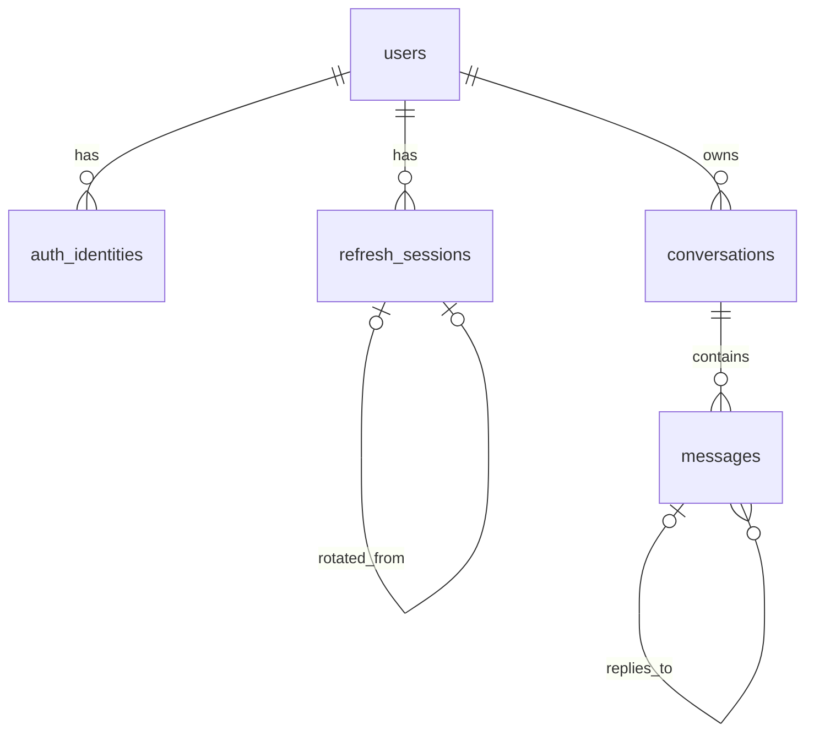

# 데이터베이스 설계

**Rev 1 · 2026-10-25 (KST)** · 코드 기준: [`2d50da5`](https://github.com/next-stop-siren/Next-Stop-Siren/tree/2d50da5976548db7b85c5b0b931b7c43e622fa15)

변경 근거: [PR #57](https://github.com/next-stop-siren/Next-Stop-Siren/pull/57) · [PR #59](https://github.com/next-stop-siren/Next-Stop-Siren/pull/59) · [PR #62](https://github.com/next-stop-siren/Next-Stop-Siren/pull/62). Rev는 이 문서의 계약·상태·범위 변경을 추적한다. 유지 규칙은 [협업 흐름](../03-development/workflow.md#문서-rev와-변경-이력)을 따른다.

현재 등록 모델은 **10개**다. 인증·대화 기반 5개, 한도 2개, 대기열 3개가 `app.models.register_models()`에 등록됐고 PR #62에서 API와 연결됐다. 아래 기반 테이블 그림과 상세 뒤에 한도·대기열 모델을 설명한다. 모델 등록은 실제 DB 생성·기존 스키마 변경·운영 데이터 복원 검증 완료를 뜻하지 않는다.

PostgreSQL 17과 SQLAlchemy 2.x ORM을 사용한다. `db-init`·`db-init-test`의 `create_all()`은 누락 테이블만 생성하고 기존 스키마를 바꾸지 않는다. [DDL 참고안](database-reference.sql)은 대기열 도입 전 기반 제약 참고 자료이며 10개 현재 모델의 완전한 실행 DDL이 아니다. 현재 계약은 [API](api.md), 정책 의도는 [회원 채팅 정책](chat-policy.md)을 따른다.



각 테이블의 기본키 `id`는 `bigint GENERATED ALWAYS AS IDENTITY`이며 FK 컬럼도 `bigint`다. `users.id`가 인증과 채팅의 공통 사용자 ID다. Google과 이메일·비밀번호 계정은 이메일이 같아도 별도 `users` 행이며 자동 연결하지 않는다. Google 로그인 키는 **검증된** `(issuer, subject)`이고 이메일은 식별 키가 아니다.

DB의 `bigint`는 JavaScript 안전 정수 범위를 넘을 수 있다. [공통 API 형식](api.md)은 ID를 JSON 십진 문자열로 전송한다. 화면에서 숫자로 변환하지 않는다.

## 테이블과 컬럼

`필수`는 `NOT NULL`, `NULL`(nullable)은 비워 둘 수 있음을 뜻한다. `기본값 없음`인 필수 필드는 삽입 시 값을 줘야 한다.

### `users` — 공통 사용자

| 필드 | 타입 | 필수 여부·기본값 | 의미 |
| --- | --- | --- | --- |
| `id` | `bigint` | 필수 · identity | 기본키 |
| `email` | `text` | 필수 · 기본값 없음 | 연락·표시용 이메일 |
| `password_hash` | `text` | NULL · 기본값 없음 | 로컬 계정 해시; Google 전용 계정은 NULL |
| `created_at` | `timestamptz` | 필수 · `now()` | 생성 시각 |

### `auth_identities` — Google 신원

| 필드 | 타입 | 필수 여부·기본값 | 의미 |
| --- | --- | --- | --- |
| `id` | `bigint` | 필수 · identity | 기본키 |
| `user_id` | `bigint` | 필수 · 기본값 없음 | `users.id` FK |
| `provider` | `text` | 필수 · `google` | 현재 허용된 제공자 |
| `issuer` | `text` | 필수 · 기본값 없음 | 검증된 발급자 |
| `subject` | `text` | 필수 · 기본값 없음 | 검증된 제공자 사용자 ID |
| `created_at` | `timestamptz` | 필수 · `now()` | 생성 시각 |

### `refresh_sessions` — refresh 세션

| 필드 | 타입 | 필수 여부·기본값 | 의미 |
| --- | --- | --- | --- |
| `id` | `bigint` | 필수 · identity | 기본키 |
| `user_id` | `bigint` | 필수 · 기본값 없음 | `users.id` FK |
| `token_digest` | `bytea` | 필수 · 기본값 없음 | 32바이트 digest; 원문 토큰 저장 금지 |
| `rotated_from_id` | `bigint` | NULL · 기본값 없음 | 같은 사용자의 전임 세션 FK |
| `issued_at` | `timestamptz` | 필수 · `now()` | 발급 시각 |
| `expires_at` | `timestamptz` | 필수 · 기본값 없음 | 만료 시각 |
| `revoked_at` | `timestamptz` | NULL · 기본값 없음 | 폐기 시각 |

### `conversations` — 대화 소유권

| 필드 | 타입 | 필수 여부·기본값 | 의미 |
| --- | --- | --- | --- |
| `id` | `bigint` | 필수 · identity | 기본키 |
| `user_id` | `bigint` | 필수 · 기본값 없음 | 소유자 `users.id` FK |
| `created_at` | `timestamptz` | 필수 · `now()` | 생성 시각 |
| `updated_at` | `timestamptz` | 필수 · `now()` | 최근 변경 시각; 서비스가 갱신 |

### `messages` — 질문과 답변 시도

| 필드 | 타입 | 필수 여부·기본값 | 의미 |
| --- | --- | --- | --- |
| `id` | `bigint` | 필수 · identity | 기본키·표시 순서 |
| `conversation_id` | `bigint` | 필수 · 기본값 없음 | `conversations.id` FK |
| `role` | `text` | 필수 · 기본값 없음 | `user` 질문 또는 `assistant` 답변 |
| `status` | `text` | 필수 · 기본값 없음 | `pending`, `completed`, `failed`, `interrupted` |
| `content` | `text` | NULL · 기본값 없음 | 완료 본문; 대기·실패·중단 답변은 NULL |
| `request_key` | `text` | NULL · 기본값 없음 | 질문 재전송 식별 키 |
| `reply_to_message_id` | `bigint` | NULL · 기본값 없음 | 답변이 참조하는 같은 대화의 질문 FK |
| `attempt_no` | `integer` | NULL · 기본값 없음 | 답변 시도 번호 |
| `retry_key` | `text` | NULL · 기본값 없음 | 재시도 식별 키 |
| `error_code` | `text` | NULL · 기본값 없음 | 실패·중단 이유 코드 |
| `created_at` | `timestamptz` | 필수 · `now()` | 생성 시각 |
| `updated_at` | `timestamptz` | 필수 · `now()` | 최근 변경 시각; 서비스가 갱신 |
| `completed_at` | `timestamptz` | NULL · 기본값 없음 | 질문·완료 답변의 완료 시각 |

모든 FK는 `ON DELETE RESTRICT`다. **초기 범위에 계정·대화 삭제 기능은 없다.** FK는 참조하는 자식 행이 있을 때 부모 행의 삭제를 막는다. 보존 기간, 일괄 삭제, 백업·운영 로그 처리는 별도 결정이다.

## 제약과 조회 경로

- `auth_identities(issuer, subject)`는 Google 신원 중복을 막는다. `users`의 로컬 이메일 부분 유일 인덱스는 `password_hash IS NOT NULL`에만 적용한다. 서비스는 계정 종류와 신원 일치, 이메일 입력을 확인한다.
- `refresh_sessions.token_digest`는 유일하고 32바이트다. 전임 ID의 유일성은 후임을 하나로 제한하며 `(rotated_from_id, user_id) → (id, user_id)`는 같은 사용자 연결을 강제한다. `(user_id, expires_at DESC)`는 사용자 세션 조회용이다.
- `conversations(user_id, updated_at DESC, id DESC)`는 내 대화 목록용이다. `messages(conversation_id, id)`는 대화 안의 표시 순서용이다.
- `messages`의 부분 유일 인덱스는 대화의 `request_key`, 질문별 `attempt_no`·`retry_key`, 대화별 활성 `pending` 답변의 중복을 막는다. `messages(reply_to_message_id, attempt_no DESC)`는 답변 이력 조회용이다.
- `reply_to_message_id` 복합 FK는 같은 대화의 메시지만 참조하게 한다. 참조 대상이 실제 `user` 질문인지, 모든 읽기·쓰기 요청자가 대화 소유자인지는 서비스가 확인한다.

승인된 D1 기준은 [인증 구현 기준](authentication.md)에 있다. `token_digest`는 별도 비밀키의 HMAC-SHA-256(refresh JWT) 32바이트다. 최초 로그인 시각 +14일의 절대 `expires_at`을 새 refresh에도 그대로 적용한다.

같은 사용자의 `users` 행을 잠가 신규 로그인·refresh·재사용 폐기·logout을 순서대로 처리한다. 이전 refresh 폐기와 새 refresh 하나의 삽입, 5초 경합 판정, 그 이후의 세션 연결 전체 폐기도 이 잠금 아래 수행한다. 한 로그인에서 이어진 세션 연결은 최초 세션을 포함해 정상 발급 최대 4095개다. 다음 발급 전에 활성 연결을 폐기한다. 조회 상한은 4096개이며 연결이 손상되면 503과 운영 경보다. DDL만으로 이 동작이 구현되지는 않는다.

## 저장과 소유권

가짜 예시: 사용자 `101`(`a@example.test`, 로컬)과 `202`(`a@example.test`, Google `(https://accounts.google.com, g-202)`)는 다른 행이다. 사용자 `101`의 대화 `501`에는 질문 `9001`(`request_key=q-demo-1`, `안녕?`)과 완료 답변 `9002`(`reply_to_message_id=9001`, `attempt_no=1`, `안녕하세요.`)가 있다. 사용자 `202`가 대화 `501`을 조회하거나 쓰면 서버는 찾을 수 없음으로 응답한다.

```sql
-- $1: 인증 미들웨어가 검증한 사용자 ID, $2: 요청한 대화 ID
SELECT m.id, m.role, m.status, m.content, m.created_at
FROM conversations AS c
JOIN messages AS m ON m.conversation_id = c.id
WHERE c.id = $2 AND c.user_id = $1
ORDER BY m.id;
```

1. 인증 미들웨어가 확인한 사용자 정보의 `user_id`로 `conversations.id`와 소유자를 함께 조회한다. 모든 대화 읽기·쓰기에 이 조건을 적용한다. `messages` FK만으로 사용자 격리를 보장하지 않는다.
2. 질문은 공백을 포함한 Unicode 코드 포인트 최대 4000자이며 공백만이면 거부한다. `request_key`는 1~200자이고 별도 공백 제한을 추가하지 않으며 화면에서는 UUID를 권장한다. 두 필드의 NUL(`U+0000`)은 저장 전 HTTP 422로 거부한다. 질문과 키의 원문을 보존하며 접수 때는 질문·작업·예약을 짧은 트랜잭션에서 저장한다. 첫 `pending` 답변은 작업의 실행 시작 때 생성한다. 같은 요청 키의 다른 본문은 충돌로 처리하고, 동일 재전송은 기존 결과를 조회한다.
3. 완료된 답변만 다음 AI 문맥에 넣는다. 실패·중단 답변의 `content`는 NULL이다. S11의 승인된 [GPT 기준](ai.md)에 따라 과거 완성 질문+답변 쌍 뒤 현재 질문을 추가한다. 실패·중단·진행 쌍은 AI 문맥에서 제외하고 DB·UI 이력은 유지한다. 상태 전이와 `updated_at` 갱신은 서비스가 담당한다.

완료 쌍 필터링은 있으나 실행 경로의 `chat_jobs.context_before()`는 ID 순서다. 연속 접수하면 Q1·Q2·A1·A2가 되어 정책의 쌍 순서와 다를 수 있다. [API의 알려진 차이](api.md#알려진-구현-차이와-인수-확인)를 확인한다. 실패·중단·진행 쌍은 문맥에서만 제외하며 이력은 유지한다.

#53부터 질문은 짧은 트랜잭션에서 질문·작업·예약만 저장하고, 답변 `pending` 행은 작업이 실행을 시작할 때 만든다. 제공자 호출은 트랜잭션 밖에서 수행하고 실행기가 30초 기한을 강제한다. 결과 저장은 `pending`인 행에만 조건부로 적용하므로 늦게 도착한 결과가 종결 상태·새 시도·완료 답변을 덮어쓰지 못한다. 수동 재시도는 같은 질문에 `attempt_no`를 1 올린 새 답변 행을 실행 시작 때 `retry_key`와 함께 만들고 이전 시도 행은 바꾸지 않는다. `messages_retry_key_uq`·`messages_attempt_uq`·`messages_one_pending_uq`가 중복 시도를 DB에서도 막는다. 이전의 60초 `pending` 회복과 D4(가장 최근 생성 질문) 규칙은 대기열의 복구와 “가장 최근 실행된 질문” 규칙으로 바뀌었다. 아래 대기열 절을 본다.

## 회원 한도 예약·정산 (#15 구현)

[회원 채팅 정책](chat-policy.md)의 한도 값을 `app.services.quota`가 예약·정산한다. #53부터 질문·재시도 접수가 대기열 입장과 같은 트랜잭션에서 예약한다(`quota.MemberQuota`). 기존 5개 테이블은 바꾸지 않는다.

| 테이블 | 역할 |
| --- | --- |
| `chat_quotas` | 회원당 한 행(`user_id` PK·`users` FK). 접수가 이 행을 `FOR UPDATE`로 잠가 같은 회원의 모든 탭·기기·대화의 예약을 하나씩 처리한다. `last_reserved_at`은 10초 간격 기준이다. |
| `chat_quota_reservations` | 예약 원장. 접수 당시 KST 일 시작 `day_start`와 6시간 시작 `six_hour_start`, `state`(`reserved`·`settled`·`refunded`), 예약 해제 사유 `refund_reason`(`failed`·`interrupted`·`canceled`·`expired`, 작업 상태와 같은 철자), `created_at`, `resolved_at`. |

- 기간 사용량은 그 기간의 `refunded`가 아닌 예약 수다. 별도 카운터가 없어 원장과 어긋나지 않는다. 기간별 부분 인덱스 `state <> 'refunded'`로 센다.
- 예약은 [API 계약](api.md#회원-채팅-대기열-53)의 판정 순서대로 마지막 예약 후 10초(`attempt_too_soon`), 그다음 일일 400·6시간 100(`quota_exceeded`)을 검사한다. 대기 자리(`queue_full`)는 그 앞에서 #52가 검사한다. 거부는 사유 코드와 `Retry-After`용 남은 초를 함께 알린다. `quota_exceeded`는 잔량이 0인 기간 중 더 늦은 초기화까지이며, 그 전에 예약 해제로 자리가 생길 수 있다.
- `limits(...)`는 API의 `limits`의 `daily`·`six_hour`(`limit`, `used`=정산, `reserved`=미종결, `remaining`=`limit`−`used`−`reserved`, `resets_at`)와 `next_attempt_at`을 계산한다. `queue`는 #52가 채운다.
- 정산·예약 해제는 `state = 'reserved'`인 행만 조건부로 바꾸므로 한 예약은 한 번만 종결된다. 행에 접수 기간이 저장되어 있어 초기화 뒤 옛 예약을 해제해도 새 기간의 잔량은 늘지 않는다.
- 결과가 불명인 동안 예약은 `reserved`로 남는다. `canceled`·`expired` 예약 해제만 제공자 호출 전 종결이다. 성공·실패·중단·미종결은 회원 차감과 별개로 제공자 과금 가능성이 있다(`provider_may_have_charged`).
- 같은 키의 재전송·재조회에는 예약을 다시 호출하지 않는다. 이는 호출하는 쪽이 지킨다.

## 영속 대기열·실행권·복구 (#52 구현)

[회원 채팅 정책](chat-policy.md)의 작업 저장·실행권·복구를 `app.services.chat_queue`·`app.services.chat_runner`가 처리한다. #53부터 질문·재시도·건너뛰기·취소 API가 이 모듈을 쓰고, 앱이 시작될 때 `ChatJobWorker`가 함께 시작된다(`CHAT_WORKER=off`면 시작하지 않음, 테스트 전용). 동기 생성과 60초 `pending` 회복은 제거했다. 기존 5개 테이블의 컬럼·제약은 바꾸지 않는다.

| 테이블 | 역할 |
| --- | --- |
| `chat_queue_members` | 회원당 한 행(`user_id` PK·`users` FK). 접수·실행 시작·결과 저장·취소·만료·건너뛰기가 **가장 먼저** 이 행을 `FOR UPDATE`로 잠근다. 회원의 실행권이며 잠금 순서는 회원 → 대화 → 메시지·작업이다. |
| `chat_jobs` | 질문 1회 또는 수동 재시도 1회. `kind`(`question`·`retry`), `state`(API의 8개 작업 상태), `retry_key`, #15 예약 ID `reservation_id`, `paused_by_message_id`, 실행 시작 때 만드는 `answer_message_id`, 실행 토큰 `run_token`, `accepted_at`·`expires_at`(+5분)·`started_at`·`deadline_at`(+30초)·`finished_at`·`skipped_at`. |
| `chat_conversation_holds` | 가장 최근 실행된 질문이 실패·중단된 대화(`conversation_id` PK). 그 질문과 가장 최근 실패 작업을 가리킨다. 재시도 성공이나 건너뛰기로 지운다. |

- `chat_jobs_shape_ck`가 상태별 필수·금지 필드, 접수 +5분 만료, 시작 +30초 기한을 DB에서도 강제한다. 질문·답변 FK는 `(id, conversation_id)` 복합 키로 같은 대화만 가리킨다.
- 부분 유일 인덱스: 회원당 `running` 1개(`chat_jobs_one_running_uq`), 질문당 진행 중 작업 1개, 질문당 새 질문 작업 1개, 질문별 `retry_key` 1개, 답변 행당 작업 1개.
- 새 질문 대기(`queued`·`paused`) 3개와 재시도 대기(`queued`) 1개는 회원 잠금 아래 센다. 실행 중 작업은 세지 않는다. 판정 순서는 API 계약대로 소유권 → 같은 키 → 키 충돌 → `queue_full`/`retry_queue_full` → #15 예약(`attempt_too_soon`, `quota_exceeded`)이고 예약 거부 시 질문·작업을 저장하지 않는다.
- 실행 선택은 회원 잠금 아래 `queued`·미만료 작업의 ID 순(FIFO)이다. 같은 대화에 `queued` 재시도가 있으면 그 대화의 새 질문은 뒤로 미루지만 다른 대화의 앞선 작업과 실행 중 작업은 앞지르지 않는다. `paused`는 실행하지 않는다.
- 시작 트랜잭션에서 `pending` 답변 행·새 `run_token`·30초 기한을 저장하고 그 질문 이전의 완료 쌍으로 문맥을 읽은 뒤 커밋한다. 제공자 호출 중에는 세션·잠금을 갖지 않는다. 결과 저장은 `state = 'running'`이고 `run_token`이 같을 때만 반영하므로 늦은 결과는 종결 상태·새 시도·완료 답변을 바꾸지 못한다.
- 작업 종결과 예약 정산·예약 해제는 한 트랜잭션이다. 완료는 정산, 실패·중단·취소·만료는 같은 이름으로 예약 해제한다. 결과 불명인 `running` 동안 예약은 유지된다.
- 실패·중단은 대화 정지를 만들고 그 대화의 `queued` 새 질문을 `paused`로 바꾼다. 정지 중 접수한 새 질문도 `paused`다. 재시도 성공·건너뛰기만 정지를 풀고, 재시도의 실패는 정지를 새 실패 작업으로 옮기며, 취소·만료는 그대로 둔다.
- 취소는 `queued`·`paused`만, 만료는 접수 5분 뒤의 `queued`·`paused`에 적용한다. 정지나 재접속으로 연장하지 않는다. 시작·취소·만료는 같은 회원 잠금과 조건부 상태 변경으로 하나만 반영된다.
- 복구: 기한 + 15초(`RECOVERY_GRACE_SECONDS`)가 지난 `running`만 조정한다. 저장된 완료 답변이 있으면 완료·정산, 그 밖에는 답변과 작업을 `interrupted`/`outcome_unknown`으로 종결·예약 해제한다. 제공자를 다시 부르지 않는다. 미만료 대기는 DB에 남아 재시작 뒤 `ChatJobWorker`가 이어서 실행한다.
- 회원 한도와 10초 간격은 `QuotaLedger` 프로토콜로 호출해 대기열이 한도 모듈을 직접 가져오지 않는다. #53은 `quota.MemberQuota`로 실제 `quota` 모듈을 연결하고 `chat_jobs.reservation_id` → `chat_quota_reservations.id` FK(`chat_jobs_reservation_fk`, `ON DELETE RESTRICT`)를 더했다.
- 같은 회원의 접수는 `chat_queue_members`를 먼저, #15 예약 안에서 `chat_quotas`를 나중에 잠근다.
- 허용 동작(`allowed_actions`)은 저장하지 않고 조회할 때 행에서 계산한다. 구독의 `since`는 작업의 `accepted_at`·`started_at`·`finished_at`·`skipped_at`으로 바뀐 대화를 찾으므로 별도 변경 시각 컬럼이 없다.
- #53 이전 동기 API가 남긴 작업 없는 `pending` 답변은 그 대화의 다음 실행 시작 트랜잭션에서 `interrupted`/`outcome_unknown`으로 닫아 `messages_one_pending_uq`가 실행을 막지 않게 한다.

적용과 되돌림: 새 테이블은 `db-init`·`db-init-test`의 `create_all()`이 누락분을 만든다. **`create_all()`은 기존 테이블을 바꾸지 않으므로** #52 때 이미 `chat_jobs`를 만든 개발·테스트 DB에는 아래 FK의 적용 여부를 점검하고 백업·적용·복원 계획을 검토한다(CI는 빈 DB라 해당 없음). 기존 행은 바뀌지 않고, #53 이전에 만든 질문에는 작업 행이 없다. 아래 되돌림 SQL은 세 대기열 테이블을 지우므로 그 작업·실행권·정지 기록이 사라진다. 기반 5개 테이블을 직접 지우지는 않지만 운영 데이터의 안전한 복원을 증명하지 않는다. 공유 DB에는 검토 전에 수동 적용하지 않는다.

```sql
-- #52 테이블이 이미 있는 DB에 #53 FK를 더할 때
ALTER TABLE chat_jobs ADD CONSTRAINT chat_jobs_reservation_fk
  FOREIGN KEY (reservation_id) REFERENCES chat_quota_reservations (id) ON DELETE RESTRICT;

-- 되돌림
DROP TABLE chat_conversation_holds;
DROP TABLE chat_jobs;
DROP TABLE chat_queue_members;
```

## 소유자와 초기 적용

1. PM 공통 엔진·세션·모델 등록, 개발·테스트 DB 분리, 테스트 세션과 초기화 명령은 현재 `main`에 구현되어 있다. 제품 5개 테이블, #15 한도 2개 테이블과 #52 대기열 3개 테이블의 모델이 등록되어 있다. `setup`은 제품 테이블을 생성하지 않으므로 개발 API 사용 전 `db-init`을 수행한다. 출력 10개는 등록 모델 수다. 초기 빈 개발·테스트 DB에서 ORM 메타데이터의 `create_all()`로 테이블을 만든다. 테이블 간 FK 순서는 모델 등록과 메타데이터가 다룬다.
2. 인증 담당은 `users`, `auth_identities`, `refresh_sessions` ORM 모델과 DB 검사를 맡는다. 채팅 담당은 인증 모델을 인계받아 `conversations`, `messages` ORM 모델과 DB 검사를 맡는다. 직접 선행 관계는 [공정진행도](../02-team/development-flow.md)의 #3 → #9 → #8 → #10을 따른다.
3. 조회 함수는 사용자 소유권 조건을 포함하고, API 요청·응답의 Pydantic 모델과 ORM 모델을 분리한다. 실제 JWT/Google 보호와 사용자 간 격리는 통합 때 확인한다.

`create_all()`은 기존 테이블을 `ALTER`하지 않는다. 기존 데이터나 스키마를 자동 삭제·재생성하지 않고 요청마다 테이블을 만들지 않는다. 이후 기존 스키마 변경은 적용·복구와 데이터 영향을 검토한 명시적 절차를 먼저 정한다. 도구는 아직 선택하지 않았다.

최소 완료 확인:

- [ ] 빈 전용 테스트 DB에 다섯 ORM 모델의 테이블·인덱스·제약이 생성된다.
- [ ] 잘못된 FK와 중복 `request_key`·답변 시도·`retry_key`가 거부된다.
- [ ] 같은 이메일의 로컬·Google 계정이 분리되고 Google은 검증된 `(issuer, subject)`로 식별된다.
- [ ] 타인 대화의 읽기·쓰기가 거부된다.
- [ ] 완료 답변만 재조회·문맥에 포함되고 실패·중단 답변은 문맥에서 빠진다.

인증과 대기열 입장·정산·실행·복구·재시도·구독에 대한 단위·DB 검사가 존재한다. 60초 pending 회복과 D4는 현재 API 계약이 아니다. 실제 화면 통합·운영 검증은 [품질 기준](../03-development/quality.md)에 따라 별도 확인한다. 수동 재시도·대기열·한도 결합은 PR #62에서 구현됐다. 운영 데이터의 백업·적용·복원 검증과 자동 마이그레이션 도구 선택은 남아 있다. 이 문서 작업에서는 **SQL을 실행하지 않았다**.

## 변경 이력

| Rev | 일자 (KST) | 변경과 근거 |
| --- | --- | --- |
| 1 | 2026-10-25 | 등록 모델 10개, 한도·대기열 연결과 기존 DB 변경의 한계를 정리했다. 기준 코드는 위 고정 SHA이며 근거 PR은 문서 상단에 있다. |
