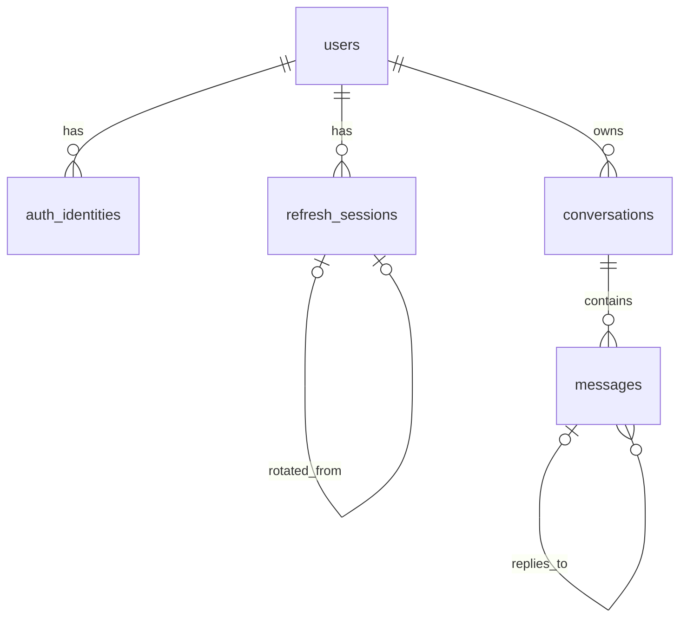

# 데이터베이스 설계

아래 다섯 테이블, 네 상태, 대화별 pending 유일성, 60초 회복과 D4는 **현재 모델** 설명이다.

[회원 채팅 목표](chat-policy.md)의 영속 작업, 회원 실행권, 접수 기간별 예약과 단일 정산·환불, 5분 기한, 정지 상태와 재시작 조정은 #52·#15의 설계 대상이다. 구체적인 테이블·컬럼·인덱스, 적용·되돌림과 기존 데이터 영향은 개발자가 제안하고 검토한다. #52 제안은 아래 [영속 대기열](#영속-대기열실행권복구-52-제안)에 있다. 현재 `create_all()`은 기존 스키마를 바꾸지 않는다.

현재 앱은 아래 **5개 제품 테이블의 ORM 모델**과 인증·대화 저장 경로를 구현한다. 이 문서는 PostgreSQL 17의 데이터 계약이다. ORM(테이블과 Python 클래스를 연결하는 모델)인 SQLAlchemy 2.x로 초기 스키마를 정의하며, [DDL 참고안](database-reference.sql)은 제약의 참고 자료이지 실행된 스키마나 필수 수기 DDL이 아니다. `app.models.register_models()`가 인증·대화 모델을 등록하며 `db-init`·`db-init-test`로 해당 DB의 누락 테이블을 생성한다. 등록 여부가 현재 로컬 DB에 이미 생성됐다는 뜻은 아니다. [기술 구성](../01-start/stack.md)에 구현 경계를 정리했다.



각 테이블의 기본키 `id`는 `bigint GENERATED ALWAYS AS IDENTITY`이며 FK 컬럼도 `bigint`다. `users.id`가 인증과 채팅의 공통 사용자 ID다. Google과 이메일·비밀번호 계정은 이메일이 같아도 별도 `users` 행이며 자동 연결하지 않는다. Google 로그인 키는 **검증된** `(issuer, subject)`이고 이메일은 식별 키가 아니다.

DB의 `bigint`는 JavaScript 안전 정수 범위를 넘을 수 있다. [공통 API 형식](api.md)은 ID를 JSON 십진 문자열로 전송한다. 화면에서 숫자로 변환하지 않는다.

## 테이블과 컬럼

`필수`는 `NOT NULL`, `NULL`(nullable)은 비워 둘 수 있음을 뜻한다. `기본값 없음`인 필수 필드는 삽입 시 값을 줘야 한다.

### `users` — 공통 사용자

| 필드 | 타입 | 필수 여부·기본값 | 의미 |
| --- | --- | --- | --- |
| `id` | `bigint` | 필수 · identity | 기본키 |
| `email` | `text` | 필수 · 기본값 없음 | 연락·표시용 이메일 |
| `password_hash` | `text` | NULL · 기본값 없음 | 로컬 계정 해시; Google 전용 계정은 NULL |
| `created_at` | `timestamptz` | 필수 · `now()` | 생성 시각 |

### `auth_identities` — Google 신원

| 필드 | 타입 | 필수 여부·기본값 | 의미 |
| --- | --- | --- | --- |
| `id` | `bigint` | 필수 · identity | 기본키 |
| `user_id` | `bigint` | 필수 · 기본값 없음 | `users.id` FK |
| `provider` | `text` | 필수 · `google` | 현재 허용된 제공자 |
| `issuer` | `text` | 필수 · 기본값 없음 | 검증된 발급자 |
| `subject` | `text` | 필수 · 기본값 없음 | 검증된 제공자 사용자 ID |
| `created_at` | `timestamptz` | 필수 · `now()` | 생성 시각 |

### `refresh_sessions` — refresh 세션

| 필드 | 타입 | 필수 여부·기본값 | 의미 |
| --- | --- | --- | --- |
| `id` | `bigint` | 필수 · identity | 기본키 |
| `user_id` | `bigint` | 필수 · 기본값 없음 | `users.id` FK |
| `token_digest` | `bytea` | 필수 · 기본값 없음 | 32바이트 digest; 원문 토큰 저장 금지 |
| `rotated_from_id` | `bigint` | NULL · 기본값 없음 | 같은 사용자의 전임 세션 FK |
| `issued_at` | `timestamptz` | 필수 · `now()` | 발급 시각 |
| `expires_at` | `timestamptz` | 필수 · 기본값 없음 | 만료 시각 |
| `revoked_at` | `timestamptz` | NULL · 기본값 없음 | 폐기 시각 |

### `conversations` — 대화 소유권

| 필드 | 타입 | 필수 여부·기본값 | 의미 |
| --- | --- | --- | --- |
| `id` | `bigint` | 필수 · identity | 기본키 |
| `user_id` | `bigint` | 필수 · 기본값 없음 | 소유자 `users.id` FK |
| `created_at` | `timestamptz` | 필수 · `now()` | 생성 시각 |
| `updated_at` | `timestamptz` | 필수 · `now()` | 최근 변경 시각; 서비스가 갱신 |

### `messages` — 질문과 답변 시도

| 필드 | 타입 | 필수 여부·기본값 | 의미 |
| --- | --- | --- | --- |
| `id` | `bigint` | 필수 · identity | 기본키·표시 순서 |
| `conversation_id` | `bigint` | 필수 · 기본값 없음 | `conversations.id` FK |
| `role` | `text` | 필수 · 기본값 없음 | `user` 질문 또는 `assistant` 답변 |
| `status` | `text` | 필수 · 기본값 없음 | `pending`, `completed`, `failed`, `interrupted` |
| `content` | `text` | NULL · 기본값 없음 | 완료 본문; 대기·실패·중단 답변은 NULL |
| `request_key` | `text` | NULL · 기본값 없음 | 질문 재전송 식별 키 |
| `reply_to_message_id` | `bigint` | NULL · 기본값 없음 | 답변이 참조하는 같은 대화의 질문 FK |
| `attempt_no` | `integer` | NULL · 기본값 없음 | 답변 시도 번호 |
| `retry_key` | `text` | NULL · 기본값 없음 | 재시도 식별 키 |
| `error_code` | `text` | NULL · 기본값 없음 | 실패·중단 이유 코드 |
| `created_at` | `timestamptz` | 필수 · `now()` | 생성 시각 |
| `updated_at` | `timestamptz` | 필수 · `now()` | 최근 변경 시각; 서비스가 갱신 |
| `completed_at` | `timestamptz` | NULL · 기본값 없음 | 질문·완료 답변의 완료 시각 |

모든 FK는 `ON DELETE RESTRICT`다. **초기 범위에 계정·대화 삭제 기능은 없다.** FK는 참조하는 자식 행이 있을 때 부모 행의 삭제를 막는다. 보존 기간, 일괄 삭제, 백업·운영 로그 처리는 별도 결정이다.

## 제약과 조회 경로

- `auth_identities(issuer, subject)`는 Google 신원 중복을 막는다. `users`의 로컬 이메일 부분 유일 인덱스는 `password_hash IS NOT NULL`에만 적용한다. 서비스는 계정 종류와 신원 일치, 이메일 입력을 확인한다.
- `refresh_sessions.token_digest`는 유일하고 32바이트다. 전임 ID의 유일성은 후임을 하나로 제한하며 `(rotated_from_id, user_id) → (id, user_id)`는 같은 사용자 연결을 강제한다. `(user_id, expires_at DESC)`는 사용자 세션 조회용이다.
- `conversations(user_id, updated_at DESC, id DESC)`는 내 대화 목록용이다. `messages(conversation_id, id)`는 대화 안의 표시 순서용이다.
- `messages`의 부분 유일 인덱스는 대화의 `request_key`, 질문별 `attempt_no`·`retry_key`, 대화별 활성 `pending` 답변의 중복을 막는다. `messages(reply_to_message_id, attempt_no DESC)`는 답변 이력 조회용이다.
- `reply_to_message_id` 복합 FK는 같은 대화의 메시지만 참조하게 한다. 참조 대상이 실제 `user` 질문인지, 모든 읽기·쓰기 요청자가 대화 소유자인지는 서비스가 확인한다.

승인된 D1 기준은 [인증 구현 기준](authentication.md)에 있다. `token_digest`는 별도 비밀키의 HMAC-SHA-256(refresh JWT) 32바이트다. 최초 로그인 시각 +14일의 절대 `expires_at`을 새 refresh에도 그대로 적용한다.

같은 사용자의 `users` 행을 잠가 신규 로그인·refresh·재사용 폐기·logout을 순서대로 처리한다. 이전 refresh 폐기와 새 refresh 하나의 삽입, 5초 경합 판정, 그 이후의 세션 연결 전체 폐기도 이 잠금 아래 수행한다. 한 로그인에서 이어진 세션 연결은 최초 세션을 포함해 정상 발급 최대 4095개다. 다음 발급 전에 활성 연결을 폐기한다. 조회 상한은 4096개이며 연결이 손상되면 503과 운영 경보다. DDL만으로 이 동작이 구현되지는 않는다.

## 저장과 소유권

가짜 예시: 사용자 `101`(`a@example.test`, 로컬)과 `202`(`a@example.test`, Google `(https://accounts.google.com, g-202)`)는 다른 행이다. 사용자 `101`의 대화 `501`에는 질문 `9001`(`request_key=q-demo-1`, `안녕?`)과 완료 답변 `9002`(`reply_to_message_id=9001`, `attempt_no=1`, `안녕하세요.`)가 있다. 사용자 `202`가 대화 `501`을 조회하거나 쓰면 서버는 찾을 수 없음으로 응답한다.

```sql
-- $1: 인증 미들웨어가 검증한 사용자 ID, $2: 요청한 대화 ID
SELECT m.id, m.role, m.status, m.content, m.created_at
FROM conversations AS c
JOIN messages AS m ON m.conversation_id = c.id
WHERE c.id = $2 AND c.user_id = $1
ORDER BY m.id;
```

1. 인증 미들웨어가 확인한 사용자 정보의 `user_id`로 `conversations.id`와 소유자를 함께 조회한다. 모든 대화 읽기·쓰기에 이 조건을 적용한다. `messages` FK만으로 사용자 격리를 보장하지 않는다.
2. 질문은 공백을 포함한 Unicode 코드 포인트 최대 4000자이며 공백만이면 거부한다. `request_key`는 1~200자이고 별도 공백 제한을 추가하지 않으며 화면에서는 UUID를 권장한다. 두 필드의 NUL(`U+0000`)은 저장 전 HTTP 422로 거부한다. 질문과 키의 원문을 보존하며 질문과 첫 `pending` 답변을 짧은 트랜잭션에서 생성한다. 같은 요청 키의 다른 본문은 충돌로 처리하고, 동일 재전송은 기존 결과를 조회한다.
3. 완료된 답변만 다음 AI 문맥에 넣는다. 실패·중단 답변의 `content`는 NULL이다. S11의 승인된 [GPT 기준](ai.md)에 따라 과거 완성 질문+답변 쌍 뒤 현재 질문을 추가한다. 실패·중단·진행 쌍은 AI 문맥에서 제외하고 DB·UI 이력은 유지한다. 상태 전이와 `updated_at` 갱신은 서비스가 담당한다.

완성 쌍 필터링은 현재 저장소의 조회 함수와 관련 테스트에 구현되어 있다. 실패·중단·진행 쌍은 문맥에서만 제외하며 이력은 유지한다.

첫 내부 목표는 모의 제공자의 완성 답변 저장·재조회다. 현재 스트리밍은 PR #44로 병합됐다. 회원 한도·대기열 목표는 [회원 채팅 정책](chat-policy.md)에 승인됐으며 후속 구현이다. 제공자 호출은 트랜잭션 밖에서 수행하고 실제 어댑터가 30초 제한을 강제한다. timeout 인자 전달만으로 제한을 보장했다고 판단하지 않는다.

오래된 `pending`의 회복 기준:

- 같은 대화의 다음 메시지 POST에서 같은 키 재전송도 포함하여, 생성 시각부터 60초를 초과했는지 확인한다. 정확히 60초이면 회복 대상이 아니다.
- 아직 `pending`인 답변만 조건부로 `interrupted`/`outcome_unknown`으로 종결한다. `content`와 `completed_at`은 NULL로 유지하고 `updated_at`을 갱신한다.
- 회복을 같은 키 재전송의 기존 결과 반환 전에 적용하여 중단된 쌍을 반환한다.
- 완료·실패·시간 초과 저장도 아직 `pending`인 행에만 조건부로 적용하여, 회복 뒤 늦게 도착한 결과가 종결 상태를 덮어쓰지 못하게 한다.
- 별도 예약 작업은 없고 GET 조회만으로는 회복하지 않는다.

수동 재시도(S13 / #14, PM 결정 D4):

- 질문의 최신 답변이 `failed` 또는 `interrupted`이고 그 질문이 대화의 가장 최근 질문일 때만, 같은 질문에 `attempt_no`를 1 올린 새 `pending` 답변 행을 `retry_key`와 함께 만든다. 이전 시도 행은 바꾸지 않는다.
- 같은 질문의 같은 `retry_key`는 한 시도다. 재전송은 새 행이나 제공자 호출 없이 그 시도를 조회한다. `messages_retry_key_uq`·`messages_attempt_uq`·`messages_one_pending_uq`가 중복 시도를 DB에서도 막는다.
- 대화 행 잠금, 오래된 `pending` 회복, 트랜잭션 밖 제공자 호출, `pending` 행에만 적용하는 결과 저장은 질문 전송과 같다. 따라서 늦게 도착한 이전 시도의 결과는 새 시도나 완료 답변을 덮어쓰지 못한다.
- 현재 구현은 질문당 시도 횟수를 제한하지 않는다. 승인된 대기열 목표도 수동 시도 횟수를 제한하지 않으며, 새 시도의 한도 예약·10초 간격은 후속 구현이다.

## 영속 대기열·실행권·복구 (#52 제안)

[회원 채팅 정책](chat-policy.md)의 작업 저장·실행권·복구를 `app.services.chat_queue`·`app.services.chat_runner`가 처리한다. **현재 API에는 아직 연결하지 않았다.** 동기 생성·`409 conversation_busy`·네 메시지 상태는 그대로이며 #53이 연결한다. 아래 세 테이블은 검토용 제안이고 기존 5개 테이블의 컬럼·제약은 바꾸지 않는다.

| 테이블 | 역할 |
| --- | --- |
| `chat_queue_members` | 회원당 한 행(`user_id` PK·`users` FK). 접수·실행 시작·결과 저장·취소·만료·건너뛰기가 **가장 먼저** 이 행을 `FOR UPDATE`로 잠근다. 회원의 실행권이며 잠금 순서는 회원 → 대화 → 메시지·작업이다. |
| `chat_jobs` | 질문 1회 또는 수동 재시도 1회. `kind`(`question`·`retry`), `state`(초안의 8개 상태), `retry_key`, #15 예약 ID `reservation_id`, `paused_by_message_id`, 실행 시작 때 만드는 `answer_message_id`, 실행 토큰 `run_token`, `accepted_at`·`expires_at`(+5분)·`started_at`·`deadline_at`(+30초)·`finished_at`·`skipped_at`. |
| `chat_conversation_holds` | 가장 최근 실행된 질문이 실패·중단된 대화(`conversation_id` PK). 그 질문과 가장 최근 실패 작업을 가리킨다. 재시도 성공이나 건너뛰기로 지운다. |

- `chat_jobs_shape_ck`가 상태별 필수·금지 필드, 접수 +5분 만료, 시작 +30초 기한을 DB에서도 강제한다. 질문·답변 FK는 `(id, conversation_id)` 복합 키로 같은 대화만 가리킨다.
- 부분 유일 인덱스: 회원당 `running` 1개(`chat_jobs_one_running_uq`), 질문당 진행 중 작업 1개, 질문당 새 질문 작업 1개, 질문별 `retry_key` 1개, 답변 행당 작업 1개.
- 새 질문 대기(`queued`·`paused`) 3개와 재시도 대기(`queued`) 1개는 회원 잠금 아래 센다. 실행 중 작업은 세지 않는다. 판정 순서는 초안대로 소유권 → 같은 키 → 키 충돌 → `queue_full`/`retry_queue_full` → #15 예약(`attempt_too_soon`, `quota_exceeded`)이고 예약 거부 시 질문·작업을 저장하지 않는다.
- 실행 선택은 회원 잠금 아래 `queued`·미만료 작업의 ID 순(FIFO)이다. 같은 대화에 `queued` 재시도가 있으면 그 대화의 새 질문은 뒤로 미루지만 다른 대화의 앞선 작업과 실행 중 작업은 앞지르지 않는다. `paused`는 실행하지 않는다.
- 시작 트랜잭션에서 `pending` 답변 행·새 `run_token`·30초 기한을 저장하고 그 질문 이전의 완료 쌍으로 문맥을 읽은 뒤 커밋한다. 제공자 호출 중에는 세션·잠금을 갖지 않는다. 결과 저장은 `state = 'running'`이고 `run_token`이 같을 때만 반영하므로 늦은 결과는 종결 상태·새 시도·완료 답변을 바꾸지 못한다.
- 작업 종결과 예약 정산·환불은 한 트랜잭션이다. 완료는 정산, 실패·중단·취소·만료는 같은 이름으로 환불한다. 결과 불명인 `running` 동안 예약은 유지된다.
- 실패·중단은 대화 정지를 만들고 그 대화의 `queued` 새 질문을 `paused`로 바꾼다. 정지 중 접수한 새 질문도 `paused`다. 재시도 성공·건너뛰기만 정지를 풀고, 재시도의 실패는 정지를 새 실패 작업으로 옮기며, 취소·만료는 그대로 둔다.
- 취소는 `queued`·`paused`만, 만료는 접수 5분 뒤의 `queued`·`paused`에 적용한다. 정지나 재접속으로 연장하지 않는다. 시작·취소·만료는 같은 회원 잠금과 조건부 상태 변경으로 하나만 반영된다.
- 복구: 기한 + 15초(`RECOVERY_GRACE_SECONDS`)가 지난 `running`만 조정한다. 저장된 완료 답변이 있으면 완료·정산, 그 밖에는 답변과 작업을 `interrupted`/`outcome_unknown`으로 종결·환불한다. 제공자를 다시 부르지 않는다. 미만료 대기는 DB에 남아 재시작 뒤 `ChatJobWorker`가 이어서 실행한다.
- 회원 한도와 10초 간격은 `QuotaLedger` 프로토콜(#15의 `reserve`·`settle`·`refund` 모양)로 호출한다. 예약 FK는 두 작업이 병합된 뒤 #53이 더한다.

적용과 되돌림: 새 테이블만 추가하므로 `db-init`·`db-init-test`의 `create_all()`이 누락분을 만든다. 기존 행은 바뀌지 않고, 현재 API가 만든 질문에는 작업 행이 없다. 되돌림은 아래 순서로 세 테이블을 지우며 기존 5개 테이블의 데이터에는 영향이 없다. 공유 DB에는 검토 전에 수동 적용하지 않는다.

```sql
DROP TABLE chat_conversation_holds;
DROP TABLE chat_jobs;
DROP TABLE chat_queue_members;
```

## 소유자와 초기 적용

1. PM 공통 엔진·세션·모델 등록, 개발·테스트 DB 분리, 테스트 세션과 초기화 명령은 현재 `main`에 구현되어 있다. 제품 5개 테이블과 #52 대기열 3개 테이블의 모델이 등록되어 있다. `setup`은 제품 테이블을 생성하지 않으므로 개발 API 사용 전 `db-init`을 수행한다. 출력 8개는 등록 모델 수다. 초기 빈 개발·테스트 DB에서 ORM 메타데이터의 `create_all()`로 테이블을 만든다. 테이블 간 FK 순서는 모델 등록과 메타데이터가 다룬다.
2. 인증 담당은 `users`, `auth_identities`, `refresh_sessions` ORM 모델과 DB 검사를 맡는다. 채팅 담당은 인증 모델을 인계받아 `conversations`, `messages` ORM 모델과 DB 검사를 맡는다. 직접 선행 관계는 [공정진행도](../02-team/development-flow.md)의 #3 → #9 → #8 → #10을 따른다.
3. 조회 함수는 사용자 소유권 조건을 포함하고, API 요청·응답의 Pydantic 모델과 ORM 모델을 분리한다. 실제 JWT/Google 보호와 사용자 간 격리는 통합 때 확인한다.

`create_all()`은 기존 테이블을 `ALTER`하지 않는다. 기존 데이터나 스키마를 자동 삭제·재생성하지 않고 요청마다 테이블을 만들지 않는다. 이후 기존 스키마 변경은 적용·복구와 데이터 영향을 검토한 명시적 절차를 먼저 정한다. 도구는 아직 선택하지 않았다.

최소 완료 확인:

- [ ] 빈 전용 테스트 DB에 다섯 ORM 모델의 테이블·인덱스·제약이 생성된다.
- [ ] 잘못된 FK와 중복 `request_key`·답변 시도·`retry_key`가 거부된다.
- [ ] 같은 이메일의 로컬·Google 계정이 분리되고 Google은 검증된 `(issuer, subject)`로 식별된다.
- [ ] 타인 대화의 읽기·쓰기가 거부된다.
- [ ] 완료 답변만 재조회·문맥에 포함되고 실패·중단 답변은 문맥에서 빠진다.

D1 인증과 S10 입력·30초 제한·60초 초과 회복, D4 수동 재시도에 대한 단위·DB 검사는 존재한다. 실제 화면 통합·운영 검증은 [품질 기준](../03-development/quality.md)에 따라 별도 확인한다. 수동 재시도 횟수 무제한은 승인됐으며 대기열·한도와의 결합은 후속 구현이다. 이 문서 작업에서는 **SQL을 실행하지 않았다**.
